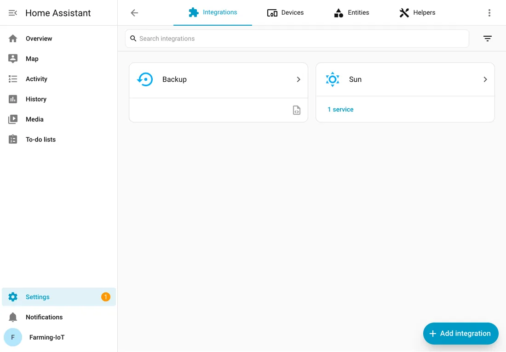

# กิจกรรมที่ 3 — สร้างกฎควบคุมระบบ (Logic)

{ .activity-banner width="1600" height="267" loading="lazy" decoding="async" }

**40 นาที**

**อุปกรณ์ที่ใช้** แล็ปท็อปของตัวแทนกลุ่มที่เปิดหน้า Login ของ Home Assistant ไว้, โทรศัพท์ 1 เครื่อง, อุปกรณ์ทั้งหมดจากกิจกรรมที่ 1–2

เพิ่มบอร์ดทั้งสองเข้า Home Assistant แล้วสร้างกฎให้ไฟสวนเปิดเองเมื่อมืดและปิดเองเมื่อสว่าง

{ .activity-divider width="1200" height="96" loading="lazy" decoding="async" }

### ใบงาน { #a3 }

คลิกชื่อหัวข้อเพื่อดูวิธีทำ เมื่อทำเสร็จให้ทำเครื่องหมายและบันทึกผลในช่องที่กำหนด กรอกที่นี่หรือในขั้นตอนด้านล่างก็ได้ คำตอบจะปรากฏทั้งสองจุด

- [ ] **[3.1 เพิ่มบอร์ดทั้งสองเข้า Home Assistant](#a3-1)** เข้าระบบด้วยชื่อผู้ใช้และรหัสผ่านที่ผู้สอนแจ้ง เพิ่มบอร์ดทั้งสองตัวด้วยหมายเลข IP ที่จดไว้ แล้วตรวจชื่อที่ขึ้น
- [ ] **[3.2 ทดสอบบอร์ดใน Home Assistant](#a3-2)** ดูค่าเซนเซอร์ในหน้าอุปกรณ์ สั่งหลอดไฟจากแล็ปท็อป แล้วสั่งจากโทรศัพท์ (ถ้าโทรศัพท์เปิดไม่ได้ ข้ามไปก่อนแล้วบอกผู้สอน)
- [ ] **[3.3 เลือกเกณฑ์ความสว่าง](#a3-3)** ค่าเกณฑ์ความสว่างที่ใช้ตั้งกฎ (กรอกตัวเลข) {{n:s1.light.on|4}} lux
- [ ] **[3.4 เขียนกฎเปิด–ปิดไฟ](#a3-3b)** เขียนเป็นประโยค "ถ้า ... แล้วให้ ..."
    - มืด: เงื่อนไขค่าแสง (ระบุว่าต่ำกว่าค่าใด พร้อมหน่วย) {{f:s1.rule.dark.if|24}} แล้วให้ระบบสั่งอะไร {{f:s1.rule.dark.then|24}}
    - สว่าง: เงื่อนไขค่าแสง (ระบุว่าสูงกว่าค่าใด พร้อมหน่วย) {{f:s1.rule.bright.if|24}} แล้วให้ระบบสั่งอะไร {{f:s1.rule.bright.then|24}}
- [ ] **[3.5 สร้างและทดสอบกฎอัตโนมัติ](#a3-3c)** `มืด-เปิดไฟ` และ `สว่าง-ปิดไฟ` ครอบแล้วเอามือออกสามรอบ ไฟติดและดับเองครบกี่รอบ {{n:s1.auto.pass|2}} ต้องได้ 3 จาก 3
- [ ] **[3.6 โจทย์เสริม: ปิดไฟตามเวลา (ไม่บังคับทำ)](#a3-4)** เวลาที่ตั้งให้ไฟดับ (เช่น 14:05; ถ้าไม่ได้ทำให้เว้นว่าง) {{f:s1.timer.at|5}} น. ผลที่สังเกตได้ {{r:s1.timer.ok|ดับตรงเวลา|ไม่ดับ|ไม่ได้ทำ}} เมื่อทดสอบเสร็จ ให้ **ปิดการใช้งานกฎนี้**
- [ ] **[คำถามท้ายกิจกรรม](#a3-q)** ถ้าค่าแสงอยู่ใกล้เกณฑ์พอดี แล้วมีเมฆลอยผ่านตอนพลบค่ำจนค่าแสงแกว่งไปมา ระบบจะเปิด–ปิดไฟอย่างไร {{ta:s1.q3}}

{ .activity-divider width="1200" height="64" loading="lazy" decoding="async" }

### 3.1 เพิ่มบอร์ดทั้งสองเข้า Home Assistant { #a3-1 }

**ชื่อและหมายเลข IP ของบอร์ดทั้งสอง** ที่จดไว้ในกิจกรรมที่ 1 และ 2 จะแสดงในตารางนี้ให้เอง ใช้กรอกในขั้นตอนถัดไปได้เลย ไม่ต้องเปิดกลับไปดู (ถ้าช่องว่าง ให้กรอกจากที่จดไว้)

| บอร์ด | ชื่อบอร์ดเต็ม (DEVICE NAME) | หมายเลข IP |
|-------|-----------------------------|------------|
| GoGo-IoT (บอร์ดเซนเซอร์) | {{f:board.iot.name|22}} | {{f:board.iot.ip|15}} |
| บอร์ดรีเลย์ | {{f:board.relay.name|22}} | {{f:board.relay.ip|15}} |

**เข้าสู่ Home Assistant**

1. ที่แล็ปท็อปของตัวแทนกลุ่ม กลับไปที่หน้า Login ของ Home Assistant ที่เปิดไว้ตอนก่อนเริ่ม ใส่ **ชื่อผู้ใช้และรหัสผ่านที่ผู้สอนแจ้ง** แล้วกด **Log in** (ถ้าหน้าเปิดไม่ขึ้น ให้อ่านที่อยู่ IP จากหน้าจอเครื่อง Farm Workshop ใหม่)

**เพิ่มและตั้งชื่อบอร์ด**

2. ไปที่ **Settings → Devices & services** กด **+ Add integration** มุมล่างขวา → ค้นหา **ESPHome** (ไม่ใช่ ESP-NOW) แล้วกดเลือก
3. หน้าต่าง ESPHome ขึ้นช่อง **Host** และ **Port** (ถ้าขึ้นเป็นรายการให้เลือกก่อน ให้เลือก **Setup another instance of ESPHome**) → ช่อง Host พิมพ์ **หมายเลข IP ของบอร์ด GoGo-IoT** ตามตารางด้านบน เช่น `192.168.10.57` (ไม่ต้องใส่ http://) ช่อง Port คงไว้ `6053` แล้วกด **Submit** ไม่มีรหัสให้ใส่
4. หน้าต่าง **Name and assign** ขึ้นมา **ตรวจชื่อในช่อง Device name** ให้ตรงกับชื่อในตาราง ทั้งสีและรหัสหกตัวท้าย ตัวพิมพ์เล็กหรือใหญ่ไม่ต้องสนใจ ให้เทียบเฉพาะตัวอักษรและตัวเลข เช่น `Gogo-Iot-Red-6749A4` ถือว่าตรงกับ `gogo-iot-red-6749a4`
5. จะพิมพ์ชื่อกลุ่มของเราแทนในช่อง **Device name** เพื่อให้หาเจอง่ายก็ได้ (ไม่บังคับทำ) แล้วกดปุ่มมุมขวาล่าง ปุ่มนี้ขึ้นว่า **Finish** ถ้าแก้ชื่อ หรือ **Skip and finish** ถ้าไม่ได้แก้ จากนั้นเพิ่ม **บอร์ดรีเลย์** ด้วยวิธีเดียวกัน โดยใช้ IP ของบอร์ดรีเลย์

{ width="85%" }

> **ทำไมต้องพิมพ์ IP เอง** บอร์ดในห้องนี้ปิดการประกาศชื่อตัวเองบนเครือข่าย (mDNS) เพราะบอร์ดหลายร้อยตัวประกาศพร้อมกันจน WiFi ใช้งานไม่ได้ Home Assistant จึงไม่เห็นบอร์ดเอง และใช้ชื่อแบบ `.local` ไม่ได้

> **ตรวจชื่อบอร์ดให้ตรงกับที่จดไว้ทั้งชื่อ** ถ้าพิมพ์ IP ผิดแม้แต่ตัวเดียว อาจไปเพิ่มบอร์ดของกลุ่มอื่น แล้วดูค่าหรือสั่งงานอุปกรณ์ผิดกลุ่มได้ ถ้าชื่อไม่ตรง ให้กดปุ่มมุมขวาล่างให้หน้าต่างปิดก่อน แล้วลบรายการนั้นทิ้ง (หน้า ESPHome → ⋮ ท้ายแถวของบอร์ด → **Delete**) แล้วเพิ่มใหม่ด้วย IP ที่ถูกต้อง · ถ้ากด Submit แล้วต่อไม่ได้ ให้อ่าน IP ใหม่จาก [web.esphome.io](https://web.esphome.io) (Reset device แล้วดูบรรทัด `IP ADDRESS`) เลขอาจเปลี่ยนไปแล้ว

> **บอร์ดที่เพิ่มแล้วกลายเป็น Unavailable** IP ของบอร์ดอาจเปลี่ยน อ่าน IP ใหม่จาก web.esphome.io แล้วกด ⋮ ท้ายแถวของบอร์ดในหน้า ESPHome → **Reconfigure** → พิมพ์ IP ใหม่ในช่อง Host ชื่อและ entity เดิมยังอยู่ ไม่ต้องลบแล้วเพิ่มใหม่

[↑ กลับไปที่ใบงาน](#a3){ .ws-back }

{ .activity-divider width="1200" height="79" loading="lazy" decoding="async" }

### 3.2 ทดสอบบอร์ดใน Home Assistant { #a3-2 }

**ทดสอบจากแล็ปท็อป**

1. ใน **Settings → Devices & services** กดเข้าไปที่บอร์ด GoGo-IoT จะเห็น entity ชุดเดียวกับหน้าเว็บของบอร์ด ครอบบอร์ดแล้วดูว่าค่าความสว่างลดลง
2. กดเข้าไปที่บอร์ดรีเลย์ กดสวิตช์ **รีเลย์ (relay)** เป็น On หลอดไฟต้องติด กด Off หลอดต้องดับ

**ทดสอบจากโทรศัพท์**

3. สมาชิกอีกคนต่อโทรศัพท์เข้า WiFi `farm-laptop-สี` ของโซนเรา (**ไม่ใช่อินเทอร์เน็ตมือถือ** เพราะ Home Assistant อยู่ในแล็ปท็อป) เปิดที่อยู่เดียวกับที่จดไว้ตอนก่อนเริ่ม เข้าระบบด้วยชื่อผู้ใช้และรหัสผ่านเดียวกัน แล้วสั่งหลอดไฟจากโทรศัพท์ ทั้งสองจอต้องแสดงสถานะเดียวกัน

> ถ้าลองเปิดจากโทรศัพท์แล้วเข้าไม่ได้ ให้ตรวจว่าอยู่บน WiFi โซนเดียวกับแล็ปท็อป และพิมพ์ที่อยู่ตรงกับที่จดไว้ หากตรวจแล้วแต่ยังเข้าไม่ได้ ให้ข้ามไปก่อนแล้วบอกผู้สอน

[↑ กลับไปที่ใบงาน](#a3){ .ws-back }

{ .activity-divider width="1200" height="96" loading="lazy" decoding="async" }

### 3.3 เลือกเกณฑ์ความสว่าง { #a3-3 }

**สถานการณ์จำลอง** เราต้องการให้ไฟสวนเปิดเมื่อมืดและปิดเมื่อสว่าง ในห้องทดลองนี้ ใช้หลอด LED แทนไฟสวน และใช้มือครอบบอร์ดเพื่อจำลองว่าฟ้ามืด ระบบจะอ่านค่าจาก **เซนเซอร์แสง** แล้วสั่ง **หลอดไฟ** ผ่านรีเลย์

**อ่านค่าแสง**

1. ในหน้าอุปกรณ์ของบอร์ด GoGo-IoT ดูค่าความสว่างเมื่อไม่มีสิ่งบัง แล้วใช้มือครอบบอร์ดให้มิดและรอจนค่าเปลี่ยน เปรียบเทียบกับค่าที่บันทึกในกิจกรรมที่ 1: ไม่บังแสง {{n:s1.light.room}} lux ใช้มือครอบ {{n:s1.light.test}} lux หากแสงในห้องเปลี่ยนไป ให้ใช้ค่าที่เห็นในขณะนี้เลือกเกณฑ์

**เลือกเกณฑ์**

2. เลือกค่ากลาง ๆ ระหว่างสองค่านั้นเป็น **เกณฑ์** ที่ถือว่ามืด เช่น เปิดโล่ง 80 ครอบ 7 เกณฑ์อาจเป็น 40 · ค่าเกณฑ์ความสว่างที่ใช้ตั้งกฎ (กรอกตัวเลข) {{n:s1.light.on|4}} lux

[↑ กลับไปที่ใบงาน](#a3){ .ws-back }

{ .activity-divider width="1200" height="105" loading="lazy" decoding="async" }

### 3.4 เขียนกฎเปิด–ปิดไฟ { #a3-3b }

**เขียนกฎจากเกณฑ์ที่เลือก**

1. เขียนกฎสองข้อเป็นประโยค **"ถ้า ... แล้วให้ ..."** ข้อหนึ่งสำหรับตอนมืด อีกข้อสำหรับตอนสว่าง โดยใช้ค่าเกณฑ์ที่เพิ่งเลือก

> มืด: เงื่อนไขค่าแสง (ระบุว่าต่ำกว่าค่าใด พร้อมหน่วย) {{f:s1.rule.dark.if|24}} แล้วให้ระบบสั่งอะไร {{f:s1.rule.dark.then|24}}
>
> สว่าง: เงื่อนไขค่าแสง (ระบุว่าสูงกว่าค่าใด พร้อมหน่วย) {{f:s1.rule.bright.if|24}} แล้วให้ระบบสั่งอะไร {{f:s1.rule.bright.then|24}}

ใน Home Assistant เราสร้างกฎอัตโนมัติที่เรียกว่า **automation** โดยกำหนด **trigger** คือเหตุการณ์ที่เริ่มให้กฎทำงาน และ **action** คือสิ่งที่ระบบต้องทำ สำหรับกฎนี้ เหตุการณ์คือค่าความสว่างเปลี่ยนข้ามเกณฑ์ ส่วนคำสั่งคือเปิดหรือปิดรีเลย์

[↑ กลับไปที่ใบงาน](#a3){ .ws-back }

{ .activity-divider width="1200" height="58" loading="lazy" decoding="async" }

### 3.5 สร้างและทดสอบกฎอัตโนมัติ { #a3-3c }

วางเมาส์บนป้าย 📷 ท้ายข้อเพื่อดูภาพหน้าจอของขั้นนั้น (หน้าจอสัมผัสให้แตะ)

**เปิดหน้าสร้างกฎ**

1. เปิด **Settings → Automations & scenes** [📷](images/steps/s2-a5-01-settings-automations.png){ .glightbox data-title="Settings → Automations & scenes" }
2. กด **+ Create automation** [📷](images/steps/s2-a5-02-create-automation.png){ .glightbox data-title="ปุ่ม Create automation" } แล้วเลือก **Create new automation** [📷](images/steps/s2-a5-03-create-new.png){ .glightbox data-title="เลือก Create new automation" }

**ตั้งเหตุการณ์เปิดไฟ**

3. ในส่วน **When** กด **+ Add trigger** [📷](images/steps/s2-a5-04-add-trigger.png){ .glightbox data-title="ส่วน When กด Add trigger" }
4. พิมพ์ **ความสว่าง** แล้วกดที่ **ความสว่าง (light)** [📷](images/steps/s2-a5-05-search-light.png){ .glightbox data-title="ค้นหา ความสว่าง แล้วกดที่ entity" }
5. เลือก **Illuminance crossed threshold** [📷](images/steps/s2-a5-06-pick-crossed-threshold.png){ .glightbox data-title="เลือก Illuminance crossed threshold" }
6. **Threshold type** เลือก **Below** [📷](images/steps/s2-a5-07-threshold-below.png){ .glightbox data-title="Threshold type เลือก Below" } แล้วพิมพ์ค่าเกณฑ์ของกลุ่มในช่อง **Below** [📷](images/steps/s2-a5-08-value-50.png){ .glightbox data-title="พิมพ์ค่าเกณฑ์ในช่อง Below" }

**ตั้งคำสั่งและบันทึกกฎ**

7. ในส่วน **Then do** กด **+ Add action** [📷](images/steps/s2-a5-09-add-action.png){ .glightbox data-title="ส่วน Then do กด Add action" }
8. พิมพ์ **รีเลย์** แล้วกดที่ **รีเลย์ (relay)** [📷](images/steps/s2-a5-10-search-relay.png){ .glightbox data-title="ค้นหา รีเลย์ แล้วกดที่ entity" } เลือก **Turn on switch** [📷](images/steps/s2-a5-11-turn-on-switch.png){ .glightbox data-title="เลือก Turn on switch" }
9. กด **Save** [📷](images/steps/s2-a5-12-save.png){ .glightbox data-title="ปุ่ม Save" } ตั้งชื่อ `มืด-เปิดไฟ` แล้วกด **Save** อีกครั้ง [📷](images/steps/s2-a5-13-save-name.png){ .glightbox data-title="ตั้งชื่อ automation แล้ว Save" } กฎที่เสร็จมี trigger หนึ่งข้อและ action หนึ่งข้อ [📷](images/steps/s2-a5-15-editor-done.png){ .glightbox data-title="กฎที่สร้างเสร็จ" }

{ width="85%" }

**ทดสอบกฎเปิดไฟ**

10. เริ่มจากเอามือออกและรอให้ค่าแสงสูงกว่าเกณฑ์ จากนั้นครอบบอร์ดให้มิด รอจนค่าบนหน้าจอต่ำกว่าเกณฑ์ โดยเผื่อเวลาตามที่วัดในข้อ 1.5 หลอดควรติดเอง เมื่อเอามือออก หลอดจะยังไม่ดับ เพราะยังไม่มีกฎสั่งปิด ให้สั่ง Off จากหน้าอุปกรณ์ก่อนทำข้อต่อไป

**สร้างกฎปิดไฟ**

11. ทำซ้ำข้อ 2–9 แต่ **Threshold type** เลือก **Above** ใส่ **ค่าเกณฑ์เดียวกัน** และ action เลือก **Turn off switch** ตั้งชื่อ `สว่าง-ปิดไฟ` ในรายการ Automations ต้องเห็นกฎสองข้อพร้อมสวิตช์เปิดอยู่ [📷](images/steps/s2-a5-14-list.png){ .glightbox data-title="รายการ Automations" }

**ทดสอบทั้งสองกฎ**

12. เริ่มเมื่อค่าแสงสูงกว่าเกณฑ์ ใช้มือครอบจนค่าต่ำกว่าเกณฑ์และไฟติด แล้วเอามือออก รอจนค่าสูงกว่าเกณฑ์และไฟดับ ทำครบสามรอบโดยไม่กดสวิตช์เอง บันทึกจำนวนรอบที่ไฟติดและดับได้ตามกฎ {{n:s1.auto.pass|2}} จาก 3 รอบ

{ width="70%" }

> **ครอบแล้วไฟไม่ติด** กฎแบบ crossed threshold ทำงานเฉพาะตอนค่า **ข้าม** เกณฑ์ ต้องให้ค่าอยู่เหนือเกณฑ์ก่อนแล้วค่อยครอบ · ตรวจว่ากฎทั้งสองเปิดอยู่ trigger ชี้ที่ `ความสว่าง (light)` และ action ชี้ที่รีเลย์ของ **กลุ่มเรา** · ถ้าไฟกะพริบเมื่อค่าแสงเปลี่ยนขึ้นลงใกล้เกณฑ์ อาจเกิดจากการใช้เกณฑ์เดียวกันทั้งเปิดและปิด ให้ลองครอบบอร์ดให้มิดและค้างมือไว้นิ่ง ๆ เราจะทดลองและแก้ปัญหานี้ในช่วงที่ 2

[↑ กลับไปที่ใบงาน](#a3){ .ws-back }

{ .activity-divider width="1200" height="79" loading="lazy" decoding="async" }

### 3.6 โจทย์เสริม: ปิดไฟตามเวลา (ไม่บังคับทำ) { #a3-4 }

ทำข้อนี้เมื่อทดสอบกฎเปิด–ปิดไฟครบแล้วและยังมีเวลาเหลือ เราจะใช้เวลาเป็นตัวเริ่มคำสั่งปิดไฟ

**ตั้งเวลาปิดไฟ**

1. ดูนาฬิกาบนแล็ปท็อป เลือกเวลาประมาณ 2 นาทีข้างหน้า บันทึกเวลาแบบ 24 ชั่วโมง เช่น 14:05 {{f:s1.timer.at|5}} น.
2. สร้าง automation ใหม่ trigger เลือก **Time** ตั้ง **At** เป็นเวลานั้น action ค้นหา **รีเลย์ (relay)** เลือก **Turn off switch** ตั้งชื่อ `ปิดไฟตามเวลา`

{ width="85%" }

**ทดสอบและปิดกฎเสริม**

3. สั่งหลอดไฟ **On** จากหน้าอุปกรณ์ แล้วรักษาแสงรอบบอร์ดให้คงที่ระหว่างรอ เพื่อไม่ให้กฎตามความสว่างสั่งงานแทรก ไฟต้องดับเองเมื่อถึงเวลา เลือกผลที่สังเกตได้ {{r:s1.timer.ok|ดับตรงเวลา|ไม่ดับ|ไม่ได้ทำ}}
4. **ปิดการใช้งานกฎนี้** ใน Settings → Automations & scenes ทันที ไม่อย่างนั้นกฎจะทำงานทุกวันเวลาเดิม รวมถึงตอนที่รีเลย์ต่อกับปั๊มในช่วงที่ 2

> ถ้าทดสอบแล้วไฟไม่ดับ ให้ดูว่าเวลาที่ตั้งผ่านไปแล้วหรือยัง เพราะต้องตั้งเวลาในอนาคตเสมอ

[↑ กลับไปที่ใบงาน](#a3){ .ws-back }

**คำถามท้ายกิจกรรม** ถ้าค่าแสงอยู่ใกล้เกณฑ์พอดี แล้วมีเมฆลอยผ่านตอนพลบค่ำ หรือเราใช้มือครอบบอร์ดแค่ครึ่งเดียวจนค่าแสงแกว่งไปมา ระบบจะเปิด–ปิดไฟอย่างไร (ยังไม่ต้องทดลองตอนนี้ เราจะทดลองและแก้ในช่วงที่ 2)
{: #a3-q }

{{ta:s1.q3}}

## ก่อนออกจากห้อง

เก็บชุดอุปกรณ์ไว้ในห้องอบรมและจ่ายไฟให้บอร์ดทั้งสองต่อเนื่องจนถึงช่วงที่ 2 ส่วนแล็ปท็อปนำกลับได้ ก่อนเก็บของ ให้ผู้บันทึกกด **ดาวน์โหลดคำตอบ** เพื่อสำรองคำตอบของกลุ่ม

ขณะนี้บอร์ดเซนเซอร์รับไฟจากแล็ปท็อป ก่อนออกจากห้องให้ย้ายสายไปใช้ช่อง USB ของกล่องจ่ายไฟตามขั้นตอนต่อไปนี้

- [ ] สั่งสวิตช์รีเลย์เป็น **Off** และตรวจว่าหลอดดับจริง หากไฟกลับมาติดระหว่างเก็บอุปกรณ์ ให้ตรวจซ้ำตามขั้นตอนสุดท้ายก่อนออกจากห้อง
- [ ] ถ้าสร้างกฎ `ปิดไฟตามเวลา` ไว้ ให้ตรวจว่า **ปิดการใช้งานกฎแล้ว** ส่วนกฎ `มืด-เปิดไฟ` และ `สว่าง-ปิดไฟ` เก็บไว้ใช้ต่อในช่วงที่ 2 โดยกฎเหล่านี้ยังทำงานได้ตราบใดที่ Home Assistant เปิดอยู่และเชื่อมต่อกับบอร์ด
- [ ] ยกสวิตช์ลูกลอยขึ้นจากแก้ว เช็ดให้แห้ง เก็บไว้กับชุดอุปกรณ์ เทน้ำในแก้วทิ้ง
- [ ] ถอดสาย USB-C ของบอร์ด GoGo-IoT ออกจากแล็ปท็อป แล้วเสียบเข้า **ช่อง USB ที่ว่างอีกช่องของ charge controller** (ช่องแรกมีบอร์ดรีเลย์ใช้อยู่) รอให้ไฟบอร์ดติดและค่ากลับมาขึ้นในหน้าอุปกรณ์ บอร์ดจะอยู่ที่ช่องนี้ไปตลอดหลักสูตร
- [ ] **อะแดปเตอร์ยังเสียบอยู่** กล่องจ่ายไฟต้องทำงานทั้งคืน บอร์ดทั้งสองรับไฟจากช่อง USB ของกล่องนี้ ตรวจว่าสายและจุดต่ออยู่ในสภาพเรียบร้อยก่อนออกจากห้อง
- [ ] ปิด Home Assistant ตามขั้นตอนปิดเครื่องที่ผู้สอนแนะนำ แล้วปิดแล็ปท็อป เมื่อ Home Assistant หยุดทำงานแล้ว ตรวจว่าหลอดไฟดับ หากยังติด ให้กดปุ่มบนบอร์ดรีเลย์เพื่อปิดไฟก่อนออกจากห้อง

---

ต่อไป: [ช่วงที่ 2 — ตรรกะควบคุมอัตโนมัติและการออกแบบ Fail-safe สำหรับฟาร์ม](activity-4.md)
