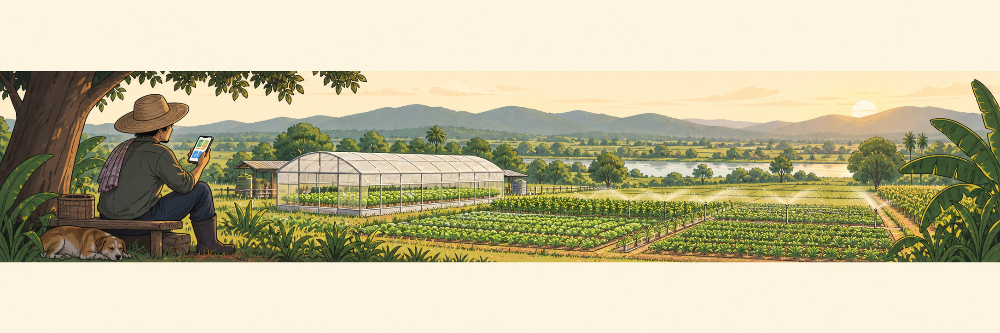

# กิจกรรมที่ 6 — สร้างหน้าจอติดตามและควบคุมฟาร์ม (Dashboard)

{ .activity-banner width="1800" height="300" loading="lazy" decoding="async" }

**35 นาที** วางแผน 5 นาที · สร้าง 25 นาที · ทดสอบ 5 นาที

**อุปกรณ์ที่ใช้** ระบบทั้งหมด และโทรศัพท์ 1 เครื่อง

สร้างแดชบอร์ดที่ช่วยให้การสังเกตการณ์และควบคุมการทำงานอุปกรณ์ในฟาร์มทำได้คล่องตัวขึ้น แดชบอร์ดที่ดีควรทำความเข้าใจและใช้งานได้ง่าย

### ใบงาน { #a6 }

คลิกหัวข้อเพื่อดูวิธีทำ ทำเสร็จแล้วทำเครื่องหมายและตอบคำถาม

- [ ] **[6.1 ใครจะใช้งานแดชบอร์ด](#a6-1)** มีใครบ้างที่จะใช้ {{f:s3.dash.user|30}}
- [ ] **[6.2 เลือกข้อมูลที่จะแสดงและควบคุม](#a6-plan)** ใช้คำที่ผู้ใช้เข้าใจง่าย
    - ค่าที่จะแสดง {{f:s3.dash.show.1|30}}
    - ค่าที่จะแสดง {{f:s3.dash.show.2|30}}
    - ค่าที่จะแสดง {{f:s3.dash.show.3|30}}
    - สิ่งที่จะควบคุม {{f:s3.dash.control.1|30}}
    - สิ่งที่จะควบคุม {{f:s3.dash.control.2|30}}
- [ ] **[6.3 สร้างแดชบอร์ด](#a6-2)** เพิ่ม Gauge ความชื้นอากาศ · Tile ลูกลอย · Tile สั่งปั๊ม · Tile โหมดรดน้ำอัตโนมัติ (Auto / Manual)
- [ ] **[6.4 ทดสอบ - ให้ผู้อื่นทดลองใช้](#a6-3)** ลองว่าเขาเข้าใจส่วนประกอบต่าง ๆ บน Dashboard หรือไม่
- [ ] **[คำถามท้ายกิจกรรม](#a6-q)** ถ้าเรามีเวลาเพิ่มแล้วจะนำ Dashboard นี้ไปใช้งานจริง ควรปรับส่วนใดบ้างให้เหมาะกับผู้ใช้ {{ta:s3.q6}}

### 6.1 ใครจะใช้งานแดชบอร์ด { #a6-1 }

**ระบุผู้ใช้**

1. ระบุว่ามีใครบ้างที่จะใช้แดชบอร์ด เช่น เจ้าของฟาร์ม คนงานหน้าแปลง หรือผู้จัดการหลายแปลง

ผู้ที่จะใช้แดชบอร์ด {{f:s3.dash.user|44}}

[↑ กลับไปที่ใบงาน](#a6){ .ws-back }

### 6.2 เลือกข้อมูลที่จะแสดงและควบคุม { #a6-plan }

**เลือกค่าที่จะแสดงและสิ่งที่จะควบคุม**

1. กรอกค่าที่จะแสดง 3 อย่างและสิ่งที่จะควบคุม 2 อย่างในตาราง ใช้คำที่ผู้ใช้เข้าใจง่าย เช่น “ความชื้นอากาศ” “น้ำถึงระดับลูกลอยหรือไม่” “เปิดปั๊ม” “สลับโหมด Auto / Manual”

| | ค่าที่จะแสดง |
|---|---|
| 1 | {{f:s3.dash.show.1|44}} |
| 2 | {{f:s3.dash.show.2|44}} |
| 3 | {{f:s3.dash.show.3|44}} |

| | สิ่งที่จะควบคุม |
|---|---|
| 1 | {{f:s3.dash.control.1|44}} |
| 2 | {{f:s3.dash.control.2|44}} |

**จัดลำดับความสำคัญ**

2. วางข้อมูลสำคัญและปุ่มที่ใช้บ่อยไว้ด้านบน ใช้ชื่อที่ผู้ใช้เข้าใจตรงกัน

[↑ กลับไปที่ใบงาน](#a6){ .ws-back }

### 6.3 สร้างแดชบอร์ด { #a6-2 }

**สร้างแดชบอร์ด**

1. เปิด **Settings → Dashboards → + Add dashboard → New dashboard from scratch** ตั้งชื่อ เช่น `แปลง 1` และเปิด **Add to sidebar** ไว้

> Farm Dashboard จากช่วงที่ 2 เป็นแดชบอร์ดที่ Home Assistant สร้างให้อัตโนมัติและแก้ไขไม่ได้ กิจกรรมนี้จึงสร้างแดชบอร์ดเปล่าขึ้นใหม่และเลือกการ์ดเอง

**เพิ่มการ์ด**

2. เปิดแดชบอร์ดใหม่ กดไอคอนดินสอ แล้วเพิ่มการ์ดตามตาราง

| การ์ดที่ต้องมี | เลือกข้อมูล | ชื่อที่ใช้บนจอ |
|---|---|---|
| **Gauge** | ความชื้นอากาศ (humidity) | ความชื้นอากาศ (%) |
| **Tile** | สวิตช์ลูกลอย (float switch) | ระดับน้ำที่ลูกลอย |
| **Tile** | รีเลย์ (relay) | สั่งปั๊ม |
| **Tile** | `Pump Auto Mode` (จากช่วงที่ 2) | โหมดรดน้ำอัตโนมัติ |

> การ์ดโหมดแสดงได้เพียง On / Off ตั้งชื่อให้อ่านแล้วรู้ทันทีว่า On คือ Auto และ Off คือ Manual

**จัดหน้าจอ**

3. จัดการ์ดสำคัญไว้ด้านบน แล้วกด **Done**

**(ไม่บังคับทำ) เพิ่มการ์ดอื่น**

4. ลองเพิ่มการ์ดอื่น ๆ ที่น่าสนใจ เช่น เพิ่ม **History graph** ตั้ง **Hours to show: 24** หรือปรับสี Gauge เป็นต้น

[↑ กลับไปที่ใบงาน](#a6){ .ws-back }

### 6.4 ทดสอบ - ให้ผู้อื่นทดลองใช้ { #a6-3 }

**ให้ผู้อื่นลองใช้**

1. เปิดแดชบอร์ดบนโทรศัพท์ที่ต่อ WiFi ของโซนเราและใช้ที่อยู่เดียวกับกิจกรรมที่ 3 (ถ้าโทรศัพท์เปิดไม่ได้ ให้ทดลองบนแล็ปท็อปแทน) ให้คนจากกลุ่มข้าง ๆ หรือคนที่ไม่ได้ช่วยสร้างทดลองดู โดยยังไม่อธิบาย
2. ให้เขาอธิบายทีละการ์ดว่าแสดงอะไรหรือสั่งอะไร แล้วลองถามเพื่อทดสอบความเข้าใจ: **ความชื้นเท่าไร · น้ำถึงระดับลูกลอยหรือไม่ · ปุ่มสั่งปั๊มอยู่ไหน · ตอนนี้เป็นโหมด Auto หรือ Manual**

**ปรับปรุงและทดสอบซ้ำ**

3. หากให้ผู้ใช้ลองแล้วตอบไม่ได้หรือเข้าใจผิด ให้ปรับการออกแบบ แล้วให้ลองใหม่

[↑ กลับไปที่ใบงาน](#a6){ .ws-back }

**คำถามท้ายกิจกรรม** ถ้าเรามีเวลาเพิ่มแล้วจะนำ Dashboard นี้ไปใช้งานจริง ควรปรับส่วนใดบ้างให้เหมาะกับผู้ใช้
{: #a6-q }

{{ta:s3.q6}}

> ตอนนี้เราดูแดชบอร์ดได้เมื่อเชื่อมต่อ WiFi ของโซนเราเท่านั้น ในกิจกรรมที่ 7 กลุ่มจะได้พิจารณาว่าจำเป็นต้องดูข้อมูลจากนอกฟาร์มหรือไม่ และจะใช้วิธีใด
