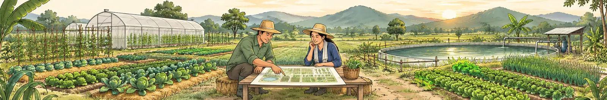
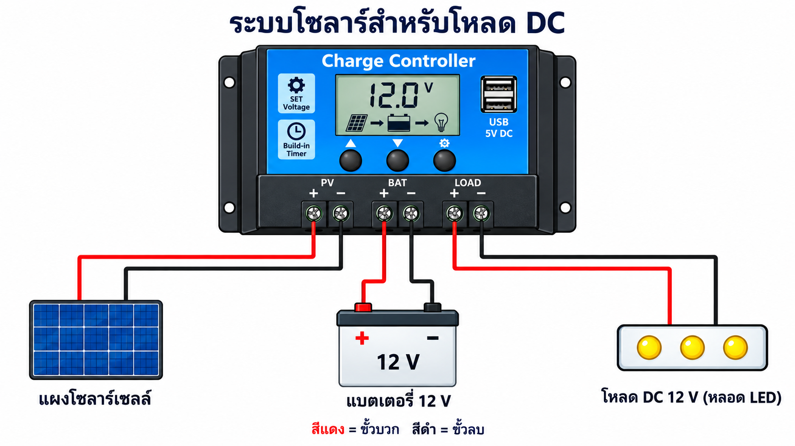
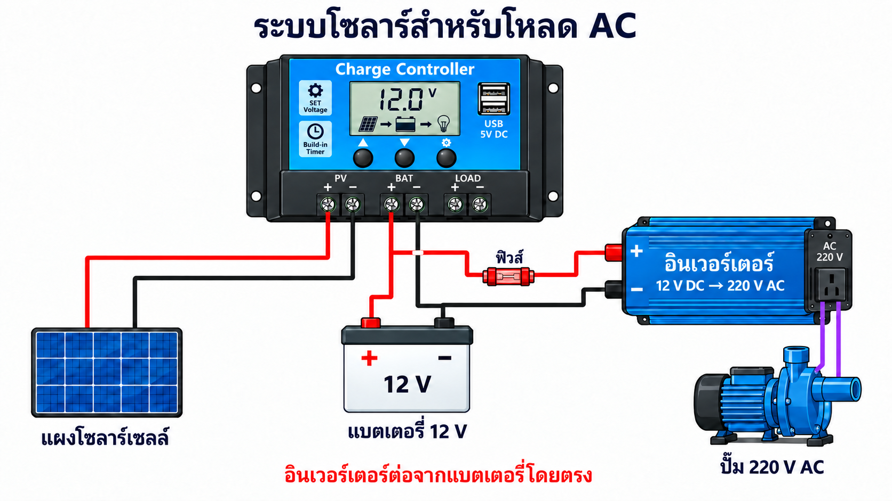

# กิจกรรมที่ 8 — ออกแบบระบบสำหรับฟาร์ม (Design)

{ .activity-banner width="1600" height="267" loading="lazy" decoding="async" }

**85 นาที** เลือกโจทย์ 5 · การสื่อสาร 20 · พลังงาน 15 · ออกแบบระบบ 30 · นำเสนอและแลกเปลี่ยนกับกลุ่มคู่ 15

{ .activity-divider width="1200" height="105" loading="lazy" decoding="async" }

### ใบงาน { #a8 }

- [ ] **[8.1 เลือกโจทย์](#a8-1)** เลือกหนึ่งปัญหาและหนึ่งจุดที่จะเริ่มทดลอง
- [ ] **[8.2 เลือกเครือข่ายในฟาร์ม](#a8-2b)** จดวิธีสื่อสารที่เลือกและเหตุผลสำหรับสองจุดเชื่อมต่อ
- [ ] **[8.3 การเข้าถึงจากนอกฟาร์มและคลาวด์](#a8-2c)** ฟังผู้สอนอธิบาย แล้วยืนยันว่าเข้าใจประเด็นสำคัญสามข้อ
- [ ] **[8.4 เลือกแบตเตอรี่](#a8-3)** เทียบชนิดแบตเตอรี่สำหรับโซลาร์ แล้วเลือกชนิดที่เหมาะกับโจทย์
- [ ] **[8.5 เลือกแหล่งพลังงาน](#a8-3b)** ลองคำนวณร่วมกัน แล้วจดแหล่งจ่ายไฟและสิ่งที่ต้องมีไฟสำรอง
- [ ] **[8.6 ออกแบบระบบ](#a8-4)** สรุปเซนเซอร์และอุปกรณ์ วิธีสื่อสาร แหล่งพลังงาน และแผนทดสอบ

{ .activity-divider width="1200" height="96" loading="lazy" decoding="async" }

### 8.1 เลือกโจทย์ { #a8-1 }

**กำหนดโจทย์ของกลุ่ม**

1. เลือกหนึ่งสถานการณ์จากตารางด้านล่าง หรือใช้ปัญหาจริงของสมาชิกในกลุ่มก็ได้ จากนั้นจดสถานการณ์และปัญหาที่ต้องการแก้ไว้ในข้อ 2

| โจทย์ | สถานการณ์ |
|------|-----------|
| **A โรงเรือนผัก** | โรงเรือน 6 × 20 เมตร ใกล้บ้าน มีไฟบ้านและ WiFi ถึง ปลูกผักสลัด ปัญหาคือร้อนจัดช่วงบ่ายและรดน้ำไม่สม่ำเสมอเมื่อเจ้าของไม่อยู่ |
| **B สวนผลไม้ 10 ไร่** | ลำไยหรือมะม่วง อยู่ติดบ้าน แปลงยาว 400 เมตร ต้องการรู้ความชื้นดิน 3–4 จุดกระจายทั่วสวน และสั่งวาล์วน้ำหยดเป็นโซน ต้องการใช้โซลาร์เป็นแหล่งพลังงาน |
| **C ไฮโดรโปนิกส์** (ขั้นสูง) | โต๊ะปลูก 8 โต๊ะในโรงเรือน ต้องเฝ้าระดับน้ำ อุณหภูมิน้ำ และค่า EC/pH ปั๊มหมุนเวียนจะหยุดนานเกิน 30 นาทีไม่ได้ |
| **D แปลงห่างไกล ไม่มีไฟ** (ขั้นสูง) | ข้าวโพดหรือมันสำปะหลัง 20 ไร่ ห่างบ้านไป 3 กิโลเมตร ไม่มีไฟบ้าน สัญญาณมือถืออ่อน ต้องการรู้ความชื้นดินและระดับน้ำในบ่อ และสั่งปั๊มน้ำโซลาร์ |
| **E ฟาร์มของเราเอง** | หากมีสมาชิกทำฟาร์มและมีข้อมูลพื้นที่ชัดเจน ให้ใช้ฟาร์มนั้นเป็นโจทย์ได้ เริ่มจากปัญหาที่เขียนไว้ตอนเริ่มช่วงที่ 1 ระบุขนาดพื้นที่ ระยะจากบ้าน แหล่งจ่ายไฟ สัญญาณมือถือ และวิธีที่ใช้แก้ปัญหาอยู่ในปัจจุบัน |

**บันทึกผล**

2. โจทย์ที่เลือก {{f:d.scenario|14}}

ปัญหาที่ต้องการแก้ (หนึ่งประโยค)

{{ta:d.problem}}

[↑ กลับไปที่ใบงาน](#a8){ .ws-back }

{ .activity-divider width="1200" height="64" loading="lazy" decoding="async" }

### 8.2 เลือกเครือข่ายในฟาร์ม { #a8-2b }

**เปรียบเทียบวิธีสื่อสาร**

1. คุยกันเรื่อง **ระยะทาง แหล่งจ่ายไฟ ปริมาณข้อมูล และค่าใช้จ่าย** ใช้ตารางนี้เลือกวิธีที่ควรนำไปทดสอบ ไม่ต้องจำทุกเทคโนโลยี ระยะในตารางเป็นค่าโดยประมาณในที่โล่ง ของจริงต้องสำรวจหน้างาน

| วิธี | ระยะโดยประมาณ (ที่โล่ง) | พลังงานที่ใช้ | ข้อดี | ข้อจำกัด | ค่าใช้จ่ายและอุปกรณ์ |
|---|---|---|---|---|---|
| **WiFi** | 30–50 ม. จากเราเตอร์ ขยายได้ด้วยตัวกระจายสัญญาณ | สูง ต้องมีไฟเลี้ยงตลอด | ใช้ของที่มีอยู่ บอร์ดในชุดใช้อยู่แล้ว ส่งข้อมูลได้มาก ต่อ Home Assistant ได้โดยตรง | ระยะสั้น สัญญาณตกเมื่อมีกำแพงหรือต้นไม้ ใช้ถ่านอยู่ได้ไม่นาน | เราเตอร์ ตัวกระจายสัญญาณ |
| **ESP-NOW** | 100–200 ม. บอร์ดถึงบอร์ด | ต่ำ เมื่อส่งเป็นช่วงแล้วหลับ | ไม่ต้องมีเราเตอร์ บอร์ด ESP32 ราคาถูก ไกลกว่า WiFi | ส่งได้ทีละชุดเล็ก ต้องมีบอร์ดตัวรับที่ต่อ Home Assistant และต้องเขียนโปรแกรมเอง | บอร์ดเพิ่มหนึ่งตัวเป็นตัวรับ |
| **Zigbee** | 10–30 ม. ต่อช่วง ส่งต่อกันเป็นทอด ๆ | ต่ำมาก เซนเซอร์ใช้ถ่านได้เป็นปี | อุปกรณ์สำเร็จรูปมีให้เลือกมาก ต่อ Home Assistant ผ่านตัวรับ USB | ระยะสั้นต่อช่วง ตัวส่งต่อต้องมีไฟเลี้ยงตลอด ส่งข้อมูลได้น้อย | ตัวรับ USB และอุปกรณ์แต่ละตัว |
| **LoRa / LoRaWAN** | 1–10 กม. สั้นลงมากเมื่อมีต้นไม้หรืออาคาร | ต่ำมาก เมื่อส่งเป็นช่วง | ไกลที่สุด ไม่ต้องพึ่งผู้ให้บริการ | ส่งได้ค่าจำนวนน้อยนาน ๆ ครั้ง สั่งงานกลับได้ช้า ต้องมีเกตเวย์ที่ต่อ Home Assistant | โมดูลต่อจุด และเกตเวย์หนึ่งตัว |
| **เครือข่ายมือถือ / NB-IoT** | ทุกที่ที่มีสัญญาณ | ปานกลางถึงสูง NB-IoT ต่ำกว่า | ไม่ต้องสร้างเครือข่ายเอง ไกลแค่ไหนก็ได้ถ้ามีสัญญาณ | ค่าบริการรายเดือน ขึ้นกับสัญญาณในพื้นที่ ข้อมูลมักต้องผ่านเซิร์ฟเวอร์ภายนอกก่อนเข้า Home Assistant | โมดูล ซิม และค่าบริการ |
| **RS-485** | ประมาณ 1 กม. ผ่านสาย | ต่ำ แต่ต้องมีไฟเลี้ยงตามสาย | ทนสัญญาณรบกวน เสถียร เซนเซอร์อุตสาหกรรม (Modbus) ใช้กันมาก | ต้องเดินสาย เสี่ยงฟ้าผ่าและสัตว์กัดสาย | สาย อุปกรณ์ และค่าติดตั้ง |

**เลือกและจดข้อสรุป**

2. เลือกวิธีที่เหมาะกับแต่ละจุด 

| จุดเชื่อมต่อ | วิธีที่เลือก | ทำไมจึงเลือกวิธีนี้ |
|---|---|---|
| จากเซนเซอร์ถึงระบบควบคุม | {{f:d.comm.1.tech|12}} | {{f:d.comm.1.why|30}} |
| จากระบบควบคุมถึงอุปกรณ์ปลายทาง | {{f:d.comm.2.tech|12}} | {{f:d.comm.2.why|30}} |

[↑ กลับไปที่ใบงาน](#a8){ .ws-back }

{ .activity-divider width="1200" height="79" loading="lazy" decoding="async" }

### 8.3 การเข้าถึงจากนอกฟาร์มและคลาวด์ { #a8-2c }

ทำเครื่องหมายเมื่อสมาชิกในทีมเข้าใจประเด็นต่อไปนี้

- [ ] **ระบบที่เราสร้างในกิจกรรมนี้เข้าถึงได้เฉพาะในเครือข่ายภายใน** โทรศัพท์หรือคอมพิวเตอร์ที่จะดูแดชบอร์ดต้องต่อ WiFi เดียวกับ Home Assistant
- [ ] **ถ้าต้องดูหรือสั่งงานจากนอกฟาร์ม ต้องตั้งค่าวิธีเข้าถึงจากภายนอกเพิ่มเติม** วิธีหนึ่งสำหรับ Home Assistant คือบริการ Home Assistant Cloud ของ Nabu Casa ([nabucasa.com](https://www.nabucasa.com)) ซึ่งมีค่าใช้จ่าย อีกทางหนึ่งคือเชื่อมต่อผ่าน VPN เพื่อเข้าถึงเครือข่ายในฟาร์ม ส่วนอุปกรณ์สำเร็จรูปบางยี่ห้อ เช่น Tuya หรือ Xiaomi มีบริการคลาวด์ของผู้ผลิต โดยค่าใช้จ่ายและความสามารถขึ้นอยู่กับบริการที่เลือก
- [ ] **ระบบของเรายังทำงานตามกฎได้แม้อินเทอร์เน็ตดับ** ต่างจากระบบที่ทำงานผ่านคลาวด์อย่างเดียว ถ้าเลือกใช้ระบบแบบคลาวด์อย่างเดียว ส่วนที่สำคัญต้องมีกลไกป้องกัน (fail-safe) ในตัว

[↑ กลับไปที่ใบงาน](#a8){ .ws-back }

{ .activity-divider width="1200" height="58" loading="lazy" decoding="async" }

### 8.4 เลือกแบตเตอรี่สำหรับระบบโซลาร์ { #a8-3 }

**Charge controller** ในกล่องจ่ายไฟของกลุ่มควบคุมการชาร์จแบตเตอรี่จากแผงโซลาร์เซลล์ และจ่ายไฟให้โหลด ชุดอบรมใช้อะแดปเตอร์ 12V ที่ขั้วแบตเตอรี่แทนแบตเตอรี่จริง จึง**ไม่ต่อแผงโซลาร์เซลล์ในชุดนี้** เพราะไม่มีแบตเตอรี่รับพลังงานจากการชาร์จ

**ดูขั้วต่อของกล่องจ่ายไฟ**

1. ดูขั้วต่อด้านล่างจากซ้ายไปขวา: **แผงโซลาร์เซลล์** (ยังไม่ต่อสาย) **แบตเตอรี่** (ต่ออะแดปเตอร์ของชุดทดลอง) และ **โหลด DC** (ผ่านรีเลย์ไปยังปั๊ม) ส่วน USB สองช่องจ่ายไฟให้บอร์ดทั้งสอง ในระบบจริง แบตเตอรี่คือส่วนที่ต้องเลือกให้ถูกชนิดและถูกขนาด

**เทียบชนิดแบตเตอรี่ที่ใช้กับโซลาร์**

2. อ่านตารางแล้วคุยกันว่าแต่ละชนิดต่างกันตรงไหน ค่าในตารางเป็นค่าโดยประมาณของแบตเตอรี่ 12 V ที่ขายทั่วไป ตัวเลขจริงดูจากสเปกของรุ่นที่จะซื้อ

| ชนิด | ราคาต่อความจุ | ส่วนที่ใช้ได้จริงต่อรอบ | อายุ (รอบชาร์จ) | น้ำหนักและการดูแล | ข้อควรระวัง |
|---|---|---|---|---|---|
| **ตะกั่ว-กรดแบบน้ำ** (Flooded) | ถูกที่สุด | ประมาณครึ่งหนึ่งของความจุ | 300–500 รอบ | หนัก ต้องเติมน้ำกลั่นและมีที่ระบายอากาศ | ปล่อยจนหมดบ่อยจะเสียเร็ว |
| **ตะกั่ว-กรดแบบแห้ง** (AGM / Gel มักขายในชื่อ deep cycle) | ถูก | ประมาณครึ่งหนึ่ง | 400–800 รอบ | หนัก ไม่ต้องเติมน้ำ | Gel ต้องใช้แรงดันชาร์จต่ำกว่าแบบอื่น |
| **ลิเธียมเหล็กฟอสเฟต** (LiFePO4 หรือ LFP) | แพงกว่าตะกั่ว-กรด 2–3 เท่าต่อ Ah แต่ถูกกว่าเมื่อคิดต่อรอบ | 80–90% ของความจุ | 2,000–5,000 รอบ | เบากว่าประมาณ 1 ใน 3 ไม่ต้องดูแล มีวงจร BMS ในตัว | ห้ามชาร์จเมื่ออุณหภูมิต่ำกว่า 0 °C ต้องใช้ controller ที่มีโหมดลิเธียม |
| **ลิเธียมไอออน NMC** (ก้อน 18650 เพาเวอร์แบงก์ แบตรถ EV) | ใกล้เคียง LFP | 80–90% | 500–1,500 รอบ | เบาที่สุด | เสี่ยงไฟไหม้มากกว่าถ้าชาร์จผิดหรือชำรุด เหมาะกับอุปกรณ์เล็กและพกพา มากกว่าระบบติดตั้งถาวร |

ชนิดอื่นที่พบได้: **NiMH** ในโคมไฟโซลาร์ขนาดเล็ก และ **โซเดียมไอออน** ที่เริ่มมีขายแต่ยังไม่แพร่หลาย งานติดตั้งถาวรในฟาร์มส่วนใหญ่เลือกระหว่างตะกั่ว-กรดกับ LFP

**เลือกให้เหมาะกับโจทย์**

3. คุยกันตามลำดับนี้ แล้วเลือกชนิดที่เหมาะกับโจทย์ของกลุ่ม
    - **ต้องใช้ไฟกลางคืนหรือไม่** ถ้าอุปกรณ์ทำงานเฉพาะตอนแดดพอ เช่น ปั๊ม อาจไม่ต้องมีแบตเตอรี่เลย
    - **ต้องใช้พลังงานคืนละเท่าไร** (คำนวณใน 8.5) แล้วเผื่อส่วนที่ใช้ได้จริง เช่น ต้องการ 120 Wh ต่อคืน ตะกั่ว-กรดต้องมีประมาณ 240 Wh (12 V 20 Ah) ส่วน LFP ประมาณ 150 Wh (12 V 12–13 Ah)
    - **ใครดูแล** ถ้าไม่มีใครมาเติมน้ำหรือตรวจเป็นประจำ ให้เลือกแบบแห้งหรือ LFP
    - **งบครั้งแรกกับอายุการใช้งาน** ตะกั่ว-กรดถูกวันนี้แต่มักต้องเปลี่ยนทุก 2–3 ปี LFP แพงกว่าแต่ใช้ได้ 8–10 ปี
    - **ที่ตั้ง น้ำหนัก และความร้อน** จุดที่ต้องยกไปไกลหรือติดบนเสาต้องการของเบา อากาศร้อนจัดลดอายุแบตเตอรี่ทุกชนิด จึงควรวางในที่ร่ม

**Charge controller และอินเวอร์เตอร์**

Charge controller รับไฟจากแผงโซลาร์เซลล์มาชาร์จแบตเตอรี่ให้พอดี ไม่ชาร์จเกิน และจ่ายไฟจากแบตเตอรี่ไปยังโหลด ต้องเลือกรุ่นที่รองรับชนิดแบตเตอรี่ที่ใช้ เพราะแต่ละชนิดต้องการแรงดันชาร์จต่างกัน

{ width="85%" }

ถ้าอุปกรณ์ต้องการไฟต่างจากแบตเตอรี่ ต้องมีตัวแปลงไฟ เช่น ปั๊มหรืออุปกรณ์ที่ใช้ไฟบ้าน 220 V AC ต้องใช้ **อินเวอร์เตอร์** แปลง 12 V DC เป็น 220 V AC อินเวอร์เตอร์ต่อกับขั้วแบตเตอรี่โดยตรงผ่านฟิวส์ ไม่ต่อผ่านช่องโหลดของ controller เพราะช่องโหลดจ่ายกระแสได้จำกัด

{ width="85%" }

**จดข้อสรุป**

4. ชนิดแบตเตอรี่ที่เหมาะกับโจทย์ของกลุ่มและเหตุผล (ถ้าไม่ต้องใช้แบตเตอรี่ ให้ระบุว่าไม่ใช้) {{f:d.battery|50}}

[↑ กลับไปที่ใบงาน](#a8){ .ws-back }

{ .activity-divider width="1200" height="96" loading="lazy" decoding="async" }

### 8.5 คำนวณพลังงานแล้วเลือกแหล่งจ่ายไฟ { #a8-3b }

**วิธีคำนวณ**

1. **หากำลังไฟรวมที่ต้องใช้**

    สูตร: **กำลังไฟ (W) = แรงดัน (V) × กระแส (A)**

    อ่านแรงดันและกระแสจากป้ายของอุปกรณ์ ถ้ามีหลายอุปกรณ์ทำงานพร้อมกัน ให้บวกกำลังไฟรวมกัน

2. **หาพลังงานที่ต้องใช้จากแบตเตอรี่ในหนึ่งวัน**

    สูตร: **พลังงาน (Wh) = กำลังไฟ (W) × ชั่วโมงที่ใช้งาน**

    นับเฉพาะชั่วโมงที่อุปกรณ์ทำงานจริงในหนึ่งวัน

3. **เลือกขนาดแบตเตอรี่**

    สูตร: **ความจุ (Ah) = พลังงาน (Wh) ÷ 12 V ÷ ส่วนที่ใช้ได้จริง** (ตะกั่ว-กรด 0.5 · LFP 0.8–0.9 ตาม 8.4)

    แบตเตอรี่ต้องเก็บพลังงานได้อย่างน้อยเท่ากับข้อ 2 ตัวเลขที่ได้คือความจุที่ต้องซื้อ

4. **เลือกจำนวนแผง**

    สูตร: **กำลังแผงที่ต้องมี (W) = พลังงาน (Wh) ÷ ชั่วโมงแดดเต็ม** แล้วปัดขึ้นเป็นจำนวนแผง

    ใช้วันที่แดดน้อยที่สุดเป็นเกณฑ์ เช่น วันฟ้าครึ้มได้แดดเทียบเท่าเต็มกำลังเพียง 3 ชั่วโมง วันแดดดีได้ 4–5 ชั่วโมง ถ้าออกแบบจากวันแดดดี แผงจะไม่พอในวันฟ้าครึ้ม

**ตัวอย่าง** ลองคำนวณตามสี่ข้อด้านบนไปพร้อมกัน

| | ตัวอย่างที่ 1: หลอด LED 50 W เปิดกลางคืน 8 ชั่วโมง | ตัวอย่างที่ 2: ปั๊ม 1,100 W วันละ 2 ชั่วโมง |
|---|---|---|
| 1. กำลังไฟ | 12 V × 4.2 A ≈ 50 W | 220 V × 5 A = 1,100 W |
| 2. พลังงานต่อวัน | 50 W × 8 ชม. = 400 Wh | 1,100 W × 2 ชม. = 2,200 Wh |
| 3. แบตเตอรี่อย่างน้อย | 400 Wh ÷ 12 V ≈ 33 Ah ที่ใช้ได้จริง → ตะกั่ว-กรดประมาณ 70 Ah หรือ LFP ประมาณ 40 Ah | 2,200 Wh ÷ 12 V ≈ 183 Ah ที่ใช้ได้จริง → ตะกั่ว-กรดประมาณ 370 Ah หรือ LFP ประมาณ 220 Ah |
| 4. แผงเมื่อได้แดดเต็มเพียง 3 ชั่วโมง | 400 Wh ÷ 3 ชม. ≈ 133 W → แผง 150 W หนึ่งแผง  | 2,200 Wh ÷ 3 ชม. ≈ 733 W → แผง 150 W ห้าแผง |

> นอกจากการคำนวณข้างต้นแล้ว ต้องตรวจว่าอุปกรณ์รองรับกระแสสูงสุดที่ต้องใช้ได้หรือไม่ เช่น ปั๊ม 1,100 W ใช้กับ charge controller ในชุดอบรมนี้ไม่ได้ เพราะจ่ายไฟได้สูงสุด 390 W เท่านั้น

> อุปกรณ์บางชนิด เช่น ปั๊มน้ำ ต้องการกระแสขณะเริ่มทำงานสูงกว่าขณะเดินตามปกติ จึงต้องเลือกอุปกรณ์ที่รองรับกระแสช่วงนี้ได้ด้วย ตัวอย่างเช่น ปั๊มที่ใช้กำลังไฟ 1,100 W ขณะเดิน อาจต้องการกำลังไฟสูงถึง 3,000 W ขณะเริ่มทำงาน ทั้งนี้ต้องตรวจจากสเปกของปั๊มและอุปกรณ์ที่ใช้ร่วมกัน

**จดเฉพาะแผนพลังงานของกลุ่ม**

5. เลือกแหล่งจ่ายไฟให้เซนเซอร์ ระบบควบคุม และอุปกรณ์ปลายทาง เช่น ไฟบ้าน โซลาร์เฉพาะกลางวัน หรือโซลาร์พร้อมแบตเตอรี่ หากยังไม่รู้กำลังไฟหรือเวลาใช้งานจริง ให้จดข้อมูลที่ต้องหาเพิ่มก่อนเลือกขนาดอุปกรณ์

แหล่งจ่ายไฟของแต่ละส่วน {{f:d.power|50}}

อุปกรณ์ที่ต้องมีไฟสำรองและระยะเวลาที่ต้องการ (ถ้าไม่มี ให้ระบุว่าไม่มี) {{f:d.power.backup|40}}

> **ระวัง** แผงที่โดนแสงมีแรงดันที่ขั้ว ห้ามให้ขั้วบวก–ลบแตะกัน การต่อระบบจริงต้องใช้แบตเตอรี่และอุปกรณ์ที่เข้ากัน และทำตามลำดับในคู่มือของรุ่นนั้น

[↑ กลับไปที่ใบงาน](#a8){ .ws-back }

**คุยท้ายเรื่อง** ถ้าฟ้าครึ้มต่อเนื่องสามวัน แล้วระบบต้องทำงานต่อ เราต้องรู้ข้อมูลอะไรเพิ่มก่อนเลือกขนาดไฟสำรอง จดเฉพาะสิ่งที่เกี่ยวกับโจทย์ของกลุ่มไว้ต่อท้ายคำตอบเรื่องไฟสำรองในข้อ 5
{: #a8-3q }

{ .activity-divider width="1200" height="79" loading="lazy" decoding="async" }

### 8.6 ออกแบบระบบสำหรับทดลองหนึ่งจุด { #a8-4 }

สรุปแบบที่กลุ่มเลือกเป็นสี่ส่วน คำตอบที่กรอกไว้ในข้อ 8.2, 8.4 และ 8.5 จะปรากฏในส่วนนี้โดยอัตโนมัติ หากยังไม่รู้ข้อมูลบางอย่าง ให้จดว่าต้องตรวจอะไรเพิ่มไว้ในช่องนั้น

**เซนเซอร์และอุปกรณ์ที่สั่งงาน**

1. ระบุเซนเซอร์หลักและอุปกรณ์ที่จะสั่งงาน อุปกรณ์เพิ่มเติมที่โจทย์ต้องใช้ให้จดรวมได้

เซนเซอร์ {{f:d.in.1.sensor|30}} อุปกรณ์ที่สั่งงาน {{f:d.out.1.device|30}}

เมื่อเกิดอะไร ระบบจะสั่งให้อุปกรณ์ทำอะไร (เขียนเป็นประโยค “ถ้า… แล้วให้…”) {{ta:d.control.rule}}

หากเซนเซอร์หรือการสื่อสารขัดข้อง ระบบควรทำอย่างไร และส่วนใดจะทำหน้าที่ป้องกัน {{ta:d.control.failure}}

**วิธีสื่อสาร**

2. สองแถวแรกมาจาก 8.2 แถวที่สามให้เลือกจากที่ฟังใน 8.3 ว่าเจ้าของต้องดูหรือสั่งงานจากนอกฟาร์มหรือไม่ ถ้าไม่ต้อง ให้ระบุว่า “ไม่ใช้”

| จุดเชื่อมต่อ | วิธีที่เลือก | ทำไมจึงเลือกวิธีนี้ |
|---|---|---|
| จากเซนเซอร์ถึงระบบควบคุม | {{f:d.comm.1.tech|12}} | {{f:d.comm.1.why|30}} |
| จากระบบควบคุมถึงอุปกรณ์ปลายทาง | {{f:d.comm.2.tech|12}} | {{f:d.comm.2.why|30}} |
| จากฟาร์มถึงเจ้าของนอกฟาร์ม | {{f:d.comm.3.tech|16}} | {{f:d.comm.3.why|30}} |

**แหล่งพลังงาน**

3. ตรวจแผนพลังงานจาก 8.4 และ 8.5 อีกครั้งให้ตรงกับอุปกรณ์ที่เลือกในข้อ 1

แหล่งจ่ายไฟของแต่ละส่วน {{f:d.power|50}}

ชนิดแบตเตอรี่ที่เลือกและเหตุผล {{f:d.battery|50}}

อุปกรณ์ที่ต้องมีไฟสำรองและระยะเวลาที่ต้องการ (ถ้าไม่มี ให้ระบุว่าไม่มี) {{f:d.power.backup|40}}

**แผนทดสอบ**

4. เขียนว่าจะรู้ได้อย่างไรว่าระบบทำงานตามที่ตั้งใจ ทั้งเมื่อทำงานตามปกติและเมื่อเกิดปัญหาที่ระบุในข้อ 1: จะดูหรือวัดอะไร และผลแบบใดจึงถือว่าใช้ได้

จะดูหรือวัดอะไร {{f:d.test.how|50}}

ผลแบบใดจึงถือว่าระบบทำงานตามที่ตั้งใจ {{f:d.test.pass|50}}

[↑ กลับไปที่ใบงาน](#a8){ .ws-back }

## คืนอุปกรณ์
ทำตามลำดับต่อไปนี้ เพื่อป้องกันระบบสั่งเปิดปั๊มระหว่างเก็บอุปกรณ์

- [ ] **Settings → Automations & scenes** ปิดสวิตช์ automation ทุกข้อที่สั่งรีเลย์ได้ (กฎรดน้ำสองข้อ fail-safe ทุกข้อ และตรวจซ้ำว่ากฎไฟสวนกับกฎตั้งเวลาปิดไว้)
- [ ] สั่งสวิตช์รีเลย์เป็น **Off** จากหน้าอุปกรณ์ แล้วดูว่าปั๊มหยุด
- [ ] ถอดอะแดปเตอร์ออกจากปลั๊ก ปิดสวิตช์บอร์ด GoGo-IoT แล้วถอด USB ของบอร์ดทั้งสอง ก่อนถอดสายโหลดและสายอะแดปเตอร์จากกล่องจ่ายไฟ
- [ ] เมื่อไม่มีไฟแล้ว ยกสวิตช์ลูกลอยออกจากแก้ว เช็ดให้แห้ง เทน้ำในแก้วทิ้ง
- [ ] ตรวจรายการอุปกรณ์ตาม [หน้าแรก](index.md) แล้วคืนทั้งชุดพร้อมบัตรประจำกลุ่ม
- [ ] **ส่งและเก็บคำตอบของกลุ่ม** ให้ผู้บันทึกเปิดเมนู **เครื่องมือ → ดาวน์โหลดคำตอบ (ไฟล์ JSON)** แล้วส่งไฟล์ผ่านช่องทางที่ผู้สอนแจ้ง ตรวจหมายเลขกลุ่มในชื่อไฟล์ และให้ผู้สอนยืนยันว่าได้รับไฟล์ของกลุ่มแล้ว จากนั้นเปิด[ใบบันทึกของกลุ่ม](record-sheet.md) แล้วเลือก **เครื่องมือ → พิมพ์ / บันทึก PDF** เก็บไว้ใช้วางแผนทดลองในฟาร์มต่อ

> แดชบอร์ดของผู้สอนแสดงความคืบหน้าในการทำกิจกรรม แต่ไม่ได้รับคำตอบที่เรากรอก การเห็นสถานะ “เชื่อมต่อผู้สอนแล้ว” จึงไม่ได้หมายความว่าส่งไฟล์คำตอบแล้ว ให้เก็บไฟล์ JSON ไว้ในเครื่องด้วย
