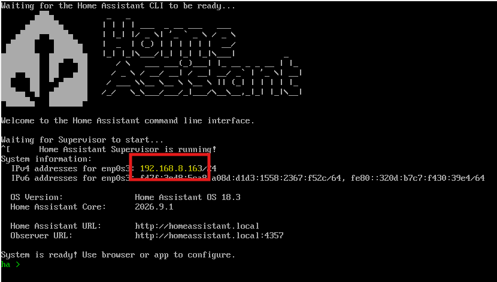

# เตรียมแล็ปท็อปก่อนวันอบรม

ในการอบรม Home Assistant จะทำงานบนแล็ปท็อปของเรา ผ่านเครื่องเสมือนชื่อ **Farm Workshop** ที่ทีมผู้สอนตั้งค่าไว้ให้แล้ว เราแค่ติดตั้ง VirtualBox นำเข้าไฟล์ แล้วกด Start

> **ทำให้เสร็จที่บ้านก่อนมาอบรม** ใช้เวลาราว 20 นาที ไม่รวมเวลาดาวน์โหลด ไฟล์มีขนาดประมาณ 2.6 GB **ห้ามรอมาดาวน์โหลดที่สถานที่อบรม** เพราะทุกกลุ่มดาวน์โหลดพร้อมกันไม่ทันแน่นอน

---

## 1. ติดตั้ง VirtualBox

ดาวน์โหลด **ทั้งสองไฟล์** ตามเครื่องของเรา

| แล็ปท็อป | VirtualBox | ไฟล์ Farm Workshop |
|---------|-----------|------------------------------|
| Windows | [Windows hosts](https://www.virtualbox.org/wiki/Downloads) | [Farm-Workshop-win-1.2.ova](https://drive.google.com/file/d/1DrX4O-jywvnCA0b4aqdQ3z9r7F2EkEf8/view?usp=sharing) (~2.6 GB) |
| Mac ชิป Intel | [macOS / Intel hosts](https://www.virtualbox.org/wiki/Downloads) | [Farm-Workshop-win-1.2.ova](https://drive.google.com/file/d/1DrX4O-jywvnCA0b4aqdQ3z9r7F2EkEf8/view?usp=sharing) (~2.6 GB) |
| Mac ชิป Apple (M1 ขึ้นไป) | [macOS / Apple Silicon hosts](https://www.virtualbox.org/wiki/Downloads) — ต้อง **รุ่น 7.2 ขึ้นไป** | `Farm-Workshop-arm64-1.2.ova` — ทีมผู้สอนจะแจ้งลิงก์ก่อนวันอบรม |

ติดตั้ง VirtualBox ตามค่าที่ตั้งไว้ กด Next หรือ Yes จนจบ

> ต้องมี RAM 8 GB และพื้นที่ว่างในเครื่อง 20 GB ขึ้นไป · Chromebook, iPad และ Windows ชิป ARM ใช้ไม่ได้ · **Mac ชิป Apple ใช้ไฟล์ของ Windows ไม่ได้** ต้องใช้ไฟล์ `arm64` และ VirtualBox รุ่น 7.2 ขึ้นไป (Mac: เมนู Apple → About This Mac ดูบรรทัด Chip หรือ Processor)

---

## 2. นำเข้าเครื่อง Farm Workshop

เปิด VirtualBox → **File → Import Appliance...** → เลือกไฟล์ `.ova` ที่ดาวน์โหลดมา → **Next** → **Finish** ค่าต่าง ๆ ตั้งไว้ให้แล้ว ไม่ต้องแก้ รอจนเครื่อง **Farm Workshop** ปรากฏในรายการ

---

## 3. เปิดเครื่องและตรวจว่าใช้ได้จริง

1. ต่อแล็ปท็อปเข้า WiFi **ก่อน** แล้วเลือก Farm Workshop → **Start** รอ 2–5 นาที
2. อ่านบรรทัด `IPv4 addresses` ในหน้าต่างดำ ตัวเลขก่อน `/` คือที่อยู่ของเรา (เลขของเราจะไม่เหมือนในภาพ)

        IPv4 addresses for enp0s3: 192.168.1.50/24

    { width="85%" }

    ภาพนี้ถ่ายจากเครื่อง Windows หรือ Mac ชิป Intel · **Mac ชิป Apple** บรรทัดนี้จะขึ้นเป็น `enp0s8` แทน `enp0s3` อ่านตัวเลขที่เดียวกัน

3. เปิดเบราว์เซอร์ พิมพ์ `http://192.168.1.50` (ใช้เลขของเครื่องเรา) เห็นหน้า **Login** ของ Home Assistant ถือว่าผ่าน ยังไม่ต้องเข้าระบบ ผู้สอนจะแจ้งชื่อผู้ใช้และรหัสผ่านในวันอบรม
4. ต่อโทรศัพท์เข้า **WiFi เดียวกัน** เปิดที่อยู่เดียวกัน เห็นหน้า Login ถือว่าผ่าน

> ใช้ตัวเลข IP เสมอ **ไม่ใช้ `homeassistant.local`** เพราะในห้องอบรมทุกเครื่องใช้ชื่อนี้ และที่อยู่อาจเปลี่ยนทุกครั้งที่เปิดเครื่อง ให้อ่านใหม่ทุกครั้ง

---

## 4. ปิดเครื่องและเตรียมมาอบรม

กดปิดหน้าต่างของเครื่องเสมือน → **Send the shutdown signal** → OK **อย่าเลือก Power off** (ข้อมูลอาจเสีย) และไม่ต้อง Save state

**วันอบรม** นำแล็ปท็อป สายชาร์จ และโทรศัพท์มา อย่าลบเครื่อง Farm Workshop ออกจาก VirtualBox

---

## ถ้าติดปัญหา

| อาการ | วิธีแก้ |
|-------|---------|
| ขึ้นข้อความเรื่อง **VT-x**, **AMD-V** หรือ **virtualization** (Windows และ Mac ชิป Intel) | ต้องเปิด virtualization ใน BIOS ของเครื่อง ค้นหา "ยี่ห้อเครื่อง enable virtualization" หรือแจ้งผู้สอน |
| **นำเข้าไฟล์ไม่ได้** หรือขึ้นว่าไฟล์ไม่รองรับ | ใช้ไฟล์ผิดชนิด Mac ชิป Apple ใช้ `Farm-Workshop-arm64-1.2.ova` เท่านั้น · Windows และ Mac ชิป Intel ใช้ `Farm-Workshop-win-1.2.ova` เท่านั้น สองไฟล์นี้ใช้สลับกันไม่ได้ |
| Mac ชิป Apple นำเข้าไฟล์ `arm64` ไม่ได้ | ดูรุ่น VirtualBox ที่เมนู **VirtualBox → About VirtualBox** ถ้าต่ำกว่า 7.2 ให้ดาวน์โหลดรุ่นใหม่แล้วติดตั้งทับ |
| ติดตั้ง VirtualBox แล้วขึ้นว่าต้องมี **Visual C++ Redistributable** | ติดตั้ง [vc_redist.x64.exe](https://aka.ms/vs/17/release/vc_redist.x64.exe) แล้วติดตั้ง VirtualBox ใหม่ |
| Mac ขึ้นว่า **System Extension Blocked** | System Settings → Privacy & Security → **Allow** → รีสตาร์ต |
| Start แล้วขึ้นว่า **network interfaces were not found** | เลือก Farm Workshop → **Settings → Network → Adapter 1** ช่อง **Name** เลือกการ์ด WiFi ของเครื่อง (Windows: ชื่อที่มีคำว่า Wi-Fi หรือ Wireless · Mac: `en0: Wi-Fi`) → **OK** แล้ว Start ใหม่ |
| ไม่มีบรรทัด IPv4 หรือเลขขึ้นต้นด้วย `169.254` | ตรวจว่าแล็ปท็อปต่อ WiFi อยู่ ปิดเครื่องเสมือนแล้ว Start ใหม่ ถ้ายังไม่ขึ้น ทำตามช่องด้านบน (เลือกการ์ด WiFi ใน Settings → Network) |
| เบราว์เซอร์เปิดไม่ขึ้น | พิมพ์ `http://` ครบ ไม่มี `:8123` · รออีก 1–2 นาที · Mac: Privacy & Security → **Local Network** เปิดให้เบราว์เซอร์ |
| โทรศัพท์เปิดไม่ได้ แต่แล็ปท็อปได้ | ตรวจว่าโทรศัพท์อยู่บน WiFi เดียวกัน ไม่ใช่ WiFi แขกหรืออินเทอร์เน็ตมือถือ |
