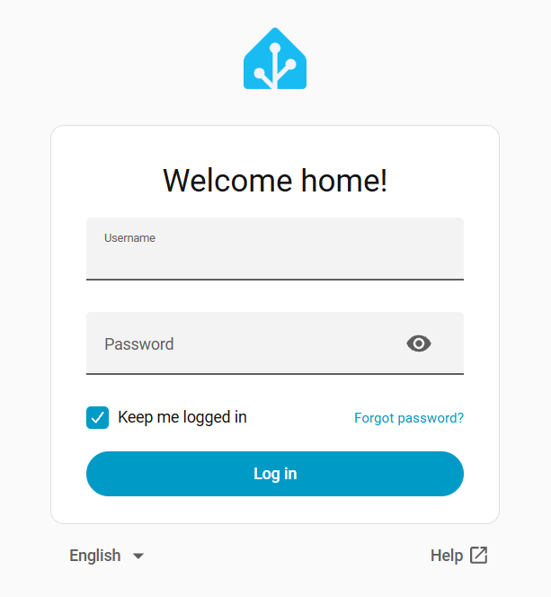

# เตรียมพร้อมก่อนเริ่มช่วงที่ 1

**รับข้อมูล → ตัดสินใจ → สั่งงาน (Input → Logic → Output)**

ช่วงนี้เราจะเริ่มจากอ่านค่าเซนเซอร์ผ่านหน้าเว็บของบอร์ด แล้วทดลองสั่งรีเลย์และต่อวงจรหลอดไฟ 12V จากนั้นจึงเพิ่มบอร์ดทั้งสองเข้า Home Assistant เพื่อดูค่าและสั่งงานจากหน้าจอเดียวกัน สุดท้ายจะเลือกเกณฑ์ความสว่าง เขียนกฎเปิด–ปิดไฟ และให้ระบบทำงานตามกฎ ส่วนปั๊มน้ำจะเริ่มใช้ในช่วงที่ 2

> **เมื่อจบช่วงนี้** เราจะอ่านค่าเซนเซอร์ที่ใช้ในการทดลองได้ เปิด–ปิดหลอดไฟจากแล็ปท็อปและโทรศัพท์ได้ และสร้างกฎอัตโนมัติสองกฎให้ไฟเปิดเมื่อมืดและปิดเมื่อสว่างได้

**วิธีกรอกใบงาน:** ช่องตัวเลขให้กรอกเฉพาะตัวเลข โดยดูหน่วยที่กำกับไว้ข้างช่อง ช่องตัวเลือกให้เลือกคำตอบตามผลที่สังเกตได้ ส่วนช่องอธิบายให้ตอบเป็นคำหรือประโยคตามคำถาม หากช่องเดิมปรากฏซ้ำ คำตอบจะตรงกัน ไม่ต้องกรอกใหม่ เว้นแต่คำสั่งให้แก้ค่า

ตรวจรายการต่อไปนี้ให้ครบก่อนเริ่มกิจกรรม เลือกสมาชิกหนึ่งคนเป็นผู้บันทึกคำตอบ และใช้เบราว์เซอร์เดิมบนเครื่องเดิมตลอดการอบรม คำตอบในใบงานและ[ใบบันทึกของกลุ่ม](record-sheet.md) จะตรงกันเมื่อเปิดบนเบราว์เซอร์เดียวกัน

> สมาชิกคนอื่นเปิดใบงานไว้ดูขั้นตอนได้ แต่ให้ผู้บันทึกเป็นคนกรอกคำตอบและทำเครื่องหมายว่าทำเสร็จแล้ว คำตอบไม่ส่งข้ามเครื่องโดยอัตโนมัติ และแดชบอร์ดของผู้สอนรับเฉพาะความคืบหน้า หากต้องย้ายเครื่อง ให้ดาวน์โหลดไฟล์คำตอบจากเครื่องเดิมแล้วนำเข้าในเครื่องใหม่

- [ ] กรอกหมายเลขกลุ่มที่ผู้สอนกำหนด (ตัวเลข 1–120) {{f:team.no|4}} และเลือกโซนที่ได้รับมอบหมาย {{r:team.zone|แดง|เขียว|น้ำเงิน}}
- [ ] เชื่อมต่อแล็ปท็อปกับ WiFi **ของโซนกลุ่ม** ชื่อ `farm-laptop-red`, `farm-laptop-green` หรือ `farm-laptop-blue` ตามสีโซน
- [ ] เลือกแล็ปท็อปหนึ่งเครื่องสำหรับเปิด Home Assistant และให้ตัวแทนกลุ่มดูแลเครื่องนี้
- [ ] เปิด VirtualBox เลือกเครื่อง **Farm Workshop** แล้วกด **Start** รอจนหน้าจอแสดง **หมายเลข IP** ของเครื่อง บันทึกเฉพาะหมายเลข IP ในช่องนี้: `http://`{{f:ha.ip1|15}} จากนั้นเปิดที่อยู่นี้ในเบราว์เซอร์ เช่น `http://192.168.1.50` เมื่อเห็นหน้าเข้าสู่ระบบ (Login) ให้เปิดแท็บค้างไว้สำหรับกิจกรรมที่ 3
- [ ] แนะนำตัวกันในกลุ่ม แล้วช่วยกันเขียน **ปัญหาในฟาร์มที่อยากแก้** สั้น ๆ หนึ่งประโยค โดยยังไม่ต้องเสนอวิธีแก้ หากไม่มีสมาชิกที่ทำฟาร์ม ให้เลือกปัญหาจากฟาร์มที่รู้จัก เราจะนำปัญหานี้มาออกแบบระบบในช่วงที่ 3 {{ta:farm.problem}}

{ width="60%" }

{ width="60%" }
