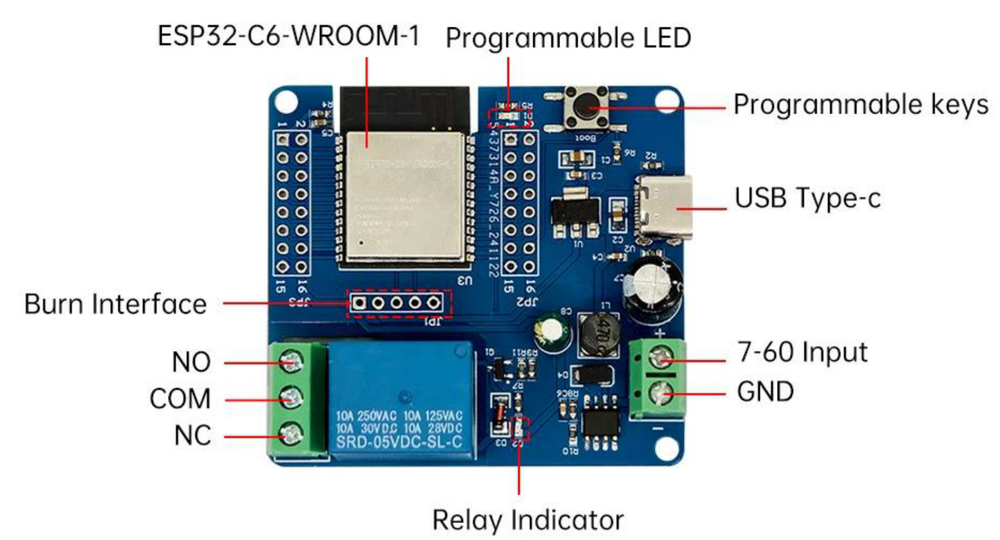

# ช่วงที่ 1 — ระบบสมองกลฝังตัวในฟาร์ม: รับรู้ ตัดสินใจ สั่งการ

**Input → Logic → Output**

ช่วงแรกเราจะทดลองอ่านค่าเซนเซอร์และสั่งรีเลย์ผ่านหน้าเว็บของบอร์ด จากนั้นต่อวงจรปั๊มน้ำ 12V แล้วเพิ่มบอร์ดทั้งสองเข้า Home Assistant เมื่ออุปกรณ์พร้อม เราจะลองดูค่าและตัดสินใจเปิด–ปิดปั๊มเอง ก่อนสร้างกฎให้ระบบสั่งงานแทน

> **เมื่อจบช่วงนี้** เราจะอ่านค่าเซนเซอร์ทุกตัวได้ สั่งปั๊มน้ำได้จากแล็ปท็อปและโทรศัพท์ และมี automation หนึ่งข้อที่หยุดปั๊มเองเมื่อน้ำในถังหมด

## ก่อนเริ่ม

ทีมของเราจะใช้ Home Assistant บนแล็ปท็อป ผ่านเครื่องเสมือน (VM) ในโปรแกรม VirtualBox ซึ่งนำเข้าไฟล์ที่ส่งให้ล่วงหน้าไว้แล้ว ก่อนรับอุปกรณ์ ให้เตรียมตามรายการต่อไปนี้

- [ ] ดูบัตรประจำทีมว่าทีมเราอยู่ **โซนสีอะไร** (แดง / เขียว / น้ำเงิน) ใช้สีนี้ตรวจสอบชุดอุปกรณ์และชื่อ WiFi ของทีม
- [ ] ต่อแล็ปท็อปเข้า WiFi **ของโซนเรา** ชื่อ `farm-laptop-สี` ตามบัตรประจำทีม ไม่ใช่ WiFi ทั่วไปของสถานที่
- [ ] เปิด VirtualBox กด **Start** ที่เครื่อง Farm Workshop รอจนหน้าจอแสดง **ที่อยู่ (IP)** ของเครื่อง จดไว้ที่นี่ `http://`{{f:ha.ip1|15}} แล้วพิมพ์ที่อยู่นั้นในเบราว์เซอร์ เช่น `http://192.168.1.50` เข้าระบบด้วยชื่อผู้ใช้และรหัสบนบัตร เมื่อเห็นหน้า **Overview** ให้ **เปิดหน้านี้ไว้** เราจะกลับมาใช้ในกิจกรรมที่ 3
- [ ] กรอกหมายเลขทีม {{f:team.no|4}} และโซนของทีม {{r:team.zone|แดง|เขียว|น้ำเงิน}} ช่องที่กรอกในใบงานนี้จะถูกจำไว้ในเบราว์เซอร์ของเครื่องนี้ และรวมอยู่ใน[ใบบันทึกของทีม](record-sheet.md) ไม่ต้องเขียนชื่อสมาชิก
- [ ] เขียน **ปัญหาในฟาร์มที่เราอยากแก้** หนึ่งประโยค ยังไม่ต้องคิดว่าจะแก้อย่างไร ถ้าไม่มีสมาชิกที่ทำฟาร์ม ให้เขียนปัญหาของฟาร์มที่รู้จัก เราจะกลับมาใช้ประโยคนี้ในช่วงที่ 3 {{ta:farm.problem}}

{ width="60%" }

> หน้าจอตั้งเป็นภาษาอังกฤษไว้ เพื่อให้ชื่อเมนูตรงกับใบงานนี้ ถ้า Home Assistant เปิดไม่ขึ้น ให้ยกมือ **ตอนนี้เลย** แม้จะยังไม่ได้ใช้จนถึงกิจกรรมที่ 3 เพราะการแก้ปัญหาใช้เวลา และกิจกรรมที่ 1–2 ทำต่อไปได้โดยไม่ต้องรอ

---

## กิจกรรมที่ 1 — รู้จักและทดลองใช้เซนเซอร์ (Sense)

**35 นาที**

**อุปกรณ์ที่ใช้** บอร์ด GoGo-IoT, สวิตช์ลูกลอยพร้อมตัวแปลงและสาย Grove, แก้วน้ำ, สาย USB-C, แล็ปท็อป

กิจกรรมนี้จะใช้หน้าเว็บของบอร์ดดูค่าเซนเซอร์ แล้วทดลองเปลี่ยนสภาพแวดล้อมเพื่อสังเกตว่าแต่ละค่าวัดอะไร และนำไปใช้ตัดสินใจเรื่องใดได้บ้าง

### รู้จักบอร์ด GoGo-IoT

บอร์ดตัวนี้มีคอนโทรลเลอร์ ESP32-C3 และเซนเซอร์ในตัวสำหรับวัดห้าค่า ได้แก่ **อุณหภูมิ ความชื้นอากาศ แสง ความกดอากาศ และความเร่ง** (บอร์ดแปลงความเร่งเป็นค่า **ความสั่นสะเทือน** ให้เราแล้ว) นอกจากนั้นมีช่องต่อเซนเซอร์เพิ่มแบบ Grove เราจะต่อ **สวิตช์ลูกลอย** เข้าที่ **ช่อง 1** ซึ่งตั้งค่าไว้แล้วให้อ่านเป็นสัญญาณดิจิทัล

{ width="55%" }

1. เสียบสาย Grove จากตัวแปลงของสวิตช์ลูกลอยเข้า **ช่อง 1** บนบอร์ด
2. เสียบสาย USB-C เข้าบอร์ด แล้วเสียบอีกปลายเข้าช่อง USB ของแล็ปท็อป
3. วางสวิตช์ลูกลอยลงแก้วน้ำที่มีน้ำครึ่งแก้ว ให้ลูกลอยลอยขึ้น

### อ่านชื่อและหมายเลข IP ของบอร์ด

บอร์ดแต่ละตัวมีชื่อเฉพาะที่สร้างจากหมายเลขประจำเครื่อง จึงไม่ซ้ำกับบอร์ดของทีมอื่น เมื่อเชื่อมต่อ WiFi แล้ว บอร์ดจะได้รับ **หมายเลข IP** สำหรับติดต่อผ่านเครือข่าย ให้จดทั้งชื่อและหมายเลข IP ไว้ใช้ในกิจกรรมต่อ ๆ ไป

1. เปิด **Chrome** หรือ **Edge** ไปที่ **web.esphome.io** (Firefox ใช้ไม่ได้)
2. กด **Connect** เลือกพอร์ตที่ปรากฏขึ้น แล้วกดยืนยัน
3. กด **Logs & Console** แล้วกดปุ่ม **Reset device** ในหน้าเว็บ (ไม่ใช่ปุ่มบนบอร์ด) บอร์ดจะเริ่มทำงานใหม่ แล้วพิมพ์ข้อความสำคัญสองบรรทัดลงในกรอบ บรรทัดแรก ๆ คือ `=====  DEVICE NAME: ...  =====` ตัวอย่างชื่อคือ `gogo-iot-red-a1b2c3` และอีกราว 10–20 วินาทีต่อมา หลังบอร์ดต่อ WiFi ได้ จะมี `=====  IP ADDRESS: ...  =====` ตามมา
4. **ตรวจสี** คำกลางในชื่อ (`red` / `green` / `blue`) ต้องตรงกับสีโซนของทีมเรา ถ้าไม่ตรง บอร์ดนี้จะไม่เห็น WiFi ของเรา ให้ยกมือขอเปลี่ยนบอร์ด
5. **จดชื่อและหมายเลข IP** ชื่อบอร์ด {{f:board.iot.name|22}} IP {{f:board.iot.ip|15}} แล้วปิดหน้าต่างนี้

{ width="60%" }

> ถ้าหน้าต่าง log ว่างเปล่า หรือชื่อเลื่อนผ่านไปแล้ว ให้กดปุ่ม **Reset device** ในหน้าเว็บอีกครั้ง **อย่าถอดสาย USB และอย่ากดปุ่มบนบอร์ด** สองอย่างนั้นจะตัดการเชื่อมต่อของเบราว์เซอร์ และชื่อจะไม่ขึ้น
> ถ้าเห็นชื่อแต่ไม่เห็นหมายเลข IP ภายในหนึ่งนาที แปลว่าบอร์ดต่อ WiFi ไม่ได้ ตรวจสีในชื่ออีกครั้ง แล้วยกมือ

### เปิดหน้าเว็บของบอร์ด

บอร์ดมีหน้าเว็บสำหรับแสดงค่าในตัว เรียกว่า **เว็บเซิร์ฟเวอร์** เราจึงเปิดดูค่าผ่านเบราว์เซอร์ได้โดยตรงเมื่อเชื่อมต่อ WiFi โซนเดียวกัน โดยยังไม่ต้องใช้ Home Assistant

1. เปิดแท็บใหม่ พิมพ์ `http://` ตามด้วยหมายเลข IP ที่จดไว้ เช่น `http://192.168.10.57`
2. จะเห็นรายการค่าจากบอร์ด แต่ละบรรทัดคือ **entity** หนึ่งตัว ค่าจะอัปเดตเองโดยไม่ต้องรีเฟรช สังเกตว่าสวิตช์ลูกลอยไม่ได้แสดงเป็นตัวเลข แต่แสดงเป็นสถานะสองอย่าง รายการที่เกี่ยวกับ **ปั๊ม** (ปั๊มกำลังทำงาน และความไวตรวจจับปั๊ม) ปล่อยไว้ก่อน เราจะใช้ในช่วงที่ 2

{ width="60%" }

> ถ้าเปิดไม่ขึ้น ตรวจว่าแล็ปท็อปอยู่บน `farm-laptop-สีเดียวกัน` กับสีในชื่อบอร์ด เพราะหน้านี้อยู่บนตัวบอร์ด ไม่ได้อยู่บนอินเทอร์เน็ต

### ทดลองดูว่าเซนเซอร์แต่ละตัววัดอะไร

ให้คนหนึ่งทำทีละอย่าง อีกคนดูว่า entity รายการใดบนหน้าเว็บเปลี่ยน

| ทำอะไร | สังเกต |
|--------|--------|
| เป่าลมหายใจใส่บอร์ดช้า ๆ 5 วินาที | ความชื้นอากาศและอุณหภูมิ ขึ้นเท่าไร |
| ใช้มือครอบบอร์ดให้มืด | แสงลงเหลือเท่าไร แล้วเอามือออก ค่ากลับมาเร็วแค่ไหน |
| เคาะโต๊ะข้างบอร์ด หรือเขย่าบอร์ดเบา ๆ | ความสั่นสะเทือน ขึ้นถึงเท่าไร แล้ววางนิ่ง ลงเหลือเท่าไร (หน่วย mg) |
| ยกสวิตช์ลูกลอยขึ้นจากน้ำ แล้ววางกลับ | สถานะเปลี่ยนจากอะไรเป็นอะไร (หน้าเว็บของบอร์ดใช้คำว่า **ON** = มีน้ำ **OFF** = น้ำหมด) |

> **บันทึกผล** ค่าที่อ่านได้จากหน้าเว็บของบอร์ด ในช่วงที่ 2 เราจะใช้ค่าเหล่านี้ตั้งเกณฑ์

| เซนเซอร์ | ค่าปกติในห้อง | ค่าเมื่อทดสอบ | ทดสอบด้วยวิธี |
|----------|---------------|---------------|---------------|
| ความชื้นอากาศ | {{n:s1.hum.room}} % | {{n:s1.hum.test}} % | เป่าลม |
| อุณหภูมิ | {{n:s1.temp.room}} °C | {{n:s1.temp.test}} °C | เป่าลม |
| แสง | {{n:s1.light.room}} | {{n:s1.light.test}} | ใช้มือครอบบอร์ด |
| ความสั่นสะเทือน | {{n:s1.vib.room}} mg | {{n:s1.vib.test}} mg | เคาะโต๊ะ / เขย่า |
| สวิตช์ลูกลอย | ลอยอยู่: {{f:s1.float.rest|4}} | ยกขึ้น: {{f:s1.float.lift|4}} | ยกขึ้นจากน้ำ |

ครอบบอร์ดอีกครั้ง แล้วนับว่าค่าแสงบนหน้าเว็บเปลี่ยนภายในกี่วินาที บอร์ดส่งค่าใหม่เป็นระยะ ไม่ใช่ทันที **เปลี่ยนภายใน** {{n:s1.light.delay|3}} **วินาที** จะได้ใช้ในช่วงที่ 2

> สวิตช์ลูกลอยไม่ได้บอกว่าน้ำมีเท่าไร บอกได้อย่างเดียวว่าน้ำถึงระดับนี้หรือไม่ถึง เซนเซอร์แบบนี้เรียกว่าเซนเซอร์ **ดิจิทัล** (ตอนเข้า Home Assistant ในกิจกรรมที่ 3 สถานะเดียวกันนี้จะเรียกว่า **Wet** = มีน้ำ และ **Dry** = น้ำหมด แทน ON/OFF) ส่วนความชื้นและแสงที่ให้ตัวเลขต่อเนื่องเรียกว่า **แอนะล็อก** ความต่างนี้จะสำคัญมากในช่วงที่ 2

**คำถามท้ายกิจกรรม** ในระบบรดน้ำของเรา ค่าใดที่จะใช้ตัดสินใจว่าต้องรดน้ำ และสวิตช์ลูกลอยมีไว้บอกอะไร

{{ta:s1.q1}}

---

## กิจกรรมที่ 2 — ต่อวงจรและสั่งงานปั๊ม (Act)

**40 นาที**

**อุปกรณ์ที่ใช้** บอร์ดรีเลย์, charge controller, อะแดปเตอร์ 12V, สายไฟ, แผงต่อสาย, ปั๊มตู้ปลา 12V พร้อมสายยาง, ภาชนะน้ำ 2 ใบ, ถาดรอง

> **สลับคนใช้แล็ปท็อปก่อนเริ่ม**

เริ่มจากสั่งรีเลย์ผ่านหน้าเว็บ โดยยังไม่ต่อปั๊ม เพื่อดูว่ารีเลย์เปิด–ปิดวงจรอย่างไร จากนั้นจึงต่อแหล่งจ่ายไฟ 12V และปั๊มเข้าด้วยกัน ขั้นตอนนี้ต้องต่อสายเอง ให้ค่อย ๆ ทำและตรวจทีละจุดตามใบงาน

### ส่วน ก — รีเลย์คือสวิตช์

#### รู้จักบอร์ดรีเลย์

บอร์ดรีเลย์เป็นบอร์ดคนละตัวกับบอร์ดเซนเซอร์ มีคอนโทรลเลอร์ของตัวเอง (ESP32-C6) และมีขั้วต่อสองกลุ่ม ดูตำแหน่งขั้วต่อจากแผนภาพนี้ก่อนต่อสาย

> **บอร์ดนี้รับไฟทางสาย USB ตลอดหลักสูตร** ในส่วน ก เสียบกับแล็ปท็อป ตั้งแต่ส่วน ข เสียบกับช่อง USB ของกล่องจ่ายไฟ ขั้วไฟเข้า 7–60V บนบอร์ด **ไม่ใช้และห้ามต่อสายเข้า** ไฟ 12V จากกล่องจ่ายไฟจึงไปที่ปั๊มทางเดียว ไม่ต้องแยกสายมาเลี้ยงบอร์ด

{ width="100%" }

| ป้ายบนแผนภาพ | คือ | เราใช้ทำอะไร |
|--------------|-----|--------------|
| **NO / COM / NC** | ขั้วรีเลย์ (บล็อกเขียว 3 ช่อง) | ใช้ **COM** กับ **NO** ให้ไฟ 12V ไปปั๊ม |
| **7-60 Input / GND** | ขั้วไฟเข้า (บล็อกเขียว 2 ช่อง) | **ไม่ใช้** ปล่อยว่างไว้ ห้ามต่อสายเข้า |
| **USB Type-c** | ช่อง USB | ไฟเลี้ยงบอร์ด ส่วน ก จากแล็ปท็อป ตั้งแต่ส่วน ข จากช่อง USB ของกล่องจ่ายไฟ |
| **Relay Indicator** | ไฟแสดงสถานะรีเลย์ | ติดเมื่อรีเลย์ทำงาน ในช่วงที่ 2 เราจะดูไฟดวงนี้คู่กับหลอดไฟ |
| **LED** | ไฟแสดงการเชื่อมต่อ WiFi | ติดค้าง = ต่อ WiFi ได้ · กะพริบ = หลุด WiFi · ดับ = ไม่มีไฟ |
| **Programmable keys** | ปุ่มบนบอร์ด | กดสั่งรีเลย์ด้วยมือได้ แม้ไม่มี Home Assistant |

#### อ่านชื่อ หมายเลข IP แล้วลองสั่งรีเลย์ (ทำก่อนต่อสายใด ๆ)

1. เสียบสาย USB-C จากบอร์ดรีเลย์เข้าแล็ปท็อป (ยังไม่ต่ออย่างอื่นทั้งสิ้น)
2. ทำเหมือนกิจกรรมที่ 1: web.esphome.io → **Connect** → เลือกพอร์ต → **Logs & Console** → กด **Reset device** ในหน้าเว็บ อ่านชื่อบอร์ด เช่น `gogo-relay-red-a1b2c3` และหมายเลข IP ตรวจว่าสีในชื่อตรงกับโซนของทีม แล้วจดไว้ ชื่อบอร์ด {{f:board.relay.name|22}} IP {{f:board.relay.ip|15}} ปิดหน้าต่าง
3. เปิดแท็บใหม่ไปที่ `http://` ตามด้วยหมายเลข IP ของบอร์ดรีเลย์ จะเห็น entity ชื่อ **รีเลย์ (relay)** เป็นสวิตช์
4. กดให้เป็น On หนึ่งวินาที แล้ว Off ฟังเสียงคลิก และดูไฟ **Relay Indicator** ติดดับตาม
5. กด **ปุ่มบนบอร์ด** หนึ่งครั้ง รีเลย์คลิกและสวิตช์บนหน้าเว็บเปลี่ยนตาม กดอีกครั้งให้กลับเป็น Off
6. **ถอดปลายสาย USB ออกจากแล็ปท็อป** ปลายฝั่งบอร์ดเสียบไว้ตามเดิม ในส่วน ข เราจะย้ายปลายนี้ไปเสียบช่อง USB ของกล่องจ่ายไฟ

> เสียงคลิกเกิดจากหน้าสัมผัสของรีเลย์เปลี่ยนตำแหน่งเพื่อเปิดหรือปิดวงจร ขณะนี้ยังไม่ได้ต่ออุปกรณ์ที่ขั้วรีเลย์ จึงได้ยินเพียงเสียงคลิก **รีเลย์ทำหน้าที่เป็นสวิตช์** ไม่ได้จ่ายไฟให้ปั๊มเอง เราจะต่อแหล่งจ่ายไฟและปั๊มในส่วน ข

### ส่วน ข — ต่อแหล่งจ่ายไฟและปั๊ม

#### กล่องจ่ายไฟ 12V

บอร์ดรีเลย์และปั๊มอยู่ฝั่งถาดน้ำ ห่างจากแล็ปท็อป เราจะใช้ **charge controller** ที่ต่ออะแดปเตอร์ 12V แทนแบตเตอรี่เป็นแหล่งจ่ายไฟร่วมกัน ในช่วงนี้ให้ดูเฉพาะ **ขั้วจ่ายไฟ 12V คู่ขวาสุด** ซึ่งมีสัญลักษณ์หลอดไฟ และ **ช่อง USB สองช่อง** ขั้ว 12V จ่ายไฟให้ปั๊ม ช่อง USB ช่องหนึ่งเลี้ยงบอร์ดรีเลย์ อีกช่องเก็บไว้ให้บอร์ด GoGo-IoT ตอนท้ายวัน ส่วนหน้าที่อื่นของ charge controller จะเรียนในช่วงที่ 3

{ width="50%" }

#### ต่อสาย

**ตรวจก่อนเริ่ม: สาย USB ของบอร์ดรีเลย์ถอดออกจากแล็ปท็อปแล้ว** และ **ยังไม่เสียบปลั๊กอะแดปเตอร์จนกว่าจะถึงขั้นสุดท้าย** ให้คนหนึ่งต่อสาย อีกคนอ่านทีละข้อและตรวจว่าทำครบก่อนอ่านข้อถัดไป

1. ต่อสายอะแดปเตอร์ 12V เข้า **คู่กลาง** (สัญลักษณ์แบตเตอรี่) ของ charge controller สายแดงเข้าบวก สายดำเข้าลบ
2. จาก **คู่ขวา** (สัญลักษณ์หลอดไฟ) ของ charge controller เดินสายสองเส้นไปยัง **แผงต่อสาย** บวกเข้าแถวบวก ลบเข้าแถวลบ แผงนี้คือจุดกระจายไฟ 12V ของเรา
3. จากแถวบวกไป **COM** ของรีเลย์ แล้วจาก **NO** ไปยังสายบวกของปั๊ม
4. สายลบของปั๊มเข้าแถวลบของแผงต่อสาย
5. เสียบปลายสาย USB-C ของบอร์ดรีเลย์เข้า **ช่อง USB ของ charge controller** ช่องใดก็ได้ สายเส้นนี้เลี้ยงตัวบอร์ด ขั้วไฟเข้า 7–60V จึงปล่อยว่างไว้
6. ตรวจทุกสกรูแน่น ไม่มีปลายสายเปลือยแตะกัน ไม่มีสายเข้าขั้ว **NC** และไม่มีสายเข้าขั้ว **7-60 Input / GND**

{ width="65%" }

> **ทำไมตัดวงจรที่สายบวกเส้นเดียว** ไฟจะไหลได้ต้องครบวงจร ตัดที่จุดเดียวก็พอ และเราเลือกตัดด้านบวก เพื่อให้สายลบทุกเส้นต่อถึงกันเป็นกราวด์ร่วม ตู้ควบคุมปั๊มจริงก็ทำแบบเดียวกัน แค่แรงดันสูงกว่า

#### เปิดไฟและสั่งปั๊ม

1. วางภาชนะสองใบบนถาดรอง เติมน้ำใบ A ค่อนใบ ใบ B ว่าง จุ่มปั๊มลงใบ A ให้จมทั้งตัว วางปลายสายยางลงใบ B แล้วหนีบไว้ ต้องจัดให้ปั๊มจมน้ำก่อนเริ่มจ่ายไฟและสั่งงาน
2. ย้ายสวิตช์ลูกลอยจากแก้วมาไว้ในใบ A ด้วย ตั้งแต่นี้ใบ A คือ **ถังน้ำต้นทาง** ของระบบ และลูกลอยคอยบอกว่าน้ำในถังยังพอหรือไม่
3. **เสียบอะแดปเตอร์เข้ารางปลั๊ก** จอ charge controller ควรติดและแสดงแรงดัน ไฟบนบอร์ดรีเลย์ควรติด รอ 30 วินาทีให้บอร์ดต่อ WiFi
4. เปิดหน้าเว็บของบอร์ดรีเลย์อีกครั้งที่หมายเลข IP เดิม (บอร์ดจะได้หมายเลขเดิมเมื่อกลับมาต่อ WiFi)
5. กดสวิตช์เป็น On นับ 10 วินาที แล้ว Off ดูว่าน้ำไหลจาก A ไป B หรือไม่ น้ำที่ไหลคือหลักฐานว่า Output ของเราทำงานจริง
6. เทน้ำจากใบ B กลับใบ A แล้ว **ย้ายปลายสายยางมาลงใบ A** ตั้งแต่นี้น้ำจะวนอยู่ในถังเดียว ปั๊มจึงเดินได้นานเท่าไรก็ได้โดยน้ำไม่หมด ใบ B ไม่ใช้อีก

> **บันทึกผล** จอ charge controller แสดง {{n:s1.psu.volt|5}} V · ทีมต่อสายครบและถูกต้องในครั้งแรกหรือไม่ {{r:s1.wiring.first|ใช่|ไม่ใช่}} ข้อที่ต้องแก้ {{f:s1.wiring.fix|20}}

> ถ้าจอ charge controller ไม่ติด ให้ถอดอะแดปเตอร์ก่อน แล้วตรวจการต่อสายข้อ 1 ถึง 6 ใหม่ ถ้าจอติดแต่บอร์ดรีเลย์ไม่ติด ให้เสียบสาย USB ให้แน่นหรือลองช่อง USB อีกช่อง ถ้าหน้าเว็บของบอร์ดเปิดไม่ขึ้นหลังรอหนึ่งนาที ให้ย้ายปลายสาย USB จาก charge controller มาเสียบแล็ปท็อปชั่วคราวเพื่ออ่านหมายเลข IP ใหม่ (บอร์ดจะเริ่มใหม่และรีเลย์เป็น Off) แล้วย้ายกลับ

#### ตู้ควบคุมปั๊มในฟาร์มจริง

ฟังผู้สอน 2 นาที ไม่ต้องแตะอุปกรณ์ จุดที่เราเพิ่งต่อ (แหล่งจ่ายไฟ รีเลย์ ปั๊ม) ในฟาร์มจริงจะอยู่ในตู้ควบคุมปั๊ม แรงดันสูงกว่า และมีสิ่งหนึ่งที่ชุดของเราไม่มี คือสวิตช์เลือก **Auto / Off / Manual** ที่หน้าตู้

| ตำแหน่ง | ใครสั่งปั๊ม | ใช้เมื่อไร |
|---------|-------------|------------|
| **Auto** | charge controller | ทำงานปกติ |
| **Off** | ไม่มีใคร ปั๊มเดินไม่ได้ | ซ่อมบำรุง เจอน้ำรั่ว |
| **Manual** | คน โดยไม่ผ่าน charge controller | เซนเซอร์เสีย เครือข่ายล่ม แต่พืชยังต้องการน้ำ |

> คนที่อยู่หน้าแปลงต้องหยุดหรือเดินปั๊มได้โดยไม่ต้องมีแล็ปท็อป จึงต้องเตรียมวิธีควบคุมด้วยมือไว้ด้วย เราจะเห็นตู้จริงทำงานในช่วงที่ 2 · **12V คือแรงดันในห้องเรียนของเรา 220V ต้องให้ช่างไฟฟ้าต่อ**

**คำถามท้ายกิจกรรม** ถ้าเปลี่ยนเป็นปั๊มบ่อ 220V ในฟาร์มจริง ต้องเปลี่ยนอะไรบ้างในสิ่งที่เราเพิ่งต่อ และใครควรเป็นคนต่อ

{{ta:s1.q2}}

> ก่อนพัก สั่งสวิตช์รีเลย์เป็น **Off** จากหน้าเว็บของบอร์ด และดูว่าปั๊มหยุดจริง

---

## กิจกรรมที่ 3 — สร้างกฎควบคุมระบบ (Logic)

**40 นาที**

**อุปกรณ์ที่ใช้** แล็ปท็อปที่เปิด Home Assistant ไว้, โทรศัพท์ 1 เครื่อง, อุปกรณ์ทั้งหมดจากกิจกรรมที่ 1–2 ยังต่ออยู่

> **สลับคนใช้แล็ปท็อปก่อนเริ่ม**

ที่ผ่านมาเราเปิดหน้าเว็บเพื่อใช้งานบอร์ดทีละตัว ต่อไปจะเพิ่มบอร์ดทั้งสองเข้า Home Assistant เพื่อดูข้อมูลและสั่งงานจากที่เดียวกัน จากนั้นลองตัดสินใจเปิด–ปิดปั๊มด้วยตัวเอง แล้วสร้างกฎให้ Home Assistant ทำหน้าที่นี้แทน

### เพิ่มบอร์ดทั้งสองเข้า Home Assistant

1. ไปที่ **Settings → Devices & services** จะเห็นการ์ดของบอร์ดที่ระบบค้นพบเองอยู่แล้ว ซึ่งมีของทุกทีมในโซนเราปนกันอยู่
2. **หาการ์ดที่ชื่อลงท้ายด้วยหกตัวอักษรของบอร์ด GoGo-IoT** ที่จดไว้ (เช่น `a1b2c3`) ตรวจสีในชื่ออีกครั้ง แล้วกดเพิ่ม ไม่ต้องพิมพ์อะไร ไม่มีรหัสให้ใส่
3. ทำซ้ำกับ **บอร์ดรีเลย์**
4. เปลี่ยนชื่ออุปกรณ์ทั้งสองเป็นชื่อทีมของเรา เพื่อให้หาเจอง่าย

{ width="55%" }

> **ถ้าไม่เห็นการ์ดของเรา** กด **+ Add integration** มุมล่างขวา → ค้นหา **ESPHome** → กด **Add device** → เลือก **Setup another instance of ESPHome** → พิมพ์ชื่อบอร์ดที่จดไว้ **โดยไม่ต้องมี `.local`** เช่น `gogo-iot-red-a1b2c3` แล้วกด Submit
> ในรายการจะเห็นการ์ดของบอร์ดทีมอื่นในโซนเดียวกันด้วย **ตรวจชื่อก่อนกดเพิ่มทุกครั้ง** การ์ดของทีมอื่นก็เพิ่มได้และดูเหมือนใช้งานได้ปกติ แต่เราจะเห็นค่าของทีมอื่น และ automation ของเราจะไปสั่งปั๊มของทีมอื่น ตรวจหกตัวท้ายให้ตรงเสมอ

### ดูค่าปัจจุบันและข้อมูลย้อนหลัง

1. กดเข้าไปที่บอร์ด GoGo-IoT จะเห็นรายการ entity เดียวกับบนหน้าเว็บของบอร์ด
2. กดที่ **ความชื้นอากาศ** หน้าต่างที่เปิดขึ้นมีกราฟย้อนหลัง Home Assistant เริ่มจดค่าตั้งแต่วินาทีที่เราเพิ่มบอร์ด และจะจดต่อไปเรื่อย ๆ หน้าเว็บของบอร์ดทำแบบนี้ไม่ได้ เพราะบอร์ดรู้แค่ค่าปัจจุบัน
3. ครอบบอร์ด แล้วดูกราฟ **แสง** ในหน้าต่างแบบเดียวกัน
4. กดเข้าไปที่บอร์ดรีเลย์ กดสวิตช์ **รีเลย์ (relay)** เป็น On แล้ว Off ฟังเสียงคลิก
5. สมาชิกอีกคนต่อโทรศัพท์เข้า WiFi ของโซนเรา `farm-laptop-สี` (**ต้องใช้ WiFi นี้ ไม่ใช่อินเทอร์เน็ตมือถือ** เพราะ Home Assistant อยู่ในแล็ปท็อป ไม่ได้อยู่บนอินเทอร์เน็ต) เปิด **ที่อยู่เดียวกับที่จดไว้ตอนก่อนเริ่ม** → **Settings → Devices & services** → บอร์ดรีเลย์ → กดสวิตช์จากโทรศัพท์
6. สั่งสลับกันจากสองเครื่อง สังเกตว่าทั้งสองจอแสดงสถานะเดียวกันเสมอ

{ width="55%" }

> ทั้งสองหน้าจอแสดงข้อมูลจาก Home Assistant เครื่องเดียวกัน จึงเห็นสถานะเดียวกันเมื่อข้อมูลอัปเดต
> ถ้าโทรศัพท์เปิดไม่ได้ ตรวจว่าโทรศัพท์อยู่บน WiFi โซนเดียวกับแล็ปท็อป และพิมพ์ที่อยู่ตรงกับที่จดไว้ ถ้ายังไม่ได้ ให้ข้ามข้อนี้ไปก่อนแล้วบอกผู้สอน เพื่อให้ผู้สอนช่วยตรวจการเชื่อมต่อเครือข่าย
> แดชบอร์ด **Overview** ของทีมเรายังว่างอยู่ เราจะออกแบบและสร้างในช่วงที่ 3 ตอนนี้ใช้หน้าอุปกรณ์แทน

### ลองตัดสินใจและสั่งงานด้วยตัวเอง

ตอนนี้เรามีเซนเซอร์รับข้อมูล (Input) และปั๊มที่พร้อมทำงาน (Output) แล้ว ส่วนการตัดสินใจ (Logic) ยังเป็นหน้าที่ของเรา ลองควบคุมระบบเองเป็นเวลา 5 นาที

ในห้องนี้เราจำลองสถานการณ์: **ความชื้นอากาศต่ำ = อากาศแห้ง แปลงต้องการน้ำ** เซนเซอร์ความชื้นอากาศทำหน้าที่แทนเซนเซอร์ความชื้นดินที่ฟาร์มจริงจะใช้ และ **สวิตช์ลูกลอยอยู่ในถังน้ำต้นทาง** บอกว่าน้ำเหลือพอให้ปั๊มดูดหรือไม่

1. ทีมตกลง **ค่าเกณฑ์** ความชื้นอากาศที่ถือว่าแห้ง ตั้งให้ **สูงกว่าค่าปกติในห้องเล็กน้อย** (ราว 2–3 %) เพื่อให้อากาศในห้องนับว่า "แห้ง" และการเป่าลมนับว่า "ชื้นพอแล้ว" เพื่อให้ทดลองได้ทั้งกรณีที่ต้องรดน้ำและกรณีที่ควรหยุด
2. คนที่ใช้แล็ปท็อปเฝ้าค่าความชื้นในหน้าอุปกรณ์ ตราบใดที่ค่าต่ำกว่าเกณฑ์ ให้เปิดปั๊ม 5 วินาทีแล้วปิด รอ 10 วินาที แล้วดูใหม่
3. อีกคนเป่าลมใส่บอร์ดเป็นระยะ เพื่อจำลองอากาศชื้น แล้วดูว่าคนใช้แล็ปท็อปหยุดรดน้ำหรือไม่ และกลับมารดอีกเมื่อค่าตกลง
4. ขณะปั๊มเดิน ยกสวิตช์ลูกลอยขึ้นจากน้ำ (น้ำหมด) แล้วดูว่าคนใช้แล็ปท็อปสั่งอะไร

> **บันทึกผล** ค่าเกณฑ์ความชื้นที่เลือก {{n:s1.threshold|4}} % · ตัดสินใจถูก {{n:s1.manual.correct|3}} ครั้งใน 5 นาที · ตอนยกลูกลอย ปิดปั๊มภายใน {{n:s1.manual.stop|3}} วินาที

ถ้าต้องรดน้ำตอนตีสาม เราคงไม่อยากลุกมาเฝ้าหน้าจอ ลองทบทวนว่าเมื่อครู่ใช้ข้อมูลใดตัดสินใจเปิดหรือปิดปั๊ม แล้วช่วยกันเขียนกฎเป็นประโยค **“ถ้า ... ให้ ...”** สองข้อ ข้อแรกเกี่ยวกับความชื้น อีกข้อเกี่ยวกับลูกลอย เราจะเริ่มสร้างกฎลูกลอยใน Home Assistant ตอนนี้ ส่วนกฎความชื้นจะทำในช่วงที่ 2

> **บันทึกผล** กฎที่เราใช้ตัดสินใจ
>
> ความชื้น: ถ้า {{f:s1.rule.hum.if|24}} ให้ {{f:s1.rule.hum.then|24}}
>
> ลูกลอย: ถ้า {{f:s1.rule.float.if|24}} ให้ {{f:s1.rule.float.then|24}}

### automation ข้อแรก: น้ำหมด หยุดปั๊ม

automation หนึ่งข้อใน Home Assistant มีสามส่วน **trigger** (เมื่อไร) · **condition** (เงื่อนไขเพิ่มเติม ใส่หรือไม่ก็ได้) · **action** (ให้ทำอะไร) กฎเรื่องลูกลอยใช้แค่สองส่วน

1. ไปที่ **Settings → Automations & scenes → + Create automation → Create new automation**
2. ใต้ **When** กด **+ Add trigger → Entity → State** เลือก Entity เป็น **สวิตช์ลูกลอย** ของบอร์ดเรา ช่อง **To** เลือก **Dry** (Dry คือน้ำหมด Wet คือมีน้ำ สถานะเดียวกับที่หน้าเว็บของบอร์ดเรียกว่า OFF/ON ในกิจกรรมที่ 1)
3. ใต้ **Then do** กด **+ Add action → Switch → Turn off** เลือก **รีเลย์ (relay)** ของบอร์ดเรา
4. กด **Save** ตั้งชื่อ `น้ำหมด หยุดปั๊ม`

{ width="60%" }

ทดสอบ: ลูกลอยลอยอยู่ในใบ A · เปิดปั๊มจากหน้าอุปกรณ์ · ยกลูกลอยขึ้น · ปั๊มต้องหยุดเองภายในราว 1 วินาที โดยไม่มีใครกดอะไร วางลูกลอยกลับ ปั๊มไม่เดินกลับมาเอง เพราะกฎบอกแค่ให้ปิด

> **เกณฑ์ผ่าน** ทำสามครั้ง ปั๊มหยุดเองทั้งสามครั้ง ผลของเรา หยุดเอง {{n:s1.auto1.pass|2}} จาก 3 ครั้ง ถ้าไม่หยุด ดูที่ **Settings → Automations** ว่า automation เปิดใช้อยู่ และ trigger กับ action ชี้ที่ entity ของบอร์ด **เรา** ไม่ใช่ของทีมข้าง ๆ

ลองอีกอย่างก่อนไปต่อ: **ยกลูกลอยค้างไว้ก่อน** แล้วค่อยเปิดปั๊ม เกิดอะไรขึ้น

**คำถามท้ายกิจกรรม** เมื่อลูกลอยยกอยู่ก่อนแล้วจึงเปิดปั๊ม ปั๊มเดินหรือไม่ และทำไมกฎของเราจึงไม่ทำงานในกรณีนี้ (ยังไม่ต้องแก้ตอนนี้ เราจะเจอสถานการณ์นี้อีกครั้งในรอบจำลองปัญหาของช่วงที่ 2 แล้วปิดช่องโหว่ตอนนั้น)

{{ta:s1.q3}}

---

## กิจกรรมที่ 4 — อ่านสเปกและเลือกอุปกรณ์ (Spec)

**15 นาที**

**อุปกรณ์ที่ใช้** บัตรสถานการณ์จากผู้สอน, สเปกที่แจก (เซนเซอร์ความชื้นและอุณหภูมิ สวิตช์ลูกลอย ปั๊ม), บอร์ดรีเลย์ ไม่ต้องแตะอุปกรณ์ที่ต่ออยู่

> กิจกรรมนี้ไม่ข้าม ถ้าเวลาเหลือน้อยกว่า 15 นาที ให้ทำแบบย่อ: อ่านสเปกเฉพาะรีเลย์กับปั๊ม บัตรใบเดียว ตอบผ่านหรือไม่ผ่านข้อเดียว

> **สลับคนใช้แล็ปท็อปก่อนเริ่ม**

เราทดลองจนรู้แล้วว่าชุดอุปกรณ์นี้ทำงานได้ ต่อไปต้องพิจารณาว่าเหมาะกับงานที่ต้องการหรือไม่ ให้ทีมรับบัตรสถานการณ์หนึ่งใบ แล้วเปรียบเทียบความต้องการในบัตรกับสเปกของอุปกรณ์

### อ่านสเปกของชุดเรา

- **เซนเซอร์ความชื้นอากาศและอุณหภูมิ** ช่วงการวัด · ความแม่นยำ (± กี่ %RH และ ± กี่ °C) · ค่าที่เราเห็นแกว่งอยู่ในช่วงความแม่นยำนั้นหรือไม่ บันทึก ± {{n:s1.spec.hum_acc|4}} %RH ± {{n:s1.spec.temp_acc|4}} °C
- **สวิตช์ลูกลอย** ทนกระแสและแรงดันได้เท่าไร · วัสดุ · ปิดวงจรเมื่อลอยขึ้นหรือลง บันทึก {{n:s1.spec.float_a|4}} A {{n:s1.spec.float_v|4}} V
- **รีเลย์** อ่านตัวเลขที่พิมพ์บนตัวรีเลย์สีน้ำเงินบนบอร์ด จะเห็นสี่บรรทัด เช่น `10A 250VAC` และ `10A 30VDC` จดค่าฝั่ง DC ไว้ บันทึก DC {{n:s1.spec.relay_dc_a|3}} A {{n:s1.spec.relay_dc_v|3}} V · AC {{n:s1.spec.relay_ac_a|3}} A {{n:s1.spec.relay_ac_v|3}} V
- **ปั๊มของเรา** กระแสที่ใช้ตามสเปก เทียบกับพิกัดรีเลย์ บันทึก {{n:s1.spec.pump_a|4}} A

### เปรียบเทียบกับงานที่ต้องการ

ในบัตรสถานการณ์จะระบุงานและค่าที่ต้องการ เช่น ความแม่นยำในการวัดอุณหภูมิ หรือกระแสไฟฟ้าที่ปั๊มใช้ ให้เทียบกับสเปกทีละข้อ แล้วกรอกผลลงในตาราง **บัตรสถานการณ์หมายเลข** {{f:s1.card|3}}

| งานต้องการ (จากบัตร) | ชุดเราให้ได้ (จากสเปก) | ผ่าน / ไม่ผ่าน |
|-----------|-------------|---------------|
| {{f:s1.spec.need1|16}} | {{f:s1.spec.have1|16}} | {{r:s1.spec.pass1|ผ่าน|ไม่ผ่าน}} |
| {{f:s1.spec.need2|16}} | {{f:s1.spec.have2|16}} | {{r:s1.spec.pass2|ผ่าน|ไม่ผ่าน}} |

ถ้าอุปกรณ์ไม่ผ่านเกณฑ์ ให้ระบุว่าควรเปลี่ยนอุปกรณ์ชิ้นใดเพื่อให้ใช้งานได้ โดยยังใช้ส่วนอื่นของชุดเดิม ชิ้นที่ต้องเปลี่ยน {{f:s1.spec.change|16}}

> สเปกบอกขอบเขตการใช้งานของอุปกรณ์ หากงานต้องการเกินกว่าที่ระบุไว้ ต้องเลือกอุปกรณ์ใหม่ให้เหมาะสม การแก้กฎควบคุมอย่างเดียวไม่สามารถชดเชยข้อจำกัดของอุปกรณ์ได้

**คำถามท้ายกิจกรรม** ชุดเรารับงานในบัตรได้หรือไม่ เพราะสเปกข้อใด

{{ta:s1.q4}}

ผู้สอนสรุปห้าอย่างที่ต้องอ่านบนสเปกทุกครั้ง: ช่วงการวัด · ความแม่นยำ · อินเทอร์เฟซ · แรงดันและกระแส · IP rating

---

## ก่อนออกจากห้อง

เมื่อจบช่วงนี้ แล็ปท็อปนำติดตัวไปได้ แต่เก็บชุดอุปกรณ์ไว้ในห้องอบรมและจ่ายไฟให้บอร์ดเซนเซอร์ต่อเนื่องจนถึงช่วงที่ 2 เพื่อให้เริ่มใช้งานต่อได้โดยไม่ต้องต่อวงจรใหม่

ขณะนี้บอร์ดเซนเซอร์รับไฟจากแล็ปท็อป ก่อนออกจากห้องให้ย้ายสายไปใช้ช่อง USB ของกล่องจ่ายไฟตามขั้นตอนต่อไปนี้

- [ ] สั่งสวิตช์รีเลย์เป็น **Off** และตรวจในหน้าอุปกรณ์ว่าเป็น Off จริง
- [ ] ยกปั๊มขึ้นจากน้ำ วางบนถาด เช็ดน้ำบนโต๊ะ สวิตช์ลูกลอยยังอยู่ในใบ A
- [ ] ถอดสาย USB-C ของบอร์ด GoGo-IoT ออกจากแล็ปท็อป แล้วเสียบเข้า **ช่อง USB ที่ว่างอีกช่องของ charge controller** (ช่องแรกมีบอร์ดรีเลย์ใช้อยู่) รอให้ไฟบอร์ดติดและค่ากลับมาขึ้นในหน้าอุปกรณ์ บอร์ดจะอยู่ที่ช่องนี้ไปตลอดหลักสูตร
- [ ] **อะแดปเตอร์ยังเสียบอยู่** กล่องจ่ายไฟต้องทำงานทั้งคืน บอร์ดทั้งสองรับไฟจากช่อง USB ของกล่องนี้ บอร์ดรีเลย์มีไฟแต่ไม่มีใครสั่ง ปั๊มจึงไม่เดิน
- [ ] แล็ปท็อปปิดได้ตามปกติ

---

## สรุปช่วงที่ 1

1. **ระบบอัตโนมัติประกอบด้วยการรับข้อมูล การตัดสินใจ และการทำงานตามคำสั่ง** หรือ Input → Logic → Output ระบบถังน้ำที่ใช้ลูกลอยก็อธิบายด้วยหลักนี้ได้ โดยใช้กลไกเป็นส่วนตัดสินใจ
2. **ค่าที่วัดได้มีทั้งค่าต่อเนื่อง (แอนะล็อก) และสถานะ (ดิจิทัล)** ในกิจกรรมนี้เราใช้ค่าความชื้นและความสว่างดูการเปลี่ยนแปลง ส่วนลูกลอยใช้บอกว่าน้ำถึงระดับที่กำหนดหรือไม่
3. **รีเลย์ทำหน้าที่เปิด–ปิดวงจร** ปั๊มต้องรับไฟจากแหล่งจ่ายที่เหมาะสม โดยต่อผ่านหน้าสัมผัสรีเลย์ รีเลย์ไม่ได้เป็นแหล่งจ่ายไฟเอง
4. **ต้องมีวิธีสั่งงานด้วยมือเมื่อจำเป็น** เช่น สวิตช์ Auto / Off / Manual สำหรับเลือกวิธีควบคุมหรือหยุดอุปกรณ์
5. **หน้าจอแสดงข้อมูลจากระบบควบคุม** โทรศัพท์และแล็ปท็อปจึงดูข้อมูลชุดเดียวกันได้
6. **เขียนกฎให้ชัดก่อนตั้งค่าในโปรแกรม** เริ่มจากประโยค “ถ้า ... ให้ ...” แล้วกำหนด trigger และ action ใน Home Assistant เพื่อให้ระบบทำงานแทนเรา
7. **เลือกอุปกรณ์ให้ตรงกับงาน** หากความต้องการเกินสเปก ต้องเปลี่ยนอุปกรณ์ให้เหมาะสม

ต่อไป: [ช่วงที่ 2 — ตรรกะควบคุมอัตโนมัติและการออกแบบ Fail-safe สำหรับฟาร์ม](session-2.md)
