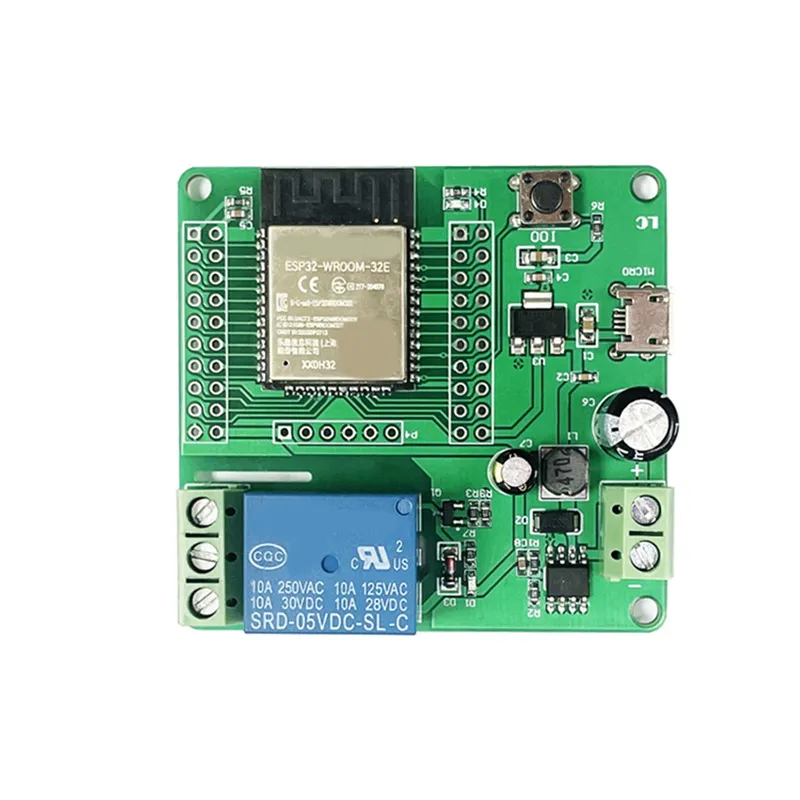

# ช่วงที่ 1 — ระบบสมองกลฝังตัวในฟาร์ม: รับรู้ ตัดสินใจ สั่งการ

**Input → Logic → Output**

ช่วงนี้เราทำให้ระบบ "รับรู้" และ "สั่งการ" ได้ก่อน โดยยังไม่ให้ระบบตัดสินใจเอง ปลายช่วงเราจะเป็นคนตัดสินใจเองโดยดูกราฟไปด้วย เพื่อให้เห็นว่าทำไมในช่วงต่อไปจึงอยากให้ระบบทำแทน

> **เมื่อจบช่วงนี้** เราจะอ่านค่าเซนเซอร์ทุกตัวบนบอร์ดได้จากแดชบอร์ด และสั่งปั๊มน้ำจากแล็ปท็อปและโทรศัพท์ได้

## ก่อนเริ่ม

Home Assistant ทำงานอยู่บนแล็ปท็อปของทีมเอง ต้องติดตั้งมาก่อนตามคู่มือที่ส่งให้ล่วงหน้า ตรวจสามอย่างนี้ก่อนรับอุปกรณ์

- [ ] เปิด Home Assistant บนแล็ปท็อปได้ (ที่อยู่ที่จดไว้ตอนติดตั้ง ปกติคือ `http://localhost:8123`) และเห็นหน้า **Overview**
- [ ] ต่อแล็ปท็อปเข้า **WiFi ของห้องอบรม** ตามชื่อและรหัสบนบัตรประจำทีม ไม่ใช่ WiFi ทั่วไปของสถานที่
- [ ] แบ่งบทบาท และเขียนชื่อลงตารางในใบบันทึก

{ width="60%" }

> หน้าจอตั้งเป็นภาษาอังกฤษไว้ เพื่อให้ชื่อเมนูตรงกับใบงานนี้ ถ้าติดตั้งไม่สำเร็จ ให้ยกมือตอนนี้เลย เพราะทุกกิจกรรมต้องใช้

---

## กิจกรรมที่ 1 — Sense

**35 นาที** · บอร์ด GoGo-IoT, สวิตช์ลูกลอยพร้อมตัวแปลงและสาย Grove, แก้วน้ำ, สาย USB-C, แล็ปท็อป

ทำให้ Home Assistant รู้จักบอร์ดเซนเซอร์ของทีม แล้วหาว่าเซนเซอร์แต่ละตัววัดอะไร และตัวไหนที่เราจะใช้ตัดสินใจ

### รู้จักบอร์ด GoGo-IoT

บอร์ดตัวนี้มีคอนโทรลเลอร์ ESP32-C3 และเซนเซอร์ในตัวห้าอย่าง คือ **อุณหภูมิ ความชื้นอากาศ แสง ความกดอากาศ และความเร่ง** นอกจากนั้นมีช่องต่อเซนเซอร์เพิ่มแบบ Grove เราจะต่อ **สวิตช์ลูกลอย** เข้าที่ **ช่อง 1** ซึ่งตั้งค่าไว้แล้วให้อ่านเป็นสัญญาณดิจิทัล

{ width="55%" }

1. **Hardware** เสียบสาย Grove จากตัวแปลงของสวิตช์ลูกลอยเข้า **ช่อง 1** บนบอร์ด
2. เสียบสาย USB-C เข้าบอร์ด แล้วเสียบอีกปลายเข้าช่อง USB ของแล็ปท็อป (ใช้เป็นไฟเลี้ยงเท่านั้น) รอ 30 วินาทีให้บอร์ดต่อ WiFi
3. วางสวิตช์ลูกลอยลงแก้วน้ำที่มีน้ำครึ่งแก้ว ให้ลูกลอยลอยขึ้น

### เพิ่มบอร์ดเข้า Home Assistant

1. **Driver** ไปที่ **Settings → Devices & services** กด **+ Add integration** มุมล่างขวา
2. ค้นหา **ESPHome** แล้วเลือก
3. ช่อง **Host** พิมพ์ IP ของบอร์ด GoGo-IoT จากบัตรประจำทีม กด **Submit**
4. ถ้าถาม **Encryption key** ให้พิมพ์รหัสจากบัตร แล้วกด **Finish**

{ width="55%" }

> **ถ้าไม่สำเร็จ** ตรวจสามอย่างตามลำดับ: แล็ปท็อปอยู่บน WiFi ห้องอบรมหรือไม่ · ไฟบนบอร์ดติดหรือไม่ · IP ตรงกับบัตรทุกตัวหรือไม่ ถ้ายังไม่ได้ให้ยกมือ

### หาว่าเซนเซอร์ตัวไหนวัดอะไร

กดเข้าไปที่อุปกรณ์ที่เพิ่งเพิ่ม จะเห็นรายการ entity แต่ละบรรทัดคือหนึ่งค่า สังเกตว่าสวิตช์ลูกลอยไม่ได้แสดงเป็นตัวเลข แต่แสดงเป็นสถานะสองอย่าง

**Hardware** ทำทีละอย่าง **Driver** ดูว่า entity ตัวไหนเปลี่ยน

| ทำอะไร | สังเกต |
|--------|--------|
| เป่าลมหายใจใส่บอร์ดช้า ๆ 5 วินาที | ความชื้นอากาศและอุณหภูมิ ขึ้นเท่าไร |
| ใช้มือครอบบอร์ดให้มืด | แสงลงเหลือเท่าไร แล้วเปิดมือ ค่ากลับมาเร็วแค่ไหน |
| เอียงบอร์ดไปมา | ความเร่งแกนไหนเปลี่ยน |
| ยกสวิตช์ลูกลอยขึ้นจากน้ำ แล้ววางกลับ | สถานะเปลี่ยนจากอะไรเป็นอะไร |

> **จดลงใบบันทึก** ค่าความชื้นอากาศปกติในห้องและตอนเป่า · ค่าแสงปกติและตอนครอบ · สถานะสวิตช์ลูกลอยตอนลอยและตอนยก ในช่วงที่ 2 เราจะใช้ค่าเหล่านี้ตั้งเกณฑ์

### เพิ่ม card บนแดชบอร์ด

1. กลับไป **Overview** กดไอคอนดินสอมุมบนขวา ถ้าถามว่าจะ **Take control** ให้กด แล้วเลือกเริ่มจากแดชบอร์ดว่าง
2. **+ Add card → Gauge** เลือก entity ความชื้นอากาศ กด Save
3. **+ Add card → History graph** เพิ่มความชื้นอากาศและแสง ตั้ง Hours to show เป็น 1 กด Save
4. **+ Add card → Entities** เพิ่ม entity ที่เหลือทั้งหมด รวมสวิตช์ลูกลอย กด Save แล้ว **Done**

{ width="60%" }

ลองครอบบอร์ดอีกครั้งแล้วดูกราฟแสง กราฟใช้เวลากี่วินาทีจึงตอบ

### เปิดดูข้างในบอร์ด

บอร์ดไม่ได้รู้เองว่าเซนเซอร์ตัวไหนต่ออยู่ที่ไหน มีไฟล์ตั้งค่า ESPHome บอกไว้ นี่คือส่วน "สมองกลฝังตัว" ของหัวข้อนี้ ดูเอกสารตั้งค่าที่แจก แล้วหาสามอย่าง

- เซนเซอร์ในตัวต่อผ่านบัสอะไร (มองหา `i2c`)
- ช่อง 1 ตั้งค่าเป็นอะไร (มองหา `binary_sensor` และ `pin`)
- บอร์ดส่งค่าให้ Home Assistant ทุกกี่วินาที (มองหา `update_interval`) แต่ละเซนเซอร์เท่ากันหรือไม่

{ width="55%" }

### อ่านสเปก

ดูสเปกที่แจก แล้วเทียบกับที่เราเห็นจริง

- **เซนเซอร์ความชื้นอากาศ** ช่วงการวัด · ความแม่นยำ (± กี่ %RH) · ค่าที่เราเห็นแกว่งอยู่ในช่วงความแม่นยำนั้นหรือไม่
- **สวิตช์ลูกลอย** ทนกระแสและแรงดันได้เท่าไร · วัสดุ · ปิดวงจรเมื่อลอยขึ้นหรือลง

> สวิตช์ลูกลอยไม่ได้บอกว่าน้ำมีเท่าไร บอกได้อย่างเดียวว่าน้ำถึงระดับนี้หรือไม่ถึง เซนเซอร์แบบนี้เรียกว่าเซนเซอร์ **ดิจิทัล** ส่วนความชื้นและแสงที่ให้ตัวเลขต่อเนื่องเรียกว่า **แอนะล็อก** ความต่างนี้จะสำคัญมากในช่วงที่ 2

**คำถามของ Recorder** ในระบบรดน้ำของเรา ค่าไหนที่จะใช้ตัดสินใจว่าต้องรดน้ำ และสวิตช์ลูกลอยมีไว้บอกอะไร

---

## บรรยาย: actuator และการขับโหลด

**25 นาที** · ไม่ต้องแตะอุปกรณ์ ฟังและจดสามอย่างลงใบบันทึก: ทำไมบอร์ดสั่งปั๊มตรงไม่ได้ · พิกัดบนตัวรีเลย์อ่านอย่างไร · สวิตช์ Auto / Off / Manual ที่ตู้ควบคุมปั๊มมีไว้ทำไม

---

## กิจกรรมที่ 2 — Act

**40 นาที** · บอร์ดรีเลย์, ตัวควบคุมการชาร์จ, adapter 12V, สายไฟ, แผงต่อสาย, ปั๊มตู้ปลา 12V พร้อมสายยาง, ภาชนะน้ำ 2 ใบ, ถาดรอง, โทรศัพท์ 1 เครื่อง

> **สลับบทบาทก่อนเริ่ม**

ทำให้ Home Assistant สั่งปั๊มได้ แล้วสูบน้ำจากภาชนะหนึ่งไปอีกใบ นี่คือครั้งเดียวในหลักสูตรที่เราต่อสายไฟด้วยมือ ทำช้า ๆ ตามลำดับ

### รู้จักบอร์ดรีเลย์

บอร์ดรีเลย์เป็นบอร์ดคนละตัวกับบอร์ดเซนเซอร์ มีคอนโทรลเลอร์ของตัวเอง (ESP32-C6) และมีขั้วต่อสองกลุ่ม

- **ขั้วไฟเข้า** รับไฟ 7–60V มาเลี้ยงตัวบอร์ด บอร์ดนี้จึงไม่ต้องใช้สาย USB จากแล็ปท็อปเลย
- **ขั้วรีเลย์** สามขั้ว พิมพ์ไว้ว่า **NC**, **COM** และ **NO** เราใช้ **COM** กับ **NO** เพื่อให้วงจรเปิดอยู่ (ปั๊มดับ) เมื่อรีเลย์ไม่ทำงาน
- **ไฟ LED** แสดงสถานะรีเลย์ ติดเมื่อรีเลย์ทำงาน

{ width="55%" }

### กล่องจ่ายไฟ 12V

บอร์ดรีเลย์อยู่ปลายโต๊ะฝั่งน้ำ ห่างจากแล็ปท็อป และปั๊มต้องใช้ไฟ 12V อยู่แล้ว เราจึงจ่ายไฟให้ทั้งสองอย่างจากกล่องเดียว คือ **ตัวควบคุมการชาร์จ** ที่มี adapter 12V ต่ออยู่แทนแบตเตอรี่ ตอนนี้ให้มองเป็นกล่องจ่ายไฟที่มี **ขั้วออก 12V หนึ่งคู่** (สัญลักษณ์หลอดไฟ คู่ขวาสุด) และ **ช่อง USB** เราจะเปิดดูว่าข้างในทำอะไรในช่วงที่ 3

{ width="50%" }

### ต่อสาย

**adapter ต้องยังไม่เสียบปลั๊กจนถึงขั้นสุดท้าย** Hardware ต่อสาย Recorder อ่านทีละข้อและตรวจว่าทำครบก่อนอ่านข้อถัดไป

1. สาย adapter 12V เข้า **คู่กลาง** (สัญลักษณ์แบตเตอรี่) ของตัวควบคุม สายแดงเข้าบวก สายดำเข้าลบ
2. จาก **คู่ขวา** (สัญลักษณ์หลอดไฟ) ของตัวควบคุม เดินสายสองเส้นไปยัง **แผงต่อสาย** บวกเข้าแถวบวก ลบเข้าแถวลบ แผงนี้คือจุดกระจายไฟ 12V ของเรา
3. จากแถวบวกไป **ขั้วไฟเข้า +** ของบอร์ดรีเลย์ จากแถวลบไป **ขั้วไฟเข้า −** สองเส้นนี้เลี้ยงตัวบอร์ด
4. จากแถวบวกอีกเส้นไป **COM** ของรีเลย์ แล้วจาก **NO** ไปยังสายบวกของปั๊ม
5. สายลบของปั๊มเข้าแถวลบของแผงต่อสาย
6. ตรวจทุกสกรูแน่น ไม่มีปลายสายเปลือยแตะกัน ไม่มีสายเข้าขั้ว **NC**

{ width="65%" }

> **ทำไมตัดวงจรที่สายบวกเส้นเดียว** วงจรจะเดินได้ต้องครบวง ตัดที่จุดเดียวก็พอ และเราเลือกตัดด้านบวก เพื่อให้สายลบทุกเส้นต่อถึงกันเป็นกราวด์ร่วม นี่คือวิธีที่ตู้ควบคุมปั๊มจริงทำเช่นกัน แค่แรงดันสูงกว่า

### เปิดไฟและเพิ่มบอร์ดรีเลย์เข้า Home Assistant

1. วางภาชนะสองใบบนถาดรอง เติมน้ำใบ A ค่อนใบ ใบ B ว่าง จุ่มปั๊มลงใบ A ให้จมทั้งตัว วางปลายสายยางลงใบ B แล้วหนีบไว้ ปั๊มต้องอยู่ในน้ำก่อนมีโอกาสเดิน
2. ย้ายสวิตช์ลูกลอยจากแก้วมาไว้ในใบ A ด้วย ตั้งแต่นี้ใบ A คือ **ถังน้ำต้นทาง** ของระบบ และลูกลอยคอยบอกว่าน้ำในถังยังพอหรือไม่
3. **เสียบ adapter เข้ารางปลั๊ก** จอตัวควบคุมควรติดและแสดงแรงดัน ไฟบนบอร์ดรีเลย์ควรติด รอ 30 วินาทีให้บอร์ดต่อ WiFi
4. **Driver** ทำเหมือนเดิม: **Settings → Devices & services → + Add integration → ESPHome** แล้วพิมพ์ IP ของ **บอร์ดรีเลย์**
5. เข้าไปที่อุปกรณ์ จะเห็น entity ประเภท **switch** กดให้เป็น On หนึ่งวินาที แล้ว Off
6. **Hardware** ดูไฟ LED บนบอร์ด ฟังเสียงคลิก และดูว่าปั๊มกระตุกหรือไม่

> **จดลงใบบันทึก** แรงดันที่จอตัวควบคุมแสดง

> เสียงคลิกคือหน้าสัมผัสกลไกในรีเลย์กำลังปิดและเปิดวงจร ไฟ LED บอกสิ่งเดียวกันด้วยสายตา ถ้าจอตัวควบคุมไม่ติด หรือบอร์ดรีเลย์ไม่ติด ให้ถอด adapter ก่อน แล้วตรวจการต่อสายข้อ 1 ถึง 6 ใหม่

### สั่งจากแดชบอร์ดและโทรศัพท์

1. **Overview** → ดินสอ → **+ Add card → Entities** เพิ่ม entity สวิตช์ปั๊ม → Save → Done
2. กดสวิตช์บนแดชบอร์ดเป็น On นับ 10 วินาที แล้ว Off ดูว่าน้ำไหลจาก A ไป B หรือไม่ นี่คือหลักฐานว่า Output ของเราทำงานจริง
3. **Hardware** เทน้ำจากใบ B กลับใบ A แล้ว **ย้ายปลายสายยางมาลงใบ A** ตั้งแต่นี้น้ำจะวนอยู่ในถังเดียว ปั๊มจึงเดินได้นานเท่าไรก็ได้โดยน้ำไม่หมด ใบ B ไม่ใช้อีก
4. สมาชิกอีกคนต่อโทรศัพท์เข้า WiFi ห้องอบรม เปิดที่อยู่ Home Assistant ของแล็ปท็อปทีม (ดูจากบัตรประจำทีม หรือถามผู้สอน) แล้วกดสวิตช์จากโทรศัพท์
5. สั่งสลับกันจากสองเครื่อง สังเกตว่าทั้งสองจอแสดงสถานะเดียวกันเสมอ

{ width="60%" }

> สถานะจริงอยู่ที่ Home Assistant ไม่ได้อยู่ที่หน้าจอ แล็ปท็อปและโทรศัพท์เป็นเพียงหน้าต่างมองเข้าไป
> ถ้าโทรศัพท์เปิดไม่ได้ มักเป็นเพราะไฟร์วอลล์ของแล็ปท็อป ให้ข้ามข้อนี้ไปก่อนแล้วบอกผู้สอน

**คำถามของ Recorder** ถ้าเปลี่ยนเป็นปั๊มบ่อ 220V ในฟาร์มจริง ต้องเปลี่ยนอะไรบ้างในสิ่งที่เราเพิ่งต่อ และใครควรเป็นคนต่อ

---

## เป็น Logic ด้วยตัวเอง

**20 นาที** · ตอนนี้ระบบมี Input และ Output ครบแล้ว แต่ Logic ยังเป็น **คน** ลองเป็น Logic เองสักครู่

ในห้องนี้เราจำลองสถานการณ์: **ความชื้นอากาศต่ำ = อากาศแห้ง แปลงต้องการน้ำ** เซนเซอร์ความชื้นอากาศทำหน้าที่แทนเซนเซอร์ความชื้นดินที่ฟาร์มจริงจะใช้ และ **สวิตช์ลูกลอยอยู่ในถังน้ำต้นทาง** บอกว่าน้ำเหลือพอให้ปั๊มดูดหรือไม่

1. ทีมตกลง **ค่าเกณฑ์** ความชื้นอากาศที่ถือว่าแห้ง ตั้งให้ **สูงกว่าค่าปกติในห้องเล็กน้อย** (ราว 2–3 %) เพื่อให้อากาศในห้องนับว่า "แห้ง" และการเป่าลมนับว่า "ชื้นพอแล้ว" ไม่อย่างนั้นจะไม่มีอะไรให้ตัดสินใจ
2. **Driver** เฝ้าเกจความชื้น ตราบใดที่ค่าต่ำกว่าเกณฑ์ ให้เปิดปั๊ม 5 วินาทีแล้วปิด รอ 10 วินาที แล้วดูใหม่
3. **Hardware** เป่าลมใส่บอร์ดเป็นระยะ เพื่อจำลองอากาศชื้น แล้วดูว่า Driver หยุดรดน้ำหรือไม่ และกลับมารดอีกเมื่อค่าตกลง
4. ขณะปั๊มเดิน **Hardware** ยกสวิตช์ลูกลอยขึ้นจากน้ำ (น้ำหมด) แล้วดูว่า Driver สั่งอะไร

> **จดลงใบบันทึก** ค่าเกณฑ์ที่เลือก · Driver ตัดสินใจถูกกี่ครั้งใน 5 นาที · ตอนยกลูกลอย Driver ปิดปั๊มภายในกี่วินาที

### มาคิดด้วยกัน

1. ถ้าอากาศแห้งตอนตีสาม ใครจะเป็นคนเปิดปั๊ม
2. เราเพิ่งทำหน้าที่ Logic เอง กฎในหัวของเราคืออะไร เขียนเป็นประโยค **"ถ้า ... ให้ ..."** สองข้อ ข้อหนึ่งเรื่องความชื้น อีกข้อเรื่องลูกลอย
3. ถ้าปั๊มเปิดค้างเพราะเราลืม จะเกิดอะไรกับปั๊มเมื่อน้ำในถังหมด

ในช่วงที่ 2 เราจะย้ายกฎทั้งสองข้อเข้า Home Assistant แล้วตอบข้อ 3 ด้วย fail-safe

---

## ก่อนออกจากห้อง

Home Assistant บนแล็ปท็อปจะกลับบ้านไปกับเรา แต่บอร์ดเซนเซอร์ของทีม **อยู่ในห้องต่อ** ผู้สอนได้เพิ่มบอร์ดของทุกทีมเข้าเครื่อง Home Assistant กลางไว้แล้ว เครื่องนั้นจะจดค่าต่อเนื่องระหว่างที่เราไม่อยู่ และเมื่อเริ่มช่วงที่ 2 เราจะเปิดดูข้อมูลของทีมเราจากเครื่องนั้น

บอร์ดเซนเซอร์ตอนนี้กินไฟจากแล็ปท็อป จึงต้องย้ายไปใช้ไฟจากกล่องจ่ายไฟแทน

- [ ] สั่งสวิตช์ปั๊มเป็น **Off** และตรวจบนแดชบอร์ดว่าเป็น Off จริง
- [ ] ยกปั๊มขึ้นจากน้ำ วางบนถาด เช็ดน้ำบนโต๊ะ สวิตช์ลูกลอยยังอยู่ในใบ A
- [ ] ถอดสาย USB-C ของบอร์ด GoGo-IoT ออกจากแล็ปท็อป แล้วเสียบเข้า **ช่อง USB ของตัวควบคุมการชาร์จ** รอให้ไฟบอร์ดติดและค่ากลับมาขึ้นบนแดชบอร์ด บอร์ดจะอยู่ที่ช่องนี้ไปตลอดหลักสูตร
- [ ] **adapter ยังเสียบอยู่** กล่องจ่ายไฟต้องทำงานทั้งคืน บอร์ดรีเลย์จะติดไฟด้วยแต่ไม่มีใครสั่ง ปั๊มจึงไม่เดิน
- [ ] แล็ปท็อปปิดได้ตามปกติ

---

## สรุปช่วงที่ 1

1. **ระบบอัตโนมัติมีสามส่วนเสมอ** Input รับรู้ Logic ตัดสินใจ Output สั่งการ ถังน้ำลูกลอยก็ครบสามส่วน เพียงแต่ Logic เป็นกลไก
2. **เซนเซอร์มีสองแบบ** แอนะล็อกให้ตัวเลขต่อเนื่อง ดิจิทัลบอกได้แค่ถึงหรือไม่ถึง ทั้งสองแบบมีที่ใช้
3. **บอร์ดสั่งโหลดตรงไม่ได้** ต้องมีรีเลย์เป็นตัวกลาง และโหลดต้องมีไฟของตัวเอง
4. **ทุก actuator ต้องมี manual override** สวิตช์ Auto / Off / Manual คือมาตรฐาน ไม่ใช่ของแถม
5. **สถานะจริงอยู่ที่ Logic** ไม่ได้อยู่ที่หน้าจอ

ต่อไป: [ช่วงที่ 2 — ตรรกะควบคุมอัตโนมัติและการออกแบบ Fail-safe สำหรับฟาร์ม](session-2.md)
