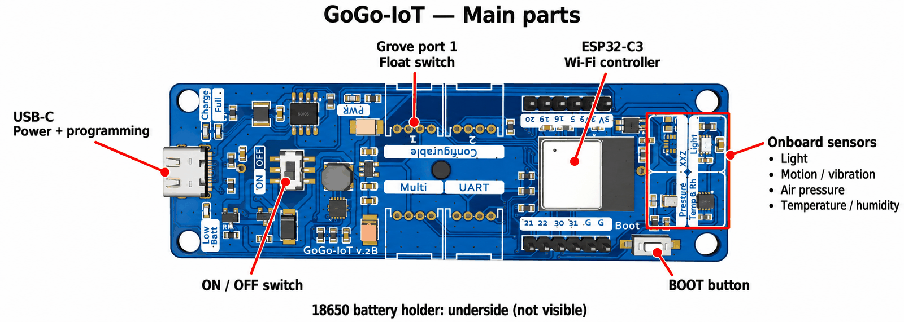
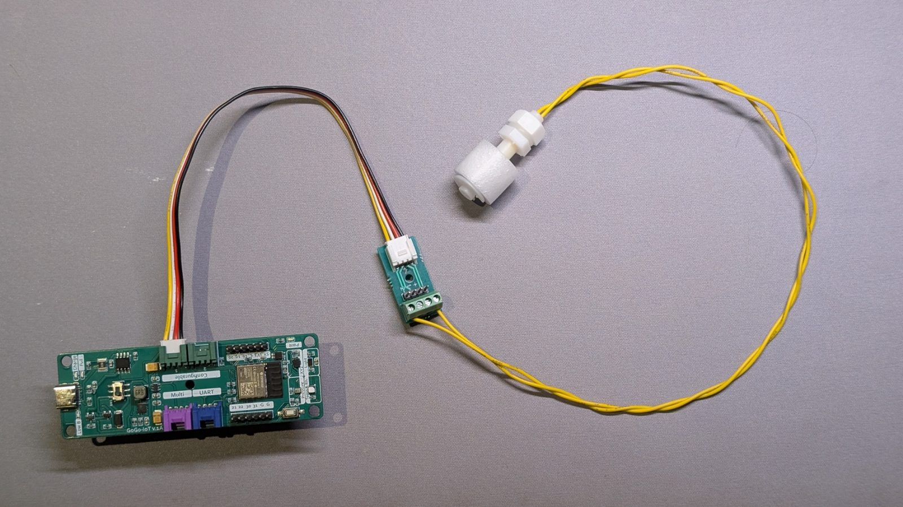
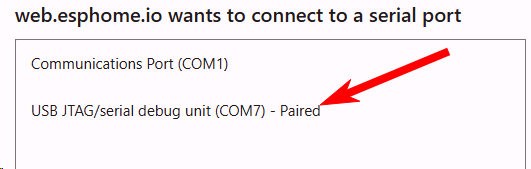
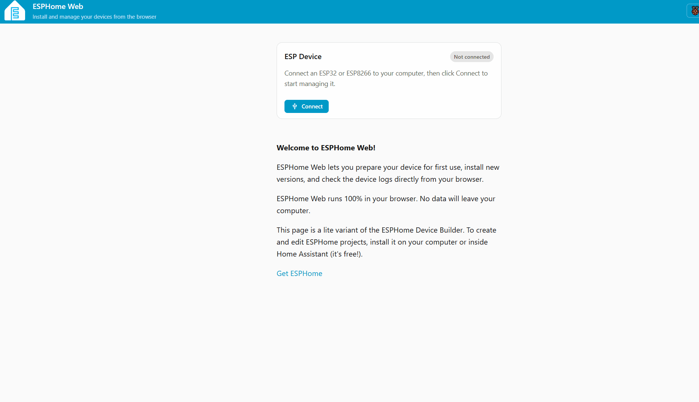
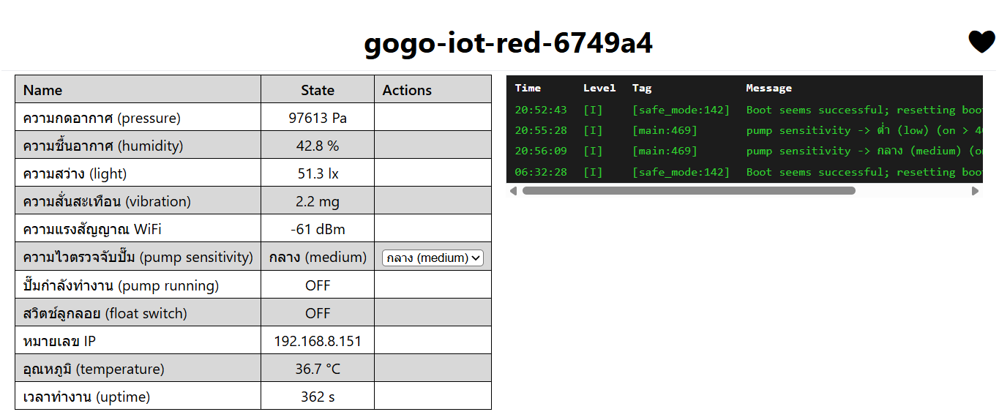
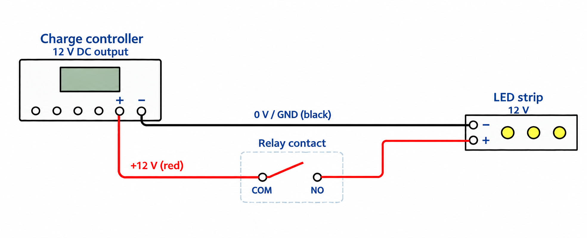
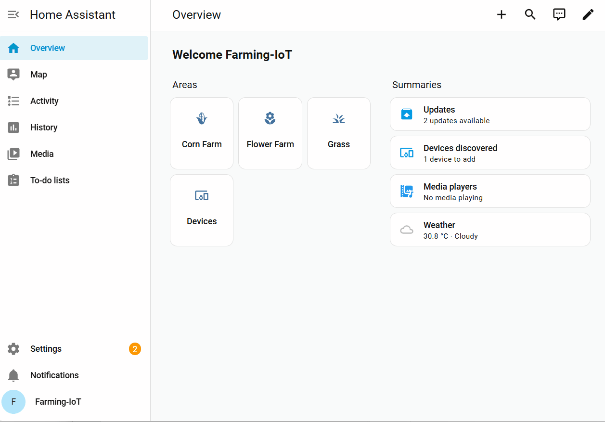

# ช่วงที่ 1 — ระบบสมองกลฝังตัวในฟาร์ม: รับรู้ ตัดสินใจ สั่งการ

**รับข้อมูล → ตัดสินใจ → สั่งงาน (Input → Logic → Output)**

ช่วงนี้เราจะเริ่มจากอ่านค่าเซนเซอร์ผ่านหน้าเว็บของบอร์ด แล้วทดลองสั่งรีเลย์และต่อวงจรหลอดไฟ 12V จากนั้นจึงเพิ่มบอร์ดทั้งสองเข้า Home Assistant เพื่อดูค่าและสั่งงานจากหน้าจอเดียวกัน สุดท้ายจะเลือกเกณฑ์ความสว่าง เขียนกฎเปิด–ปิดไฟ และให้ระบบทำงานตามกฎ ส่วนปั๊มน้ำจะเริ่มใช้ในช่วงที่ 2

> **เมื่อจบช่วงนี้** เราจะอ่านค่าเซนเซอร์ที่ใช้ในการทดลองได้ เปิด–ปิดหลอดไฟจากแล็ปท็อปและโทรศัพท์ได้ และสร้างกฎอัตโนมัติสองกฎให้ไฟเปิดเมื่อมืดและปิดเมื่อสว่างได้

## เตรียมพร้อมก่อนเริ่ม

ตรวจรายการต่อไปนี้ให้ครบก่อนเริ่มกิจกรรม เลือกสมาชิกหนึ่งคนเป็นผู้บันทึกคำตอบ และใช้เบราว์เซอร์เดิมบนเครื่องเดิมตลอดการอบรม คำตอบในใบงานและ[ใบบันทึกของกลุ่ม](record-sheet.md) จะตรงกันเมื่อเปิดบนเบราว์เซอร์เดียวกัน

- [ ] กรอกหมายเลขกลุ่ม {{f:team.no|4}} และเลือกโซนที่ได้รับมอบหมาย {{r:team.zone|แดง|เขียว|น้ำเงิน}}
- [ ] เชื่อมต่อแล็ปท็อปกับ WiFi **ของโซนกลุ่ม** ชื่อ `farm-laptop-red`, `farm-laptop-green` หรือ `farm-laptop-blue` ตามสีโซน
- [ ] เลือกแล็ปท็อปหนึ่งเครื่องสำหรับเปิด Home Assistant และให้ตัวแทนกลุ่มดูแลเครื่องนี้
- [ ] เปิด VirtualBox เลือกเครื่อง **Farm Workshop** แล้วกด **Start** รอจนหน้าจอแสดง **หมายเลข IP** ของเครื่อง บันทึกเฉพาะหมายเลข IP ในช่องนี้: `http://`{{f:ha.ip1|15}} จากนั้นเปิดที่อยู่นี้ในเบราว์เซอร์ เช่น `http://192.168.1.50` เมื่อเห็นหน้าเข้าสู่ระบบ (Login) ให้เปิดแท็บค้างไว้สำหรับกิจกรรมที่ 3
- [ ] แนะนำตัวกันในกลุ่ม แล้วช่วยกันเขียน **ปัญหาในฟาร์มที่อยากแก้** สั้น ๆ หนึ่งประโยค โดยยังไม่ต้องเสนอวิธีแก้ หากไม่มีสมาชิกที่ทำฟาร์ม ให้เลือกปัญหาจากฟาร์มที่รู้จัก เราจะนำปัญหานี้มาออกแบบระบบในช่วงที่ 3 {{ta:farm.problem}}

{ width="60%" }

---

## กิจกรรมที่ 1 — รู้จักและทดลองอ่านค่าเซนเซอร์ (Sense)

**35 นาที**

**อุปกรณ์ที่ใช้** บอร์ด GoGo-IoT, สวิตช์ลูกลอยพร้อมตัวแปลงและสาย Grove, แก้วน้ำ, สาย USB-C, แล็ปท็อป

เราจะเปิดหน้าเว็บของบอร์ดเพื่อดูค่าเซนเซอร์ แล้วทดลองเปลี่ยนสภาพรอบบอร์ดทีละอย่าง สังเกตว่าค่าใดเปลี่ยนไป และคิดว่าจะนำค่านั้นไปใช้ตัดสินใจเรื่องใดในฟาร์มได้บ้าง

### ใบงาน { #a1 }

คลิกชื่อหัวข้อเพื่อดูวิธีทำ เมื่อทำเสร็จให้ทำเครื่องหมายและบันทึกผลในช่องที่กำหนด กรอกที่นี่หรือในขั้นตอนด้านล่างก็ได้ คำตอบจะปรากฏทั้งสองจุด

- [ ] **[1.1 รู้จักบอร์ดและต่อสวิตช์ลูกลอย](#a1-1)** เสียบสาย Grove ของลูกลอยเข้าช่อง 1 เสียบ USB จากบอร์ดเข้าแล็ปท็อป แล้ววางลูกลอยในแก้วน้ำ
- [ ] **[1.2 อ่านชื่อและหมายเลข IP ของบอร์ด](#a1-2)** ชื่อบอร์ด {{f:board.iot.name|22}} IP {{f:board.iot.ip|15}} ตรวจว่าสีในชื่อบอร์ดตรงกับสีโซนของกลุ่ม
- [ ] **[1.3 เปิดหน้าเว็บของบอร์ด](#a1-3)** พิมพ์ `http://` ตามด้วย IP ของบอร์ด แล้วดูรายการค่าจากบอร์ด
- [ ] **[1.4 ทดลองอ่านค่าเซนเซอร์](#a1-4)** ค่าปกติในห้องและค่าเมื่อทดสอบ
    - ความชื้นอากาศ {{n:s1.hum.room}} % เป่าลมแล้ว {{n:s1.hum.test}} %
    - อุณหภูมิ {{n:s1.temp.room}} °C เป่าลมแล้ว {{n:s1.temp.test}} °C
    - แสง {{n:s1.light.room}} ใช้มือครอบแล้ว {{n:s1.light.test}}
    - ความสั่นสะเทือน {{n:s1.vib.room}} mg เคาะโต๊ะแล้ว {{n:s1.vib.test}} mg
    - สวิตช์ลูกลอย เมื่อวางในน้ำ {{f:s1.float.rest|4}} เมื่อยกพ้นน้ำ {{f:s1.float.lift|4}}
- [ ] **[1.5 สังเกตเวลาตอบสนอง](#a1-4b)** ครอบบอร์ดแล้ว ค่าแสงบนหน้าเว็บเปลี่ยนภายในกี่วินาที {{n:s1.light.delay|3}}
- [ ] **[คำถามท้ายกิจกรรม](#a1-q)** หากจะสร้างระบบรดน้ำ เราควรวัดค่าอะไรเพื่อช่วยตัดสินใจว่าจะรดน้ำเมื่อไร และสวิตช์ลูกลอยช่วยบอกข้อมูลอะไรได้บ้าง {{ta:s1.q1}}

### 1.1 รู้จักบอร์ดและต่อสวิตช์ลูกลอย { #a1-1 }

บอร์ดตัวนี้มีคอนโทรลเลอร์ ESP32-C3 และเซนเซอร์ในตัวสำหรับวัดห้าค่า ได้แก่ **อุณหภูมิ ความชื้นอากาศ แสง ความกดอากาศ และความเร่ง** (บอร์ดแปลงความเร่งเป็นค่า **ความสั่นสะเทือน** ให้เราแล้ว) นอกจากนั้นมีช่องต่อเซนเซอร์เพิ่มแบบ Grove เราจะต่อ **สวิตช์ลูกลอย** เข้าที่ **ช่อง 1** ซึ่งตั้งค่าไว้แล้วให้อ่านเป็นสัญญาณดิจิทัล

{ width="100%" }

ตำแหน่งอุปกรณ์ในภาพ: **USB-C** ใช้จ่ายไฟและเชื่อมต่อคอมพิวเตอร์ · **ON / OFF** คือสวิตช์เปิด–ปิดบอร์ด · **Grove port 1** ใช้ต่อสวิตช์ลูกลอย · กรอบสีแดงด้านขวาคือกลุ่มเซนเซอร์ในตัว · ช่องใส่ถ่าน **18650 อยู่ด้านใต้บอร์ด** จึงไม่ปรากฏในภาพ

{ width="75%" }

1. เสียบสาย Grove จากตัวแปลงของสวิตช์ลูกลอยเข้า **ช่อง 1** บนบอร์ด
2. เสียบสาย USB-C เข้าบอร์ด แล้วเสียบอีกปลายเข้าช่อง USB ของแล็ปท็อป
3. วางสวิตช์ลูกลอยลงแก้วน้ำที่มีน้ำครึ่งแก้ว ให้ลูกลอยลอยขึ้น

[↑ กลับไปที่ใบงาน](#a1){ .ws-back }

### 1.2 อ่านชื่อและหมายเลข IP ของบอร์ด { #a1-2 }

1. เปิด **Chrome** หรือ **Edge** ไปที่ **[web.esphome.io](https://web.esphome.io)** (Firefox, Safari ใช้ไม่ได้)
2. กด **Connect** เลือกพอร์ตที่ปรากฏขึ้น แล้วกดยืนยัน (เลข COM อาจไม่เหมือนในภาพ)

    { width="60%" }

3. กด **Logs & Console** แล้วกดปุ่ม **Reset device** ในหน้าเว็บ (ไม่ใช่ปุ่มบนบอร์ด) บอร์ดจะเริ่มทำงานใหม่ และแสดงข้อความสำคัญสองบรรทัดในหน้าต่างบันทึกการทำงาน (log) บรรทัดแรก ๆ คือ `=====  DEVICE NAME: ...  =====` ตัวอย่างชื่อคือ `gogo-iot-red-a1b2c3` และอีกราว 10–20 วินาทีต่อมา หลังบอร์ดต่อ WiFi ได้ จะมี `=====  IP ADDRESS: ...  =====` ตามมา
4. **ตรวจชื่อบอร์ด** ชื่อต้องตรงกับโซนของเรา (`red` / `green` / `blue`) ถ้าไม่ตรง บอร์ดนี้จะเชื่อมต่อเครือข่ายของโซนเราไม่ได้ ให้ยกมือขอเปลี่ยนบอร์ด
5. **จดชื่อและหมายเลข IP** ชื่อบอร์ด {{f:board.iot.name|22}} IP {{f:board.iot.ip|15}} แล้วปิดหน้าต่างนี้

{ width="60%" }

> ถ้าหน้าต่าง log ว่างเปล่า หรือชื่อเลื่อนผ่านไปแล้ว ให้กดปุ่ม **Reset device** ในหน้าเว็บอีกครั้ง **อย่าถอดสาย USB และอย่ากดปุ่มบนบอร์ด** สองอย่างนั้นจะตัดการเชื่อมต่อของเบราว์เซอร์ และชื่อจะไม่ขึ้น
> ถ้าเห็นชื่อแต่ไม่เห็นหมายเลข IP ภายในหนึ่งนาที แปลว่าบอร์ดต่อ WiFi ไม่ได้ ตรวจสีในชื่ออีกครั้ง แล้วยกมือ

[↑ กลับไปที่ใบงาน](#a1){ .ws-back }

### 1.3 เปิดหน้าเว็บของบอร์ด { #a1-3 }

บอร์ดมีหน้าเว็บสำหรับแสดงค่าในตัว เรียกว่า **เว็บเซิร์ฟเวอร์** เราจึงเปิดดูค่าผ่านเบราว์เซอร์ได้โดยตรงเมื่อเชื่อมต่อ WiFi โซนเดียวกัน โดยยังไม่ต้องใช้ Home Assistant

1. เปิดแท็บใหม่ พิมพ์ `http://` ตามด้วยหมายเลข IP ที่จดไว้ เช่น `http://192.168.10.57`
2. จะเห็นรายการค่าจากบอร์ด แต่ละรายการเรียกว่า **entity** เช่น ค่าความสว่างหรือสถานะสวิตช์ลูกลอย ค่าจะอัปเดตเองโดยไม่ต้องรีเฟรช สังเกตว่าสวิตช์ลูกลอยไม่ได้แสดงเป็นตัวเลข แต่แสดงเป็นสถานะสองอย่าง รายการที่เกี่ยวกับ **ปั๊ม** (ปั๊มกำลังทำงาน และความไวตรวจจับปั๊ม) ปล่อยไว้ก่อน เราจะใช้ในช่วงที่ 2

{ width="100%" }

> ถ้าเปิดไม่ขึ้น ตรวจว่าแล็ปท็อปอยู่บน `farm-laptop-สีเดียวกัน` กับสีในชื่อบอร์ด เพราะหน้านี้อยู่บนตัวบอร์ด ไม่ได้อยู่บนอินเทอร์เน็ต

[↑ กลับไปที่ใบงาน](#a1){ .ws-back }

### 1.4 ทดลองอ่านค่าเซนเซอร์ { #a1-4 }

บันทึกค่าขณะวางบอร์ดไว้ตามปกติก่อน จากนั้นให้สมาชิกคนหนึ่งทดลองตามตารางทีละอย่าง อีกคนสังเกตและบันทึกค่าบนหน้าเว็บ รอให้ค่ากลับมาใกล้เคียงเดิมก่อนเริ่มการทดลองถัดไป

| ทำอะไร | สังเกต |
|--------|--------|
| เป่าลมหายใจใส่บอร์ดช้า ๆ 5 วินาที | ความชื้นอากาศและอุณหภูมิเปลี่ยนไปเท่าไร |
| ใช้มือครอบบอร์ดให้มืด | ค่าความสว่างลดลงเหลือเท่าไร เมื่อเอามือออก ค่ากลับมาใกล้เคียงเดิมหรือไม่ |
| เคาะโต๊ะข้างบอร์ด หรือเขย่าบอร์ดเบา ๆ | ค่าความสั่นสะเทือนเพิ่มขึ้นถึงเท่าไร เมื่อวางนิ่งแล้ว ลดลงเหลือเท่าไร (หน่วย mg) |
| ยกสวิตช์ลูกลอยขึ้นจากน้ำ แล้ววางกลับ | สถานะเปลี่ยนจากอะไรเป็นอะไร (หน้าเว็บของบอร์ดใช้คำว่า **ON** = น้ำถึงระดับลูกลอย **OFF** = น้ำต่ำกว่าระดับลูกลอย) |

> **บันทึกผล** ค่าที่อ่านได้จากหน้าเว็บของบอร์ด ค่าแสงจะใช้ตั้งเกณฑ์ในกิจกรรมที่ 3 ส่วนค่าความชื้นอากาศจะใช้ในช่วงที่ 2

| เซนเซอร์ | ค่าปกติในห้อง | ค่าเมื่อทดสอบ | ทดสอบด้วยวิธี |
|----------|---------------|---------------|---------------|
| ความชื้นอากาศ | {{n:s1.hum.room}} % | {{n:s1.hum.test}} % | เป่าลม |
| อุณหภูมิ | {{n:s1.temp.room}} °C | {{n:s1.temp.test}} °C | เป่าลม |
| แสง | {{n:s1.light.room}} | {{n:s1.light.test}} | ใช้มือครอบบอร์ด |
| ความสั่นสะเทือน | {{n:s1.vib.room}} mg | {{n:s1.vib.test}} mg | เคาะโต๊ะ / เขย่า |
| สวิตช์ลูกลอย | วางในน้ำ: {{f:s1.float.rest|4}} | ยกพ้นน้ำ: {{f:s1.float.lift|4}} | ยกขึ้นจากน้ำ |

[↑ กลับไปที่ใบงาน](#a1){ .ws-back }

> **ค่าตัวเลขกับสถานะต่างกันอย่างไร** ความชื้นและความสว่างบอกปริมาณเป็นตัวเลข ส่วนสวิตช์ลูกลอยบอกได้เพียงว่าน้ำถึงระดับที่ติดตั้งไว้หรือไม่ ไม่ได้บอกปริมาตรน้ำที่เหลือ ในหน้าเว็บของบอร์ดจะเห็น **ON / OFF** ส่วน Home Assistant จะแสดง **Wet / Dry** ตามลำดับ ข้อมูลทั้งหมดที่เราเห็นบนหน้าเว็บถูกส่งมาในรูปแบบดิจิทัล แม้ค่าบางชนิดจะใช้แทนปริมาณที่เปลี่ยนแปลงต่อเนื่องก็ตาม

### 1.5 สังเกตเวลาตอบสนอง { #a1-4b }

ใช้มือครอบบอร์ดอีกครั้ง แล้วนับเวลาตั้งแต่เริ่มครอบจนค่าแสงบนหน้าเว็บเปลี่ยนไป บันทึกเวลาที่สังเกตได้ {{n:s1.light.delay|3}} วินาที

บอร์ดอ่านและส่งค่าเป็นระยะ จึงอาจต้องรอสักครู่กว่าจะเห็นค่าเปลี่ยนบนหน้าจอ ใช้เวลาที่วัดได้นี้ประกอบการทดสอบกฎในกิจกรรมที่ 3 และช่วงที่ 2 อย่าเพิ่งสรุปว่ากฎไม่ทำงานทันทีที่ครอบบอร์ด

[↑ กลับไปที่ใบงาน](#a1){ .ws-back }

**คำถามท้ายกิจกรรม** หากจะสร้างระบบรดน้ำ เราควรวัดค่าอะไรเพื่อช่วยตัดสินใจว่าจะรดน้ำเมื่อไร และสวิตช์ลูกลอยช่วยบอกข้อมูลอะไรได้บ้าง
{: #a1-q }

{{ta:s1.q1}}

---

## กิจกรรมที่ 2 — ต่อวงจรและสั่งงานหลอดไฟ (Act)

**40 นาที**

**อุปกรณ์ที่ใช้** บอร์ดรีเลย์, กล่องจ่ายไฟ (charge controller), อะแดปเตอร์ 12V, สาย USB-C, แล็ปท็อป, สายไฟ, เต๋าต่อสาย, หลอด LED 12V, ไขควง

เริ่มจากลองสั่งรีเลย์โดยยังไม่ต่อหลอดไฟ เพื่อสังเกตการทำงานของสวิตช์ จากนั้นจึงต่อแหล่งจ่ายไฟและหลอดไฟ แล้วทดสอบว่าคำสั่งบนหน้าเว็บควบคุมหลอดไฟได้จริง

### ใบงาน { #a2 }

คลิกชื่อหัวข้อเพื่อดูวิธีทำ เมื่อทำเสร็จให้ทำเครื่องหมายและบันทึกผลในช่องที่กำหนด กรอกที่นี่หรือในขั้นตอนด้านล่างก็ได้ คำตอบจะปรากฏทั้งสองจุด

- [ ] **[2.1 รู้จักบอร์ดรีเลย์](#a2-1)** ให้ทุกคนในกลุ่มชี้บนบอร์ดจริงว่าขั้วใดต่อไฟไปหลอดไฟ และขั้วใดห้ามต่อสาย
- [ ] **[2.2 อ่านชื่อและหมายเลข IP แล้วลองสั่งรีเลย์](#a2-1b)** ชื่อบอร์ด {{f:board.relay.name|22}} IP {{f:board.relay.ip|15}} สั่งรีเลย์จากสวิตช์บนหน้าเว็บและจากปุ่มบนบอร์ด แล้วถอดปลายสาย USB ออกจากแล็ปท็อป
- [ ] **[2.3 รู้จักกล่องจ่ายไฟและวงจรหลอดไฟ](#a2-2)** หาขั้วไฟเข้า คู่กลาง (สัญลักษณ์แบตเตอรี่) ขั้วไฟออก คู่ขวาสุด (สัญลักษณ์หลอดไฟ) และช่อง USB สองช่องใช้จ่ายไฟเลี้ยงบอร์ดรีเลย์
- [ ] **[2.4 ต่อสายวงจรหลอดไฟ](#a2-2b)** ต่อสายให้ครบหกข้อโดยยังไม่เสียบปลั๊กอะแดปเตอร์ ให้อีกคนตรวจว่าสกรูแน่นทุกจุด ไม่มีปลายสายแตะกัน ไม่มีสายเข้า **NC** และ **7-60 Input / GND**
- [ ] **[2.5 จ่ายไฟและทดสอบหลอดไฟ](#a2-2c)** หันเลนส์หลอดออกจากบอร์ด GoGo-IoT เสียบอะแดปเตอร์ แล้วสั่ง On ให้หลอดติด สั่ง Off ให้หลอดดับ
- [ ] **[คำถามท้ายกิจกรรม](#a2-q)** หากนำแนวคิดนี้ไปควบคุมปั๊มน้ำ 220V ในฟาร์มจริง ต้องพิจารณาอุปกรณ์และความปลอดภัยเรื่องใดบ้าง และควรให้ใครเป็นผู้ติดตั้ง {{ta:s1.q2}} ก่อนพัก สั่งรีเลย์เป็น **Off** แล้วดูว่าหลอดดับจริง

### 2.1 รู้จักบอร์ดรีเลย์ { #a2-1 }

บอร์ดรีเลย์เป็นบอร์ดคนละตัวกับบอร์ดเซนเซอร์ มีคอนโทรลเลอร์ของตัวเอง (ESP32-C6) และมีขั้วต่อสองกลุ่ม ดูตำแหน่งขั้วต่อจากแผนภาพนี้ก่อนต่อสาย

{ width="100%" }

| ป้ายบนแผนภาพ | คือ | เราใช้ทำอะไร |
|--------------|-----|--------------|
| **NO / COM / NC** | ขั้วรีเลย์ (บล็อกเขียว 3 ช่อง) | ใช้ **COM** กับ **NO** ให้ไฟ 12V ไปหลอดไฟ (ช่วงที่ 2 ไปปั๊ม) |
| **7-60 Input / GND** | ขั้วไฟเข้า (บล็อกเขียว 2 ช่อง) | **ไม่ใช้** ปล่อยว่างไว้ ห้ามต่อสายเข้า |
| **USB Type-c** | ช่อง USB | ไฟเลี้ยงบอร์ด ในข้อ 2.2 ใช้ไฟจากแล็ปท็อป ตั้งแต่ข้อ 2.4 ใช้ไฟจากกล่องจ่ายไฟ |
| **Relay Indicator** | ไฟแสดงสถานะรีเลย์ | ติดเมื่อรีเลย์ทำงาน ตั้งแต่ข้อ 2.5 เราจะดูไฟดวงนี้คู่กับหลอดไฟ |
| **LED** | ไฟแสดงการเชื่อมต่อ WiFi | ติดค้าง = ต่อ WiFi ได้ · กะพริบ = หลุด WiFi · ดับ = ไม่มีไฟ |
| **Programmable keys** | ปุ่มบนบอร์ด | กดสั่งรีเลย์ด้วยมือได้ แม้ไม่มี Home Assistant |

[↑ กลับไปที่ใบงาน](#a2){ .ws-back }

### 2.2 อ่านชื่อและหมายเลข IP แล้วลองสั่งรีเลย์ { #a2-1b }

1. เสียบสาย USB-C จากบอร์ดรีเลย์เข้าแล็ปท็อป (ยังไม่ต่ออย่างอื่นทั้งสิ้น)
2. ทำเหมือนกิจกรรมที่ 1: [web.esphome.io](https://web.esphome.io) → **Connect** → เลือกพอร์ต → **Logs & Console** → กด **Reset device** ในหน้าเว็บ อ่านชื่อบอร์ด เช่น `gogo-relay-red-a1b2c3` และหมายเลข IP ตรวจว่าสีในชื่อตรงกับโซนของกลุ่ม แล้วจดไว้ ชื่อบอร์ด {{f:board.relay.name|22}} IP {{f:board.relay.ip|15}} ปิดหน้าต่าง
3. เปิดแท็บใหม่ไปที่ `http://` ตามด้วยหมายเลข IP ของบอร์ดรีเลย์ จะเห็น entity ชื่อ **รีเลย์ (relay)** เป็นสวิตช์
4. กดให้เป็น On หนึ่งวินาที แล้ว Off ฟังเสียงคลิก และดูไฟ **Relay Indicator** ติดดับตาม
5. กด **ปุ่มบนบอร์ด** หนึ่งครั้ง รีเลย์คลิกและสวิตช์บนหน้าเว็บเปลี่ยนตาม กดอีกครั้งให้กลับเป็น Off
6. **ถอดปลายสาย USB ออกจากแล็ปท็อป** ปลายฝั่งบอร์ดเสียบไว้ตามเดิม ในข้อ 2.4 เราจะย้ายปลายนี้ไปเสียบช่อง USB ของกล่องจ่ายไฟ

> เสียงคลิกเกิดจากหน้าสัมผัสของรีเลย์เปลี่ยนตำแหน่งเพื่อเปิดหรือปิดวงจร ขณะนี้ยังไม่ได้ต่ออุปกรณ์ที่ขั้วรีเลย์ จึงได้ยินเพียงเสียงคลิก **รีเลย์ทำหน้าที่เป็นสวิตช์** ไม่ได้จ่ายไฟให้หลอดไฟเอง เราจะต่อแหล่งจ่ายไฟและหลอดไฟในข้อ 2.4

[↑ กลับไปที่ใบงาน](#a2){ .ws-back }

### 2.3 รู้จักกล่องจ่ายไฟและวงจรหลอดไฟ { #a2-2 }

ในชุดทดลองนี้ เราใช้ **charge controller เป็นกล่องจ่ายไฟ** ให้หลอดไฟและบอร์ด ลองหาจุดต่อทั้งสามตำแหน่งต่อไปนี้: **ขั้วคู่กลาง** (สัญลักษณ์แบตเตอรี่) คือไฟเข้าจากอะแดปเตอร์ · **ขั้วคู่ขวาสุด** (สัญลักษณ์หลอดไฟ) คือไฟออก 12V ไปหลอดไฟ · **ช่อง USB สองช่อง** ใช้จ่ายไฟเลี้ยงบอร์ดรีเลย์ (อีกช่องเก็บไว้ให้บอร์ด GoGo-IoT ตอนท้ายวัน)

หลอด LED ใช้ไฟ 12V หากต่อตรงกับแหล่งจ่ายไฟ หลอดจะติดตลอดที่มีไฟเข้า เราจึงต่อสายบวกผ่านขั้ว **COM** และ **NO** ของรีเลย์ เมื่อสั่ง On หน้าสัมผัสจะต่อถึงกัน วงจรจึงครบและหลอดติด เมื่อสั่ง Off หน้าสัมผัสจะแยกออกและหลอดดับ

{ width="85%" }

[↑ กลับไปที่ใบงาน](#a2){ .ws-back }

### 2.4 ต่อสายวงจรหลอดไฟ { #a2-2b }

**ยังไม่เสียบปลั๊กอะแดปเตอร์ระหว่างต่อสาย** และตรวจว่าถอดสาย USB ของบอร์ดรีเลย์ออกจากแล็ปท็อปแล้ว ต่อสายตามแผนภาพ แล้วให้สมาชิกอีกคนช่วยตรวจในข้อ 6

1. ต่อสายอะแดปเตอร์ 12V เข้า **คู่กลาง** (สัญลักษณ์แบตเตอรี่) ของ charge controller สายแดงเข้าบวก สายดำเข้าลบ อะแดปเตอร์นี้ทำหน้าที่แทนแบตเตอรี่ที่ชาร์จเต็ม
2. ต่อสายของหลอด LED เข้าเต๋าต่อสาย โดยแยกสายบวก (มีแถบแดง) และสายลบไว้คนละจุด
3. ต่อสายจากขั้วลบของ **คู่ขวาสุด** (สัญลักษณ์หลอดไฟ) บนกล่องจ่ายไฟ ไปยังจุดต่อสายลบของ LED ที่เต๋าต่อสาย
4. ใช้สายสองเส้นต่อทางเดินไฟบวก: เส้นแรกจากขั้วบวกของ **คู่ขวาสุด** บนกล่องจ่ายไฟไปยัง **COM** ของรีเลย์ เส้นที่สองจาก **NO** ไปยังจุดต่อสายบวกของ LED ที่เต๋าต่อสาย
5. เสียบปลายสาย USB ของบอร์ดรีเลย์เข้าช่อง USB ของกล่องจ่ายไฟ โดยยังไม่เสียบปลั๊กอะแดปเตอร์
6. ตรวจว่าสกรูทุกตัวขันแน่น ไม่มีปลายสายเปลือยแตะกัน ไม่มีสายเข้าขั้ว **NC** และไม่มีสายเข้าขั้ว **7-60 Input / GND**

{ width="85%" }

> **ทำไมรีเลย์ต่ออยู่ที่สายบวกเพียงเส้นเดียว** กระแสไฟจะไหลได้เมื่อวงจรครบ การเปิดหน้าสัมผัสรีเลย์ที่จุดเดียวจึงทำให้หลอดดับได้ ในวงจร 12V นี้ เราให้รีเลย์ตัดต่อสายบวก ส่วนสายลบต่อกลับไปยังกล่องจ่ายไฟโดยตรง

[↑ กลับไปที่ใบงาน](#a2){ .ws-back }

### 2.5 จ่ายไฟและทดสอบหลอดไฟ { #a2-2c }

1. วางหลอด LED ให้เลนส์หันออกจากบอร์ด GoGo-IoT และห่างจากบอร์ดอย่างน้อย 30 ซม. ไม่อย่างนั้นแสงจากหลอดจะย้อนเข้าเซนเซอร์แสงของบอร์ด และทำให้ระบบสั่งเปิด–ปิดไฟสลับไปมาในกิจกรรมที่ 3
2. **เสียบอะแดปเตอร์เข้ารางปลั๊ก** จอ charge controller ควรติดและแสดงแรงดัน ไฟบนบอร์ดรีเลย์ควรติด รอ 30 วินาทีให้บอร์ดต่อ WiFi
3. เปิดหน้าเว็บของบอร์ดรีเลย์อีกครั้งที่หมายเลข IP เดิม (หากเปิดไม่ได้ ให้ทำตามคำแนะนำใต้ขั้นตอนนี้เพื่ออ่านหมายเลข IP ใหม่)
4. กดสวิตช์เป็น On หลอดต้องติด กด Off หลอดต้องดับ ทำซ้ำสองสามครั้ง สังเกตว่าไฟ **Relay Indicator** ติดดับพร้อมหลอด การที่หลอดติดและดับตามคำสั่งยืนยันว่าอุปกรณ์ทำงานจริง ไม่ใช่เพียงสถานะบนหน้าจอเปลี่ยน
5. ถ้าหลอดไม่ติดแต่รีเลย์คลิก ให้สั่ง Off ถอดอะแดปเตอร์ แล้วตรวจสอบวงจรอีกครั้ง

> ถ้าจอ charge controller ไม่ติด ให้ถอดอะแดปเตอร์ก่อน แล้วตรวจการต่อสายข้อ 1 ถึง 6 ใหม่ ถ้าจอติดแต่บอร์ดรีเลย์ไม่ติด ให้เสียบสาย USB ให้แน่นหรือลองช่อง USB อีกช่อง ถ้าหน้าเว็บของบอร์ดเปิดไม่ขึ้นหลังรอหนึ่งนาที ให้ย้ายปลายสาย USB จาก charge controller มาเสียบแล็ปท็อปชั่วคราวเพื่ออ่านหมายเลข IP ใหม่ (บอร์ดจะเริ่มใหม่และรีเลย์เป็น Off) แล้วย้ายกลับ

[↑ กลับไปที่ใบงาน](#a2){ .ws-back }

**คำถามท้ายกิจกรรม** หากนำแนวคิดนี้ไปควบคุมปั๊มน้ำ 220V ในฟาร์มจริง ต้องพิจารณาอุปกรณ์และความปลอดภัยเรื่องใดบ้าง และควรให้ใครเป็นผู้ติดตั้ง
{: #a2-q }

{{ta:s1.q2}}

> ก่อนพัก สั่งสวิตช์รีเลย์เป็น **Off** จากหน้าเว็บของบอร์ด และดูว่าหลอดดับจริง

---

## กิจกรรมที่ 3 — สร้างกฎควบคุมระบบ (Logic)

**40 นาที**

**อุปกรณ์ที่ใช้** แล็ปท็อปของตัวแทนกลุ่มที่เปิดหน้า Login ของ Home Assistant ไว้, โทรศัพท์ 1 เครื่อง, อุปกรณ์ทั้งหมดจากกิจกรรมที่ 1–2

เพิ่มบอร์ดทั้งสองเข้า Home Assistant แล้วสร้างกฎให้ไฟสวนเปิดเองเมื่อมืดและปิดเองเมื่อสว่าง

### ใบงาน { #a3 }

คลิกชื่อหัวข้อเพื่อดูวิธีทำ เมื่อทำเสร็จให้ทำเครื่องหมายและบันทึกผลในช่องที่กำหนด กรอกที่นี่หรือในขั้นตอนด้านล่างก็ได้ คำตอบจะปรากฏทั้งสองจุด

- [ ] **[3.1 เพิ่มบอร์ดทั้งสองเข้า Home Assistant](#a3-1)** เข้าระบบด้วยชื่อผู้ใช้และรหัสผ่านที่ผู้สอนแจ้ง เพิ่มบอร์ดทั้งสองตัว โดยดูจากชื่อบอร์ดที่จดไว้
- [ ] **[3.2 ทดสอบบอร์ดใน Home Assistant](#a3-2)** ดูค่าเซนเซอร์ในหน้าอุปกรณ์ สั่งหลอดไฟจากแล็ปท็อป แล้วสั่งจากโทรศัพท์ (ถ้าโทรศัพท์เปิดไม่ได้ ข้ามไปก่อนแล้วบอกผู้สอน)
- [ ] **[3.3 เลือกเกณฑ์ความสว่าง](#a3-3)** ค่าเกณฑ์ที่กลุ่มเลือก {{n:s1.light.on|4}}
- [ ] **[3.4 เขียนกฎเปิด–ปิดไฟ](#a3-3b)** เขียนเป็นประโยค "ถ้า ... ให้ ..."
    - มืด: ถ้าเซนเซอร์แสง {{f:s1.rule.dark.if|24}} ให้ {{f:s1.rule.dark.then|24}}
    - สว่าง: ถ้าเซนเซอร์แสง {{f:s1.rule.bright.if|24}} ให้ {{f:s1.rule.bright.then|24}}
- [ ] **[3.5 สร้างและทดสอบกฎอัตโนมัติ](#a3-3c)** `มืด-เปิดไฟ` และ `สว่าง-ปิดไฟ` ครอบแล้วเอามือออกสามรอบ ไฟติดและดับเองครบกี่รอบ {{n:s1.auto.pass|2}} ต้องได้ 3 จาก 3
- [ ] **[3.6 โจทย์เสริม: ปิดไฟตามเวลา](#a3-4)** (ทำเมื่อเสร็จก่อนเวลา) เวลาที่กลุ่มตั้ง {{f:s1.timer.at|5}} น. ผล {{r:s1.timer.ok|ดับตรงเวลา|ไม่ดับ|ไม่ได้ทำ}} เมื่อทดสอบเสร็จ ให้ **ปิดการใช้งานกฎนี้**
- [ ] **[คำถามท้ายกิจกรรม](#a3-q)** ถ้าค่าแสงแกว่งอยู่ใกล้เกณฑ์พอดี เช่น เมฆลอยผ่านตอนพลบค่ำ ระบบจะเปิด–ปิดไฟอย่างไร {{ta:s1.q3}}

### 3.1 เพิ่มบอร์ดทั้งสองเข้า Home Assistant { #a3-1 }

1. ที่แล็ปท็อปของตัวแทนกลุ่ม กลับไปที่หน้า Login ของ Home Assistant ที่เปิดไว้ตอนก่อนเริ่ม ใส่ **ชื่อผู้ใช้และรหัสผ่านที่ผู้สอนแจ้ง** แล้วกด **Log in** (ถ้าหน้าเปิดไม่ขึ้น ให้อ่านที่อยู่ IP จากหน้าจอเครื่อง Farm Workshop ใหม่)
2. ไปที่ **Settings → Devices & services** จะเห็นการ์ดของบอร์ดที่ระบบค้นพบเองอยู่แล้ว ซึ่งมีของทุกกลุ่มในโซนเราปนกันอยู่
3. **หาการ์ดที่ชื่อลงท้ายด้วยรหัสหกตัวท้ายของบอร์ด GoGo-IoT** ที่จดไว้ (เช่น `a1b2c3`) ตรวจสีในชื่ออีกครั้ง แล้วกดเพิ่ม ไม่ต้องพิมพ์อะไร ไม่มีรหัสให้ใส่
4. เพิ่ม **บอร์ดรีเลย์** เข้าไปใน Home Assistant ด้วยวิธีเดียวกัน
5. เปลี่ยนชื่ออุปกรณ์ทั้งสองเป็นชื่อกลุ่มของเรา (ไม่บังคับ) เพื่อให้หาเจอง่าย

{ width="85%" }

> **ถ้าไม่เห็นการ์ดของเรา** กด **+ Add integration** มุมล่างขวา → ค้นหา **ESPHome** → กด **Add device** → เลือก **Setup another instance of ESPHome** → พิมพ์ชื่อบอร์ดที่จดไว้ **โดยไม่ต้องมี `.local`** เช่น `gogo-iot-red-a1b2c3` แล้วกด Submit

> **ตรวจชื่อบอร์ดให้ตรงกับที่จดไว้ทั้งชื่อ** โดยเฉพาะรหัสหกตัวท้าย หากเพิ่มบอร์ดของกลุ่มอื่น เราอาจดูค่าหรือสั่งงานอุปกรณ์ผิดกลุ่มได้

[↑ กลับไปที่ใบงาน](#a3){ .ws-back }

### 3.2 ทดสอบบอร์ดใน Home Assistant { #a3-2 }

1. ใน **Settings → Devices & services** กดเข้าไปที่บอร์ด GoGo-IoT จะเห็น entity ชุดเดียวกับหน้าเว็บของบอร์ด ครอบบอร์ดแล้วดูว่าค่าความสว่างลดลง
2. กดเข้าไปที่บอร์ดรีเลย์ กดสวิตช์ **รีเลย์ (relay)** เป็น On หลอดไฟต้องติด กด Off หลอดต้องดับ
3. สมาชิกอีกคนต่อโทรศัพท์เข้า WiFi `farm-laptop-สี` ของโซนเรา (**ไม่ใช่อินเทอร์เน็ตมือถือ** เพราะ Home Assistant อยู่ในแล็ปท็อป) เปิดที่อยู่เดียวกับที่จดไว้ตอนก่อนเริ่ม เข้าระบบด้วยชื่อผู้ใช้และรหัสผ่านเดียวกัน แล้วสั่งหลอดไฟจากโทรศัพท์ ทั้งสองจอต้องแสดงสถานะเดียวกัน

> ถ้าโทรศัพท์เปิดไม่ได้ ตรวจว่าอยู่บน WiFi โซนเดียวกับแล็ปท็อป และพิมพ์ที่อยู่ตรงกับที่จดไว้ ถ้ายังไม่ได้ ข้ามไปก่อนแล้วบอกผู้สอน

[↑ กลับไปที่ใบงาน](#a3){ .ws-back }

### 3.3 เลือกเกณฑ์ความสว่าง { #a3-3 }

**สถานการณ์จำลอง** เราต้องการให้ไฟสวนเปิดเมื่อมืดและปิดเมื่อสว่าง ในห้องทดลองนี้ ใช้หลอด LED แทนไฟสวน และใช้มือครอบบอร์ดเพื่อจำลองว่าฟ้ามืด ระบบจะอ่านค่าจาก **เซนเซอร์แสง** แล้วสั่ง **หลอดไฟ** ผ่านรีเลย์

1. ในหน้าอุปกรณ์ของบอร์ด GoGo-IoT ดูค่าความสว่างเมื่อไม่มีสิ่งบัง แล้วใช้มือครอบบอร์ดให้มิดและรอจนค่าเปลี่ยน เปรียบเทียบกับค่าที่บันทึกในกิจกรรมที่ 1: ไม่บังแสง {{n:s1.light.room}} ใช้มือครอบ {{n:s1.light.test}} หากแสงในห้องเปลี่ยนไป ให้ใช้ค่าที่เห็นในขณะนี้เลือกเกณฑ์
2. เลือกค่ากลาง ๆ ระหว่างสองค่านั้นเป็น **เกณฑ์** ที่ถือว่ามืด เช่น เปิดโล่ง 80 ครอบ 7 เกณฑ์อาจเป็น 40 · ค่าเกณฑ์ของกลุ่ม {{n:s1.light.on|4}}

### 3.4 เขียนกฎเปิด–ปิดไฟ { #a3-3b }

เขียนกฎสองข้อเป็นประโยค **"ถ้า ... ให้ ..."** ข้อหนึ่งสำหรับตอนมืด อีกข้อสำหรับตอนสว่าง โดยใช้ค่าเกณฑ์ที่เพิ่งเลือก

> มืด: ถ้าเซนเซอร์แสง {{f:s1.rule.dark.if|24}} ให้ {{f:s1.rule.dark.then|24}}
>
> สว่าง: ถ้าเซนเซอร์แสง {{f:s1.rule.bright.if|24}} ให้ {{f:s1.rule.bright.then|24}}

ใน Home Assistant เราสร้างกฎอัตโนมัติที่เรียกว่า **automation** โดยกำหนด **trigger** คือเหตุการณ์ที่เริ่มให้กฎทำงาน และ **action** คือสิ่งที่ระบบต้องทำ สำหรับกฎนี้ เหตุการณ์คือค่าความสว่างเปลี่ยนข้ามเกณฑ์ ส่วนคำสั่งคือเปิดหรือปิดรีเลย์

### 3.5 สร้างและทดสอบกฎอัตโนมัติ { #a3-3c }

https://youtu.be/Q2D7aAni7Xo

วางเมาส์บนป้าย 📷 ท้ายข้อเพื่อดูภาพหน้าจอของขั้นนั้น (หน้าจอสัมผัสให้แตะ)

1. **Settings → Automations & scenes** [📷](images/steps/s2-a5-01-settings-automations.png){ .glightbox data-title="Settings → Automations & scenes" }
2. กด **+ Create automation** [📷](images/steps/s2-a5-02-create-automation.png){ .glightbox data-title="ปุ่ม Create automation" } แล้วเลือก **Create new automation** [📷](images/steps/s2-a5-03-create-new.png){ .glightbox data-title="เลือก Create new automation" }
3. ในส่วน **When** กด **+ Add trigger** [📷](images/steps/s2-a5-04-add-trigger.png){ .glightbox data-title="ส่วน When กด Add trigger" }
4. พิมพ์ **ความสว่าง** แล้วกดที่ **ความสว่าง (light)** [📷](images/steps/s2-a5-05-search-light.png){ .glightbox data-title="ค้นหา ความสว่าง แล้วกดที่ entity" }
5. เลือก **Illuminance crossed threshold** [📷](images/steps/s2-a5-06-pick-crossed-threshold.png){ .glightbox data-title="เลือก Illuminance crossed threshold" }
6. **Threshold type** เลือก **Below** [📷](images/steps/s2-a5-07-threshold-below.png){ .glightbox data-title="Threshold type เลือก Below" } แล้วพิมพ์ค่าเกณฑ์ของกลุ่มในช่อง **Below** [📷](images/steps/s2-a5-08-value-50.png){ .glightbox data-title="พิมพ์ค่าเกณฑ์ในช่อง Below" }
7. ในส่วน **Then do** กด **+ Add action** [📷](images/steps/s2-a5-09-add-action.png){ .glightbox data-title="ส่วน Then do กด Add action" }
8. พิมพ์ **รีเลย์** แล้วกดที่ **รีเลย์ (relay)** [📷](images/steps/s2-a5-10-search-relay.png){ .glightbox data-title="ค้นหา รีเลย์ แล้วกดที่ entity" } เลือก **Turn on switch** [📷](images/steps/s2-a5-11-turn-on-switch.png){ .glightbox data-title="เลือก Turn on switch" }
9. กด **Save** [📷](images/steps/s2-a5-12-save.png){ .glightbox data-title="ปุ่ม Save" } ตั้งชื่อ `มืด-เปิดไฟ` แล้วกด **Save** อีกครั้ง [📷](images/steps/s2-a5-13-save-name.png){ .glightbox data-title="ตั้งชื่อ automation แล้ว Save" } กฎที่เสร็จมี trigger หนึ่งข้อและ action หนึ่งข้อ [📷](images/steps/s2-a5-15-editor-done.png){ .glightbox data-title="กฎที่สร้างเสร็จ" }
10. **ทดสอบกฎเปิดไฟ** เริ่มจากเอามือออกและรอให้ค่าแสงสูงกว่าเกณฑ์ จากนั้นครอบบอร์ดให้มิด รอจนค่าบนหน้าจอต่ำกว่าเกณฑ์ โดยเผื่อเวลาตามที่วัดในข้อ 1.5 หลอดควรติดเอง เมื่อเอามือออก หลอดจะยังไม่ดับ เพราะยังไม่มีกฎสั่งปิด ให้สั่ง Off จากหน้าอุปกรณ์ก่อนทำข้อต่อไป
11. **กฎข้อที่สอง** ทำซ้ำข้อ 2–9 แต่ **Threshold type** เลือก **Above** ใส่ **ค่าเกณฑ์เดียวกัน** และ action เลือก **Turn off switch** ตั้งชื่อ `สว่าง-ปิดไฟ` ในรายการ Automations ต้องเห็นกฎสองข้อพร้อมสวิตช์เปิดอยู่ [📷](images/steps/s2-a5-14-list.png){ .glightbox data-title="รายการ Automations" }
12. **ทดสอบทั้งสองกฎ** เริ่มเมื่อค่าแสงสูงกว่าเกณฑ์ ใช้มือครอบจนค่าต่ำกว่าเกณฑ์และไฟติด แล้วเอามือออก รอจนค่าสูงกว่าเกณฑ์และไฟดับ ทำครบสามรอบโดยไม่กดสวิตช์เอง บันทึกจำนวนรอบที่ไฟติดและดับได้ตามกฎ {{n:s1.auto.pass|2}} จาก 3 รอบ

{ width="70%" }

> **ครอบแล้วไฟไม่ติด** กฎแบบ crossed threshold ทำงานเฉพาะตอนค่า **ข้าม** เกณฑ์ ต้องให้ค่าอยู่เหนือเกณฑ์ก่อนแล้วค่อยครอบ · ตรวจว่ากฎทั้งสองเปิดอยู่ trigger ชี้ที่ `ความสว่าง (light)` และ action ชี้ที่รีเลย์ของ **กลุ่มเรา** · ถ้าไฟกะพริบเมื่อค่าแสงเปลี่ยนขึ้นลงใกล้เกณฑ์ อาจเกิดจากการใช้เกณฑ์เดียวกันทั้งเปิดและปิด ให้ลองครอบบอร์ดให้มิดและค้างมือไว้นิ่ง ๆ เราจะทดลองและแก้ปัญหานี้ในช่วงที่ 2

[↑ กลับไปที่ใบงาน](#a3){ .ws-back }

### 3.6 โจทย์เสริม: ปิดไฟตามเวลา { #a3-4 }

ทำข้อนี้เมื่อทดสอบกฎเปิด–ปิดไฟครบแล้วและยังมีเวลาเหลือ เราจะใช้เวลาเป็นตัวเริ่มคำสั่งปิดไฟ

1. ดูนาฬิกาบนแล็ปท็อป เลือกเวลาประมาณ 2 นาทีข้างหน้า จดไว้ {{f:s1.timer.at|5}} น.
2. สร้าง automation ใหม่ trigger เลือก **Time** ตั้ง **At** เป็นเวลานั้น action ค้นหา **รีเลย์ (relay)** เลือก **Turn off switch** ตั้งชื่อ `ปิดไฟตามเวลา`
3. สั่งหลอดไฟ **On** จากหน้าอุปกรณ์ แล้วรักษาแสงรอบบอร์ดให้คงที่ระหว่างรอ เพื่อไม่ให้กฎตามความสว่างสั่งงานแทรก ไฟต้องดับเองเมื่อถึงเวลา ผล {{r:s1.timer.ok|ดับตรงเวลา|ไม่ดับ|ไม่ได้ทำ}}
4. **ปิดการใช้งานกฎนี้** ใน Settings → Automations & scenes ทันที ไม่อย่างนั้นกฎจะทำงานทุกวันเวลาเดิม รวมถึงตอนที่รีเลย์ต่อกับปั๊มในช่วงที่ 2

> ถ้าไฟไม่ดับ ดูว่าเวลาที่ตั้งผ่านไปแล้วหรือยัง ต้องตั้งเวลาในอนาคตเสมอ

[↑ กลับไปที่ใบงาน](#a3){ .ws-back }

**คำถามท้ายกิจกรรม** ถ้าค่าแสงแกว่งอยู่ใกล้เกณฑ์พอดี เช่น เมฆลอยผ่านตอนพลบค่ำ หรือมือครอบบอร์ดแค่ครึ่งเดียว ระบบจะเปิด–ปิดไฟอย่างไร (ยังไม่ต้องทดลองตอนนี้ เราจะทดลองและแก้ในช่วงที่ 2)
{: #a3-q }

{{ta:s1.q3}}

---

## สรุปช่วงที่ 1

1. **ระบบอัตโนมัติประกอบด้วยการรับข้อมูล การตัดสินใจ และการทำงานตามคำสั่ง** หรือ Input → Logic → Output ระบบถังน้ำที่ใช้ลูกลอยก็อธิบายด้วยหลักนี้ได้ โดยใช้กลไกเป็นส่วนตัดสินใจ
2. **ข้อมูลจากเซนเซอร์มีทั้งค่าปริมาณและสถานะสองแบบ** ในกิจกรรมนี้เราใช้ค่าความชื้นและความสว่างดูการเปลี่ยนแปลง ส่วนลูกลอยใช้บอกว่าน้ำถึงระดับที่กำหนดหรือไม่
3. **รีเลย์ทำหน้าที่เปิด–ปิดวงจร** อุปกรณ์ปลายทาง ไม่ว่าหลอดไฟหรือปั๊ม ต้องรับไฟจากแหล่งจ่ายที่เหมาะสม โดยต่อผ่านหน้าสัมผัสรีเลย์ รีเลย์ไม่ได้เป็นแหล่งจ่ายไฟเอง
4. **หน้าจอแสดงข้อมูลจากระบบควบคุม** โทรศัพท์และแล็ปท็อปจึงดูข้อมูลชุดเดียวกันได้
5. **เขียนกฎให้ชัดก่อนตั้งค่าในโปรแกรม** เริ่มจากประโยค “ถ้า ... ให้ ...” แล้วกำหนด trigger และ action ใน Home Assistant เพื่อให้ระบบทำงานแทนเรา กฎความสว่างที่สร้างในช่วงนี้เริ่มทำงานเมื่อค่าข้ามเกณฑ์ ส่วนกฎเวลาจะเริ่มทำงานเมื่อถึงเวลาที่กำหนด

---

## ก่อนออกจากห้อง

เก็บชุดอุปกรณ์ไว้ในห้องอบรมและจ่ายไฟให้บอร์ดทั้งสองต่อเนื่องจนถึงช่วงที่ 2 ส่วนแล็ปท็อปนำกลับได้ ก่อนเก็บของ ให้ผู้บันทึกกด **ดาวน์โหลดคำตอบ** เพื่อสำรองคำตอบของกลุ่ม

ขณะนี้บอร์ดเซนเซอร์รับไฟจากแล็ปท็อป ก่อนออกจากห้องให้ย้ายสายไปใช้ช่อง USB ของกล่องจ่ายไฟตามขั้นตอนต่อไปนี้

- [ ] สั่งสวิตช์รีเลย์เป็น **Off** และตรวจว่าหลอดดับจริง หากไฟกลับมาติดระหว่างเก็บอุปกรณ์ ให้ตรวจซ้ำตามขั้นตอนสุดท้ายก่อนออกจากห้อง
- [ ] ถ้าสร้างกฎ `ปิดไฟตามเวลา` ไว้ ให้ตรวจว่า **ปิดการใช้งานกฎแล้ว** ส่วนกฎ `มืด-เปิดไฟ` และ `สว่าง-ปิดไฟ` เก็บไว้ใช้ต่อในช่วงที่ 2 โดยกฎเหล่านี้ยังทำงานได้ตราบใดที่ Home Assistant เปิดอยู่และเชื่อมต่อกับบอร์ด
- [ ] ยกสวิตช์ลูกลอยขึ้นจากแก้ว เช็ดให้แห้ง เก็บไว้กับชุดอุปกรณ์ เทน้ำในแก้วทิ้ง
- [ ] ถอดสาย USB-C ของบอร์ด GoGo-IoT ออกจากแล็ปท็อป แล้วเสียบเข้า **ช่อง USB ที่ว่างอีกช่องของ charge controller** (ช่องแรกมีบอร์ดรีเลย์ใช้อยู่) รอให้ไฟบอร์ดติดและค่ากลับมาขึ้นในหน้าอุปกรณ์ บอร์ดจะอยู่ที่ช่องนี้ไปตลอดหลักสูตร
- [ ] **อะแดปเตอร์ยังเสียบอยู่** กล่องจ่ายไฟต้องทำงานทั้งคืน บอร์ดทั้งสองรับไฟจากช่อง USB ของกล่องนี้ ตรวจว่าสายและจุดต่ออยู่ในสภาพเรียบร้อยก่อนออกจากห้อง
- [ ] ปิด Home Assistant ตามขั้นตอนปิดเครื่องที่ผู้สอนแนะนำ แล้วปิดแล็ปท็อป เมื่อ Home Assistant หยุดทำงานแล้ว ตรวจว่าหลอดไฟดับ หากยังติด ให้กดปุ่มบนบอร์ดรีเลย์เพื่อปิดไฟก่อนออกจากห้อง

---

ต่อไป: [ช่วงที่ 2 — ตรรกะควบคุมอัตโนมัติและการออกแบบ Fail-safe สำหรับฟาร์ม](session-2.md)
