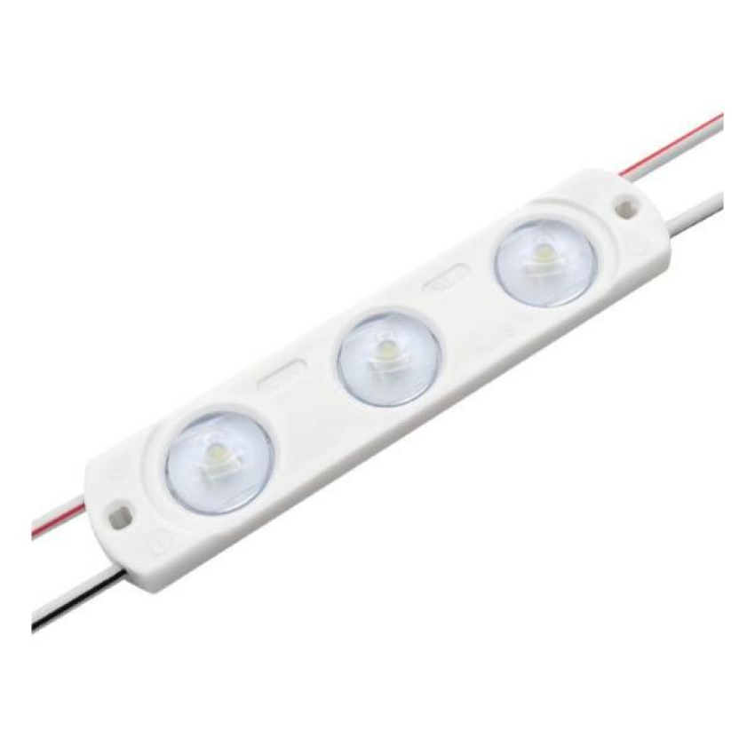
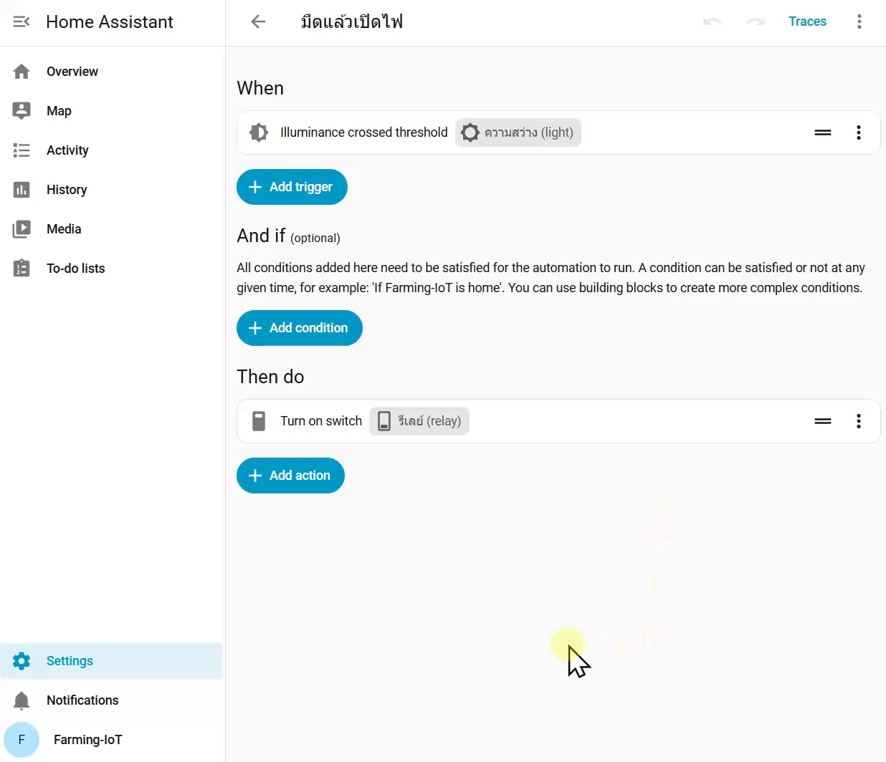

# ช่วงที่ 2 — ตรรกะควบคุมอัตโนมัติและการออกแบบ Fail-safe สำหรับฟาร์ม

**ให้โปรแกรมตัดสินใจและสั่งงานแทนเรา**

ช่วงที่ 1 เราได้ลองดูค่าเซนเซอร์แล้วเปิด–ปิดปั๊มด้วยมือ รวมถึงสร้างกฎให้หยุดปั๊มเมื่อน้ำหมด ในช่วงนี้จะเพิ่มกฎให้ Home Assistant ควบคุมระบบได้มากขึ้น เริ่มจากเปิด–ปิดไฟสวนดอกไม้ตามความสว่าง แล้วนำหลักเดียวกันกลับมาใช้กับการรดน้ำ ช่วงหลังจะจับคู่กับทีมข้าง ๆ เพื่อจำลองปัญหาที่อาจเกิดขึ้นในหน้างานจริงระหว่างใช้งาน สังเกตอาการ และเพิ่มวิธีป้องกันความเสียหาย (Fail-safe)

## ก่อนเริ่ม

- [ ] ต่อแล็ปท็อปเข้า WiFi ของโซนเรา `farm-laptop-สี` เปิด VirtualBox กด Start รอจนหน้าจอแสดงที่อยู่ (IP) เปิดเบราว์เซอร์แล้วพิมพ์ที่อยู่ IP นั้น **อาจไม่ใช่เลขเดิมกับช่วงที่ 1 ให้อ่านจากหน้าจอทุกครั้ง** จดไว้ `http://`{{f:ha.ip2|15}} รอครึ่งนาที แล้วตรวจว่า entity ของบอร์ดทั้งสองกลับมาแสดงค่า (ต้องไม่ค้าง หรือ unavailable)

> เปิดบอร์ดและ Home Assistant ไว้ตลอดช่วงนี้ เพื่อบันทึกค่าเซนเซอร์สำหรับนำมาอ่านและวิเคราะห์ในช่วงที่ 3

---

## ทบทวน: automation มีสามส่วน

**15 นาที**

**อุปกรณ์ที่ใช้** แล็ปท็อป

ช่วงที่ 1 เราใช้มนุษย์เป็นผู้ควบคุม แล้วปิดท้ายด้วย automation ข้อแรก คือถ้าลูกลอยบอกว่าน้ำหมด ให้ปิดปั๊ม ช่วงนี้เราจะสร้างกฎเพิ่มอีกหลายข้อ ขอให้เปิดกฎเดิมขึ้นมาทบทวนส่วนประกอบกันก่อน

1. **Settings → Automations & scenes** กดที่ชื่อ automation ที่สร้างไว้ในช่วงที่ 1
2. หาสามส่วนบนหน้าจอ **When** · **And if** · **Then do**

| ส่วน | หน้าที่ | ตัวอย่างจากกฎช่วงที่ 1 |
|------|----------------|----------------|
| **Trigger** (When) | ทำงานเมื่อไร | ลูกลอยเปลี่ยนเป็น Dry (น้ำหมด) |
| **Condition** (And if) | ต้องผ่านเงื่อนไขใดเพิ่มเติม | ไม่มี |
| **Action** (Then do) | ให้ทำอะไร | ปิดปั๊ม |

**Trigger** กำหนดเหตุการณ์ที่เริ่มเรียกใช้กฎ เช่น ลูกลอยเปลี่ยนเป็นน้ำหมด ส่วน **Condition** ตรวจเงื่อนไขเพิ่มเติม ณ เวลานั้น กฎจากช่วงที่ 1 ใช้เพียง trigger กับ action ได้ แต่กฎบางข้อที่จะสร้างต่อไปต้องมี condition ด้วย

> **บันทึกผล** automation ข้อแรกของเรา trigger {{f:s2.auto1.trigger|18}} action {{f:s2.auto1.action|18}} condition {{f:s2.auto1.condition|10}}

จากนี้ไปเราจะสร้างกฎอีกหลายข้อ เริ่มจากระบบไฟสวนซึ่งเป็นการทดลองสั้น ๆ เห็นผลในไม่กี่วินาที แล้วนำหลักเดียวกันมาใช้กับระบบรดน้ำ

---

## กิจกรรมที่ 5 — ตั้งกฎให้ระบบทำงานอัตโนมัติ (Think)

**75 นาที** (รวมเปลี่ยนโหลดจากปั๊มเป็นหลอดไฟและกลับสองครั้ง)

**อุปกรณ์ที่ใช้** บอร์ด GoGo-IoT, บอร์ดรีเลย์, **หลอด LED 12V**, ไขควง, แล็ปท็อป

### สถานการณ์: ไฟกลางคืนสำหรับแปลงไม้ดอก

ไม้ดอกหลายชนิด เช่น เบญจมาศ ต้องได้รับแสงนานกว่าช่วงกลางวันตามธรรมชาติ สวนจึงเปิดหลอดไฟเมื่อฟ้ามืด ระบบนี้ต้องตัดสินใจจาก **เซนเซอร์แสง** และสั่ง **หลอดไฟ** ผ่านรีเลย์ ซึ่งดีกว่าการตั้งเวลาเปิด-ปิดตายตัว เพราะแต่ละฤดูฟ้ามืดและสว่างไม่ตรงเวลากัน ในห้องนี้เราใช้ **หลอด LED 12V** จากชุดอุปกรณ์แทนหลอดไฟในสวน เป็นแผงเล็กมีเลนส์สามดวงและสายออกสองเส้น สายสีแดงคือขาบวก รับไฟจากกล่องจ่ายไฟ 12V ชุดเดียวกับปั๊ม

{ width="45%" }

เริ่มฝึกด้วยเซนเซอร์แสงเพราะทดสอบได้ง่าย เพียงใช้มือครอบบอร์ดแล้วเอาออก ก็ทำให้ค่าความสว่างเปลี่ยนและเห็นการตอบสนองของระบบได้ทันที

### เปลี่ยนโหลดจากปั๊มเป็นหลอดไฟเป็นการชั่วคราวสำหรับแบบฝึกหัดนี้

ขณะนี้รีเลย์ต่ออยู่กับปั๊ม เราจะเปลี่ยนมาต่อหลอด LED ชั่วคราวเพื่อให้เห็นผลการเปิด–ปิดชัดเจน เป็นการถอดสายสองเส้นของปั๊มออก แล้วใส่สายสองเส้นของหลอดเข้าที่เดิม ส่วนอื่นของวงจรไม่ต้องแตะ

1. ไปที่ **Settings → Automations & scenes** ปิดสวิตช์ของกฎ `น้ำหมด หยุดปั๊ม` ชั่วคราว ระหว่างทดลองไฟสวน รีเลย์ต้องฟังแต่กฎเรื่องแสง ไม่ใช่กฎเรื่องน้ำ
2. เปิดหน้าอุปกรณ์ของบอร์ดรีเลย์ สั่งสวิตช์รีเลย์เป็น **Off** การปิดกฎกับการสั่งรีเลย์ Off เป็นคนละเรื่องกัน ต้องทำทั้งสองอย่าง
3. คลายสกรูหัวต่อสายปั้มน้ำแล้วถอดสายไฟปั้มน้ำทั้งสองเส้น 
4. ขันสายไฟสองเส้นของไฟ LED เข้าไปแทน สายแถบแดงคือไฟบวก อย่าต่อกลับขั้ว
5. ทดสอบ: สั่ง On หลอด LED ต้องติด สั่ง Off หลอดต้องดับ ถ้าไม่ติด ตรวจว่าสายต่อกลับขั้วหรือไม่ 

{ width="85%" }

*ตัวอย่างวงจรเมื่อต่อหลอด LED เสร็จ* อะแดปเตอร์ 12V ต่อเข้า **คู่แบตเตอรี่** ของ charge controller แทนแบตเตอรี่ จอจึงติดและแสดง 12.0V · สายบวก 12V จาก **คู่โหลด** เข้า **COM** ของรีเลย์ แล้วออกจาก **NO** ไปแผงต่อสายสีขาว · สายลบจากคู่โหลดไปแผงต่อสายโดยตรง · หลอด LED รับไฟจากแผงต่อสาย · บอร์ดรีเลย์รับไฟทางสาย USB-C จาก **ช่อง USB** ของ charge controller ขั้วไฟเข้า 7–60V จึงว่าง (ในภาพใช้คีมหนีบแทนสายอะแดปเตอร์)

> วงจรยังใช้หลักเดิม คือรีเลย์เปิด–ปิดทางเดินไฟด้านบวก และอุปกรณ์รับไฟจากแผงต่อสายชุดเดิม สิ่งที่เปลี่ยนคืออุปกรณ์ปลายทาง (Output) จากปั๊มเป็นหลอดไฟ เมื่อจบการทดลองนี้จะเปลี่ยนกลับไปใช้ปั๊ม

ตอนนี้ทีมมีกฎอยู่ข้อเดียวคือ `น้ำหมด หยุดปั๊ม` และปิดไว้ กฎที่จะสร้างต่อไปนี้จะสั่งรีเลย์ตัวเดียวกัน จึงต้องรู้ตลอดว่าขณะนี้กฎข้อใดเปิดอยู่บ้าง

### (ก) สร้างกฎ: มืดแล้วเปิดไฟ

ทีมเลือก **ค่าเกณฑ์ (Threshold) ความสว่าง** จากค่าปกติในห้อง (สว่าง) และค่าตอนครอบ (มืด)  เลือกค่ากลาง ๆ ระหว่างสองค่านั้น เช่น ถ้าตอนสว่างได้ค่า 80 และตอนมืดได้ 7 ค่าที่เกณฑ์อาจเป็น 40 หรือ 50 เพราะอยู่ประมาณกึ่งกลาง เกณฑ์ของทีม เปิดไฟเมื่อต่ำกว่า {{n:s2.light.on|4}}

วางเมาส์บนป้าย **ดูภาพ** ท้ายข้อเพื่อดูภาพหน้าจอของขั้นนั้น (บนหน้าจอสัมผัสให้แตะ)

1. **Settings → Automations & scenes** [📷](images/steps/s2-a5-01-settings-automations.png){ .glightbox data-title="Settings → Automations & scenes" }
2. กด **+ Create automation** ที่มุมล่างขวา [📷](images/steps/s2-a5-02-create-automation.png){ .glightbox data-title="ปุ่ม Create automation" } แล้วเลือก **Create new automation** [📷](images/steps/s2-a5-03-create-new.png){ .glightbox data-title="เลือก Create new automation" }
3. ในส่วน **When** กด **+ Add trigger** [📷](images/steps/s2-a5-04-add-trigger.png){ .glightbox data-title="ส่วน When กด Add trigger" }
4. พิมพ์ **ความสว่าง** ในช่องค้นหา แล้วกดที่ **ความสว่าง (light)** [📷](images/steps/s2-a5-05-search-light.png){ .glightbox data-title="ค้นหา ความสว่าง แล้วกดที่ entity" }
5. รายการทางขวาจะแสดง trigger ที่ใช้กับเซนเซอร์แสงได้ เลือก **Illuminance crossed threshold** [📷](images/steps/s2-a5-06-pick-crossed-threshold.png){ .glightbox data-title="เลือก Illuminance crossed threshold" }
6. แผงตั้งค่า trigger จะเปิดทางขวา ที่ **Threshold type** เลือก **Below** [📷](images/steps/s2-a5-07-threshold-below.png){ .glightbox data-title="Threshold type เลือก Below" } แล้วพิมพ์ค่าเกณฑ์ของทีมในช่อง **Below** (หน่วย lx) [📷](images/steps/s2-a5-08-value-50.png){ .glightbox data-title="พิมพ์ค่าเกณฑ์ในช่อง Below" }
7. ในส่วน **Then do** กด **+ Add action** [📷](images/steps/s2-a5-09-add-action.png){ .glightbox data-title="ส่วน Then do กด Add action" }
8. พิมพ์ **รีเลย์** ในช่องค้นหา แล้วกดที่ **รีเลย์ (relay)** [📷](images/steps/s2-a5-10-search-relay.png){ .glightbox data-title="ค้นหา รีเลย์ แล้วกดที่ entity" } จากรายการทางขวาเลือก **Turn on switch** [📷](images/steps/s2-a5-11-turn-on-switch.png){ .glightbox data-title="เลือก Turn on switch" }
9. กด **Save** ที่มุมล่างขวา [📷](images/steps/s2-a5-12-save.png){ .glightbox data-title="ปุ่ม Save" } ตั้งชื่อ `มืด-เปิดไฟ` (หรือชื่ออื่นที่ต้องการ) แล้วกด **Save** อีกครั้ง [📷](images/steps/s2-a5-13-save-name.png){ .glightbox data-title="ตั้งชื่อ automation แล้ว Save" }
10. หน้าจอจะกลับมาที่กฎที่สร้างเสร็จ มี trigger หนึ่งข้อและ action หนึ่งข้อ [📷](images/steps/s2-a5-15-editor-done.png){ .glightbox data-title="กฎที่สร้างเสร็จ" } กดลูกศรย้อนกลับด้านบนจะเห็นกฎใหม่ในรายการ Automations พร้อมสวิตช์เปิดอยู่ [📷](images/steps/s2-a5-14-list.png){ .glightbox data-title="รายการ Automations" }

{ width="70%" }

**ทดสอบ** ก่อนทดสอบทุกครั้ง ให้เซนเซอร์เปิดโล่งจนค่าแสงอยู่เหนือเกณฑ์ และหลอดดับอยู่ จากนั้นเอามือครอบปิดเซนเซอร์แสงบนบอร์ดแล้วดูว่าหลอดไฟติดหรือไม่ ลองเอามือออกแล้วดูว่าหลอดไฟดับหรือไม่ (ยังไม่ดับ เพราะยังไม่มีกฎสั่งปิด)

> trigger แบบ crossed threshold ทำงานเฉพาะตอนค่า **ข้าม** เส้นเกณฑ์ ถ้าค่าอยู่ใต้เกณฑ์อยู่แล้วตั้งแต่ก่อนสร้างกฎ จะยังไม่มีอะไรเกิดขึ้น ต้องทำให้ค่าขึ้นเหนือเกณฑ์ก่อนแล้วค่อยลดลงมาใหม่

สั่ง Off ด้วยมือก่อนไปขั้นถัดไป

### ปัญหาที่มักพบในระบบอัตโนมัติ - การเปิดปิดถี่เกินความจำเป็นเมื่อค่าแสงอยู่ใกล้เกณฑ์

เพิ่มกฎให้ปิดไฟเมื่อสว่าง โดยสร้าง automation เพิ่มโดยใช้วิธีเดิม แต่ที่ **Threshold type** เลือกเป็น **Above** แล้วป้อน **ค่าเดียวกับเกณฑ์เปิด** และ action เลือก **Turn off switch** ตั้งชื่อว่า `สว่าง-ปิดไฟ` (หรือชื่ออื่นที่ต้องการ)

ให้ลองดูผลการทำงานเมื่อค่าความสว่างอยู่ใกล้เกณฑ์

**วิธีทดสอบ** ค่อย ๆ เลื่อนมือเข้าหาบอร์ดจนค่าแสงอยู่ใกล้เกณฑ์ แล้วขยับมือช้า ๆ ขึ้นลงตรงนั้น ให้อีกคนจับเวลา 1 นาที และนับว่าหลอดไฟติดและดับรวมกี่ครั้ง **บันทึกผล** ก่อนแก้ ติดดับ {{n:s2.chatter.before|3}} ครั้งใน 1 นาที สิ่งที่เกิดขึ้นคือหลอดไฟจะติดและดับเมื่อค่าความสว่างแกว่งเหนือและใต้เกณฑ์ สถานการณ์นี้เกิดขึ้นในชีวิตจริงได้ เช่น เมฆลอยผ่านตอนพลบค่ำ หรือเมื่อแสงจากหลอดไฟย้อนกลับมารบกวนเซนเซอร์

> การเปิด–ปิดถี่ ๆ ลักษณะนี้เรียกว่า **chattering** หากเกิดขึ้นในการใช้งานจริง หลอดไฟจะกะพริบ รีเลย์สึกหรอเร็ว และหากใช้ควบคุมปั๊มก็อาจทำให้ปั๊มเสียหายได้

### (ข) Hysteresis: การแยกค่าสำหรับเกณฑ์เปิดและปิด

แก้ไข Automation `สว่าง-ปิดไฟ` โดยปรับแก้ค่า **Above** ให้สูงกว่าเกณฑ์เปิดพอสมควร (เช่น สูงกว่าราวหนึ่งในสี่ของระยะระหว่างค่ามืดกับค่าสว่าง แต่ยังต่ำกว่าค่าตอนสว่างในห้อง ไม่อย่างนั้นไฟจะไม่ดับเลย) กด Save แล้วทดสอบแบบเดิมอีกครั้ง จับเวลา 1 นาที นับจำนวนครั้งที่ไฟติดและดับ **บันทึกผล** ปิดไฟเมื่อสูงกว่า {{n:s2.light.off|4}} · หลังแก้ ติดดับ {{n:s2.chatter.after|3}} ครั้งใน 1 นาที เทียบกับก่อนแก้

- [ ] **ทีมตรวจตัวเอง** ผ่านเมื่อครบสามข้อ: ขยับมือแบบเดิม 1 นาที ไฟติดดับไม่เกิน 2 ครั้ง · ครอบเซนเซอร์มิด ไฟติด · เอามือออก ไฟดับ ถ้ายังกะพริบถี่ ให้เพิ่มระยะห่างระหว่างเกณฑ์เปิดกับเกณฑ์ปิด ถ้าไฟไม่ติดหรือไม่ดับเลย แสดงว่าเกณฑ์ข้อใดข้อหนึ่งอยู่นอกช่วงค่าที่วัดได้จริง ให้ดูค่าตอนมืดและตอนสว่างอีกครั้ง

### (ค) การเพิ่มเงื่อนไขเวลา

บางครั้งอาจอยากให้ไฟติดเฉพาะบางช่วงเวลา ทำได้โดยแก้ไข `มืด-เปิดไฟ` ในส่วน **And if** กด **+ Add condition → Time** ตั้ง **After** และ **Before** แล้วกด Save

ส่วน **When** คือ **trigger** เป็นเหตุการณ์ที่ทำให้กฎเริ่มทำงาน ส่วน **And if** คือ **condition** เป็นด่านตรวจว่าจะยอมให้ทำ action หรือไม่ ทุกครั้งที่เกิด trigger ระบบจะตรวจ condition หนึ่งครั้ง ถ้าไม่ผ่านก็จบรอบนั้นไปเฉย ๆ

ก่อนทดสอบแต่ละข้อ ให้เริ่มจากสภาพเดิมเสมอ: เซนเซอร์เปิดโล่งจนค่าแสงอยู่เหนือเกณฑ์เปิด และหลอดดับอยู่ (ถ้ายังติด สั่ง Off จากหน้าอุปกรณ์รีเลย์) ไม่อย่างนั้นจะไม่มีการข้ามเกณฑ์ และกฎจะไม่ทำงานไม่ว่าเงื่อนไขเวลาจะเป็นอย่างไร

**ทดสอบ 1** ตั้งช่วงเวลาให้ครอบคลุมเวลาปัจจุบัน แล้วครอบเซนเซอร์ ไฟควรติดเหมือนเดิม

**ทดสอบ 2** เปลี่ยนเงื่อนไขเป็นเวลานอกช่วงเวลาปัจจุบัน แล้วลองครอบเซนเซอร์อีกครั้ง ไฟจะไม่ติด ถ้าอยากเห็นหลักฐานว่า trigger เกิดจริงแต่ถูกกั้น ให้กดปุ่ม **Traces** ที่แถบด้านบนของหน้าแก้ไขกฎ จะเห็นรอบล่าสุดเดินมาถึงกล่อง condition แล้วหยุด

ข้อจำกัดของวิธีนี้คือ ถ้าแสงมืดก่อนถึงช่วงเวลาที่กำหนด ไฟจะไม่ติดแม้ถึงเวลา เพราะ trigger ทำงานเมื่อ "มืด" ไม่ได้ทำงานเมื่อ "ถึงเวลาที่กำหนด" นี่เป็นข้อที่มักพลาดกันบ่อย

วิธีแก้ไขคือ ให้เพิ่ม Trigger เวลาเข้าไป และ เช็คใน And if ว่าค่าแสงต่ำกว่าที่กำหนดหรือไม่

1. แก้ไข `มืด-เปิดไฟ` ในส่วน **When** กด **+ Add trigger → Time** ตั้ง **At** เป็นเวลาเดียวกับ After
2. ในส่วน **And if** กด **+ Add condition → Numeric state** เลือก **ความสว่าง (light)** ช่อง **Below** ใส่เกณฑ์เปิดค่าเดียวกับใน (ก) แล้วกด Save
3. แก้ไข `สว่าง-ปิดไฟ` ในส่วน **When** กด **+ Add trigger → Time** ตั้ง **At** เป็นเวลาเดียวกับ Before แล้วกด Save
4. ทดสอบ: สั่งรีเลย์เป็น Off แล้ววางของทึบครอบเซนเซอร์ไว้ให้มืดตลอด (ฟ้ามืดก่อนถึงเวลา) ดูนาฬิกาบนแล็ปท็อป ตั้ง **After** และ **At** ของ `มืด-เปิดไฟ` เป็นอีกราว 2 นาทีข้างหน้า และ **Before** กับ **At** ของ `สว่าง-ปิดไฟ` ให้ช้ากว่านั้นอีกราว 1 นาที กด Save ทั้งสองกฎ แล้วรอโดยไม่แตะเซนเซอร์ ไฟต้องติดเมื่อถึงเวลา After และดับเมื่อถึงเวลา Before ถ้าจะทดสอบซ้ำ ต้องเลือกเวลาใหม่ในอนาคตและแก้ทั้ง After และ At เวลาที่ผ่านไปแล้วจะไม่ย้อนกลับมาเกิดอีก

กฎหนึ่งข้อมีได้หลาย trigger เกิดอันใดอันหนึ่งก็เริ่มทำงาน แต่ทุก condition ต้องผ่านทั้งหมด การตรวจค่าแสงซ้ำใน condition จำเป็นเพราะ trigger เวลาไม่รู้ว่าฟ้ามืดหรือยัง

### (ง) เพิ่มการแจ้งเตือน

เพิ่ม action อีกอันใน `มืด-เปิดไฟ` ค้นหา **notification → Send a persistent notification** ใส่ข้อความที่อยากให้เจ้าของสวนเห็น ข้อความจะขึ้นที่ไอคอนกระดิ่งมุมล่างซ้าย

นอกจากนี้ยังมี action แบบ **Send a notification via mobile_app** ซึ่งจะแจ้ง notification ในโทรศัพท์ แต่ action นี้จะปรากฎในรายการก็ต่อเมื่อมีโทรศัพท์ล็อกอินเข้า Home Assistant เครื่องนี้ผ่านแอป Companion แล้วเท่านั้น ถ้าทีมใดลองเชื่อมโทรศัพท์เข้ามาได้ ให้ใช้ action นั้นแทน ข้อความจะเด้งบนโทรศัพท์จริง

### สลับสถานการณ์: กลับมาที่ระบบรดน้ำ

รีเลย์ของเรามีตัวเดียว ตอนนี้จะย้ายกลับไปสั่งปั๊มแทนหลอดไฟ เป็นการถอดสายหลอดสองเส้นออก แล้วใส่สายปั๊มสองเส้นกลับที่เดิม

1. ไปที่ **Settings → Automations & scenes** **ปิดสวิตช์** ของ `มืด-เปิดไฟ` และ `สว่าง-ปิดไฟ` ทั้งสองข้อ (สวิตช์ทางขวาในรายการ) กฎยังอยู่ แต่ไม่ทำงาน รวมถึง trigger เวลาที่เพิ่มไว้ในข้อ (ค) ด้วย แล้วสั่งสวิตช์รีเลย์เป็น **Off** จากหน้าอุปกรณ์
2. คลายสกรูขั้ว **NO** ถอดสายแดงของหลอด LED ออก แล้วถอดสายดำออกจากแถวลบ เก็บหลอดไว้ในกล่อง ต่อสายบวกของปั๊มกลับเข้าขั้ว **NO** ขันแน่น และสายลบของปั๊มกลับเข้า **แถวลบ** ของแผงต่อสาย จดเวลาที่ต่อปั๊มกลับ {{f:s2.pump_back_t|5}} น. ช่วงที่ 3 จะใช้แยกว่าแถบรีเลย์บนกราฟช่วงไหนเป็นหลอดไฟ ช่วงไหนเป็นปั๊ม
3. ตรวจว่าปั๊มจมอยู่ในใบ A ปลายสายยางอยู่ในใบ A (น้ำวน) และลูกลอยอยู่ในใบ A หน้าอุปกรณ์แสดง **Wet** แล้วจึง **เปิดสวิตช์** กฎ `น้ำหมด หยุดปั๊ม` กลับ ตอนนี้กฎที่เปิดอยู่มีข้อเดียวคือกฎน้ำหมด ส่วนกฎไฟสวนสองข้อปิดอยู่
4. สร้าง automation `รดน้ำ - เปิดปั๊ม`: **+ Add trigger → Entity → Numeric state** (เลือกชนิด trigger ก่อน แล้วค่อยเลือก entity ในแผงตั้งค่า ต่างจากข้อ (ก) ที่เลือก entity ก่อน) เลือก **ความชื้นอากาศ** ช่อง **Below** ใส่ค่าเกณฑ์จากช่วงที่ 1 (สูงกว่าค่าปกติในห้องเล็กน้อย) → Switch turn on
5. สร้าง `รดน้ำ - ปิดปั๊ม`: Numeric state ของความชื้นอากาศ ช่อง **Above** ใส่ค่าที่ **สูงกว่า** เกณฑ์เปิดราว 5–10 % (ใช้บทเรียนจากข้อ (ข) ทันที) → Switch turn off
6. ทดสอบ: ค่าในห้องต่ำกว่าเกณฑ์เปิดอยู่แล้ว เป่าลมใส่บอร์ดจนค่าพุ่งเกินเกณฑ์ปิด ปั๊มหยุดหรือไม่ แล้วหยุดเป่า รอให้ค่าตกลงต่ำกว่าเกณฑ์เปิด ปั๊มกลับมาเดินหรือไม่ ใช้เวลากี่วินาที

> **บันทึกผล** เกณฑ์ความชื้นอากาศ เปิดปั๊มเมื่อต่ำกว่า {{n:s2.hum.on|4}} % ปิดปั๊มเมื่อสูงกว่า {{n:s2.hum.off|4}} % · หยุดเป่าแล้วปั๊มกลับมาเดินใน {{n:s2.hum.restart|3}} วินาที

### ปิดกฎชั่วคราว แล้วสั่งเอง

ชาวสวนต้องหยุดระบบอัตโนมัติได้โดยไม่ต้องลบกฎ เช่น ตอนซ่อมท่อ หน้า **Settings → Automations & scenes** ทำหน้าที่นี้ สวิตช์ทางขวาของแต่ละกฎคือเปิด–ปิดการทำงาน ส่วนสวิตช์รีเลย์ในหน้าอุปกรณ์คือการสั่งเอง (**manual override**) ซึ่งทำงานได้เสมอไม่ว่ากฎจะเปิดหรือปิด

1. ปิดสวิตช์ของ `รดน้ำ - เปิดปั๊ม` แล้วทำให้อากาศแห้งจนค่าต่ำกว่าเกณฑ์เปิด ปั๊มต้อง **ไม่เดิน**
2. เปิดหน้าอุปกรณ์ของบอร์ดรีเลย์ สั่ง On แล้ว Off ปั๊มต้องเดินและหยุดตามคำสั่ง แม้กฎปิดอยู่
3. **เปิดสวิตช์** `รดน้ำ - เปิดปั๊ม` กลับ แล้วตรวจรายการ Automations ให้ได้แบบนี้ก่อนไปกิจกรรมถัดไป: `น้ำหมด หยุดปั๊ม` เปิด · `รดน้ำ - เปิดปั๊ม` และ `รดน้ำ - ปิดปั๊ม` เปิด · `มืด-เปิดไฟ` และ `สว่าง-ปิดไฟ` ปิด

> ช่วงที่ 3 เราจะสร้างแดชบอร์ดที่รวมสวิตช์เหล่านี้ไว้หน้าเดียวสำหรับผู้ใช้จริง ในช่วงนี้ใช้หน้า Automations กับหน้าอุปกรณ์ตรง ๆ

**คำถามท้ายกิจกรรม** เกณฑ์เปิดและเกณฑ์ปิดของระบบไฟสวนคือเท่าไร ทำไมสองค่านี้ต้องต่างกัน และเราเอาบทเรียนนี้ไปใช้กับระบบรดน้ำอย่างไร

{{ta:s2.q5}}

---

## กิจกรรมที่ 6 — จำลองปัญหาและเพิ่มระบบป้องกัน (Failure lab)

**45 นาที**

**อุปกรณ์ที่ใช้** ระบบรดน้ำทำงานอยู่ ปั๊มจมในใบ A น้ำวนกลับใบ A สวิตช์ลูกลอยในใบ A

ปัญหาแต่ละข้อทำสามขั้น **จำลองปัญหา** ให้เห็นว่าระบบเดิมรับมือไม่ได้ → **แก้** ด้วยกฎ fail-safe → **จำลองซ้ำ** เพื่อยืนยันว่าแก้ได้แล้ว ทีมข้าง ๆ เป็นผู้จำลองปัญหาให้เรา ระหว่างนั้นเราดูเฉพาะหน้าจอ Home Assistant

**ก่อนจำลองปัญหาทุกข้อ** ตรวจว่ากฎ `น้ำหมด หยุดปั๊ม` และกฎรดน้ำสองข้อเปิดอยู่ กฎไฟสวนปิดอยู่ entity ของบอร์ดทั้งสองแสดงค่า และเปิดหน้าอุปกรณ์ของบอร์ด GoGo-IoT กับบอร์ดรีเลย์ไว้คนละแท็บ ปั๊มที่สั่งเดินด้วยมือจะเดินค้าง เพราะค่าความชื้นในห้องไม่ถึงเกณฑ์ปิด อย่าแก้เกณฑ์ความชื้นเพื่อให้ปั๊มเดิน

### ปัญหาที่ 1 — น้ำหมดแล้ว แต่ยังสั่งปั๊มเดินได้ (Fail-safe 1)

**วิธีจำลองปัญหา** ยกสวิตช์ลูกลอยพ้นน้ำแล้วถือค้างไว้ รอให้หน้าอุปกรณ์แสดง **Dry** (ถ้าปั๊มเดินอยู่ กฎจากช่วงที่ 1 จะหยุดปั๊มตอนนี้) จากนั้นกดปุ่มบนบอร์ดรีเลย์เพื่อสั่งปั๊มเดิน

**ถ้าจำลองสำเร็จ** ปั๊มเดินทั้งที่ลูกลอยเป็น Dry และไม่มีอะไรหยุดมัน เพราะกฎเดิมทำงานเฉพาะตอนลูกลอย **เปลี่ยน** สถานะ ไม่ได้ตรวจว่าตอนนี้น้ำมีหรือไม่ นี่คือคำถามที่ฝากไว้ท้ายช่วงที่ 1

**วิธีแก้**

1. **Settings → Automations & scenes** เปิด `น้ำหมด หยุดปั๊ม` เปลี่ยนชื่อเป็น `Fail-safe - น้ำหมด` แล้วเพิ่ม action **Send a persistent notification** ข้อความ `น้ำในถังต่ำ หยุดปั๊มแล้ว`
2. ในกฎเดียวกัน กด **+ Add trigger → Entity → State** เลือกสวิตช์ปั๊ม ช่อง **To** เลือก **On** แล้วในส่วน **And if** กด **+ Add condition → Entity → State** เลือกสวิตช์ลูกลอย สถานะ **Dry** กด Save กฎนี้จึงทำงานทั้งเมื่อลูกลอยเปลี่ยนเป็น Dry และเมื่อมีคนสั่งเปิดปั๊ม แต่หยุดปั๊มเฉพาะเมื่อน้ำหมดจริง
3. ปิดช่องทางอัตโนมัติด้วย เปิด `รดน้ำ - เปิดปั๊ม` ในส่วน **And if** กด **+ Add condition → Entity → State** เลือกสวิตช์ลูกลอย สถานะ **Wet** กด Save กฎรดน้ำจะไม่เริ่มปั๊มถ้าไม่มีหลักฐานว่ามีน้ำ

**ถือว่าแก้ได้เมื่อ** จำลองซ้ำแบบเดิม ปั๊มต้องหยุดเองภายในราวหนึ่งวินาทีและมีข้อความแจ้งเตือนขึ้น ลองทั้งกดปุ่มบนบอร์ดและกดสวิตช์ปั๊มในหน้าอุปกรณ์ ผลต้องเหมือนกัน แล้ววางลูกลอยกลับ

> **บันทึกผล** จำลองปัญหาสำเร็จหรือไม่ {{r:s2.sab.1.ok|สำเร็จ|ไม่สำเร็จ}} · เกิดอะไรขึ้น {{f:s2.sab.1.what|24}}
>
> แก้ได้แล้วหรือไม่ {{r:s2.sab.1.fixed|แก้ได้|ยังไม่ได้}} · หมายเหตุ {{f:s2.sab.1.note|24}}

> condition ในข้อ 3 ต้องมี **หลักฐานว่ามีน้ำ** ไม่ใช่แค่ไม่มีสัญญาณว่าน้ำหมด ถ้าสายลูกลอยหลุด สวิตช์จะอ่านได้ Dry ถ้าบอร์ดดับ สถานะจะเป็น unavailable ทั้งสองอย่างไม่ใช่ Wet กฎรดน้ำจึงไม่เริ่มปั๊มรอบใหม่ นี่คือหลักของ fail-safe: เมื่อไม่แน่ใจ ให้ไปทางปลอดภัย

### ปัญหาที่ 2 — ปั๊มเดินไม่หยุด (Fail-safe 2)

**วิธีจำลองปัญหา** กดปุ่มบนบอร์ดรีเลย์ให้ปั๊มเดิน แล้วปล่อยทิ้งไว้หนึ่งนาทีโดยไม่แตะอะไร

**ถ้าจำลองสำเร็จ** ปั๊มเดินค้างไปเรื่อย ๆ ไม่มีกฎใดหยุด เพราะกฎรดน้ำรอให้ค่าความชื้นข้ามเกณฑ์ปิด ซึ่งในห้องไม่เกิดขึ้น ในฟาร์มจริงคือแปลงน้ำท่วมจนกว่าจะมีคนมาเห็น

**วิธีแก้**

1. สร้าง automation ชื่อ `Fail-safe - จำกัดเวลาเปิดปั๊ม`
2. Trigger: **Entity → State** เลือกสวิตช์ปั๊ม ช่อง **To** เลือก **On** ช่อง **For** ตั้ง **30 วินาที** (ในฟาร์มจริงอาจเป็น 10–20 นาที)
3. Action: **Switch → Turn off** สวิตช์ปั๊ม และแจ้งเตือน `ปั๊มเดินเกินเวลา ตัดการทำงานแล้ว โปรดตรวจสอบ`

**ถือว่าแก้ได้เมื่อ** กดปุ่มให้ปั๊มเดินอีกครั้ง ปั๊มต้องหยุดเองที่ราว 30 วินาที พร้อมข้อความแจ้งเตือน

> **บันทึกผล** จำลองปัญหาสำเร็จหรือไม่ {{r:s2.sab.2.ok|สำเร็จ|ไม่สำเร็จ}} · เกิดอะไรขึ้น {{f:s2.sab.2.what|24}}
>
> แก้ได้แล้วหรือไม่ {{r:s2.sab.2.fixed|แก้ได้|ยังไม่ได้}} · หมายเหตุ {{f:s2.sab.2.note|24}}

> **หลังระบบตัดการทำงานแล้ว** ปั๊มจะ **ไม่**กลับมาเดินเอง จนกว่าค่าความชื้นจะขึ้นเหนือเกณฑ์แล้วตกลงมาข้ามเกณฑ์เปิดอีกครั้ง เพราะ trigger ทำงานเฉพาะตอนค่า **ข้าม** เส้น ในฟาร์มจริงอาจกินเวลาหลายวัน fail-safe ที่ตัดการทำงานจึงต้องมีแจ้งเตือนคู่กันเสมอ เพื่อให้คนมาดู แก้สาเหตุ แล้วสั่งเริ่มใหม่

### ปัญหาที่ 3 — บอร์ดเซนเซอร์ดับ (Fail-safe 3)

**วิธีจำลองปัญหา** สั่งปั๊ม On จากหน้าอุปกรณ์รีเลย์ แล้ว **ปิดสวิตช์บนบอร์ด GoGo-IoT** ทันที (ถอดสาย USB อย่างเดียวไม่พอ เพราะบอร์ดมีถ่าน 18650 จะทำงานต่อได้อีกหลายชั่วโมง)

**ถ้าจำลองสำเร็จ** entity ทุกตัวของบอร์ด GoGo-IoT กลายเป็น **unavailable** ภายในไม่กี่สิบวินาที แต่ปั๊มยังเดินต่อ และไม่มีข้อความแจ้งเตือนเรื่องเซนเซอร์ เพราะระบบควบคุมไม่รู้ค่าความชื้นแล้ว แต่ก็ไม่มีกฎใดบอกให้ทำอะไร ถ้าปั๊มหยุดตอน 30 วินาที นั่นคือ Fail-safe 2 ทำงาน ไม่ใช่การรับรู้ว่าเซนเซอร์หาย ดูข้อความแจ้งเตือนว่าเป็นของกฎใด แล้วเปิดสวิตช์บอร์ดกลับ

**วิธีแก้** ทีมตกลงกันก่อนว่า **ถ้าระบบควบคุมไม่ได้รับค่าความชื้น ปั๊มควรเปิด ปิด หรือคงสถานะเดิม** และเพราะอะไร

> **บันทึกผล** ทีมเลือกให้ปั๊ม {{r:s2.fs3.choice|เปิด|ปิด|คงสถานะเดิม}} เพราะ {{f:s2.fs3.why|30}}

1. สร้าง automation ชื่อ `Fail-safe - เซนเซอร์หาย`
2. Trigger: **Entity → State** เลือกความชื้นอากาศ ช่อง **To** พิมพ์ `unavailable` แล้วเพิ่ม trigger อีกอันแบบเดียวกันแต่ To เป็น `unknown`
3. Action: **Switch → Turn off** สวิตช์ปั๊ม และแจ้งเตือน `ไม่ได้รับค่าจากเซนเซอร์ หยุดปั๊มเพื่อความปลอดภัย`

**ถือว่าแก้ได้เมื่อ** รอให้ entity ของบอร์ดกลับมาแสดงค่าก่อน แล้วจำลองซ้ำ (สั่งปั๊ม On ใหม่ให้เวลานับหนึ่งเริ่มใหม่ แล้วปิดสวิตช์บอร์ดทันที) ปั๊มต้องหยุดเองก่อนครบ 30 วินาที และข้อความแจ้งเตือนต้องเป็นของ `Fail-safe - เซนเซอร์หาย` ถ้าไม่แน่ใจ เปิด Traces ของทั้งสองกฎ แล้วเปิดสวิตช์บอร์ดกลับ

> **บันทึกผล** จำลองปัญหาสำเร็จหรือไม่ {{r:s2.sab.3.ok|สำเร็จ|ไม่สำเร็จ}} · เกิดอะไรขึ้น {{f:s2.sab.3.what|24}}
>
> แก้ได้แล้วหรือไม่ {{r:s2.sab.3.fixed|แก้ได้|ยังไม่ได้}} · หมายเหตุ {{f:s2.sab.3.note|24}}

### ปัญหาที่ 4 — สั่งแล้วปั๊มไม่เดิน แต่หน้าจอดูปกติ (Fail-safe 4)

**วิธีจำลองปัญหา** คลายสกรูขั้ว **NO** บนบอร์ดรีเลย์ ถอดสายบวกของปั๊มออก แล้วสั่งสวิตช์ปั๊ม On จากหน้าอุปกรณ์

**ถ้าจำลองสำเร็จ** หน้าอุปกรณ์แสดง On รีเลย์มีเสียงคลิก ไฟแสดงสถานะติด แต่ปั๊มเงียบและน้ำไม่ไหล Home Assistant ไม่รู้เรื่องนี้เลย เพราะรู้แค่ว่าสั่งอะไรไป ไม่รู้ว่าเกิดอะไรขึ้นจริง (Fail-safe 2 จะปิดสวิตช์ตอน 30 วินาทีด้วยเหตุผลที่ผิด คือคิดว่าปั๊มเดินนานเกิน)

**วิธีแก้** ใช้เซนเซอร์วัดความสั่นสะเทือนบนบอร์ด GoGo-IoT ตรวจว่าปั๊มเดินจริง โดยนำบอร์ดไปวางประกบกับปั๊มเพื่อให้แรงสั่นมาถึงบอร์ด การสั่นบอกได้แค่ว่ามอเตอร์หมุน ไม่ได้บอกว่าน้ำไปถึงแปลง ในฟาร์มจริงจึงมักเสริมด้วยเซนเซอร์การไหลหรือแรงดันน้ำ

| entity | บอกอะไร |
|---|---|
| `ความสั่นสะเทือน (vibration)` | ความแรงของการสั่น หน่วย **mg** (มิลลิจี) |
| `ปั๊มกำลังทำงาน (pump running)` | ผลการตรวจจับ เดิน / ไม่เดิน |

> **ตำแหน่งบอร์ดสำคัญ** เซนเซอร์อยู่บนบอร์ด GoGo-IoT ไม่ได้อยู่ที่ปั๊ม วางบอร์ดให้แนบปั๊มก่อนทดสอบ ถ้า `ปั๊มกำลังทำงาน` ไม่เปลี่ยนเป็น On ตอนปั๊มเดิน ให้ปรับความไวให้สูงขึ้น

1. สร้าง automation ชื่อ `Fail-safe - สั่งแล้วไม่เดิน`
2. Trigger: **Entity → State** เลือกสวิตช์ปั๊ม ช่อง **To** ใส่ `On` ช่อง **For** ใส่ **15 วินาที** (สั้นกว่า Fail-safe 2 โดยตั้งใจ ถ้าใช้ 30 วินาทีเท่ากัน กฎสองข้อจะทำงานพร้อมกันและเราจะไม่รู้ว่าข้อความที่ขึ้นมาจากข้อใด)
3. Condition: **Entity → State** เลือก `ปั๊มกำลังทำงาน` สถานะ **Off**
4. Action: **Switch → Turn off** สวิตช์ปั๊ม และแจ้งเตือน `สั่งปั๊มแล้วแต่ไม่มีการสั่น ตรวจสายและระดับน้ำ`

**ถือว่าแก้ได้เมื่อ** สายปั๊มยังถอดอยู่ สั่งสวิตช์ปั๊ม On อีกครั้ง ภายใน 15 วินาทีต้องมีข้อความแจ้งเตือนและสวิตช์ต้องปิดไปเอง (ก่อน Fail-safe 2 ที่ 30 วินาที) จากนั้นต่อสายกลับ ขันให้แน่น สั่ง On อีกครั้ง คราวนี้ปั๊มต้องเดินต่อได้เกิน 15 วินาที ถ้าถูกตัด แปลว่าบอร์ดไม่แนบปั๊มหรือความไวต่ำเกินไป

> **บันทึกผล** จำลองปัญหาสำเร็จหรือไม่ {{r:s2.sab.4.ok|สำเร็จ|ไม่สำเร็จ}} · เกิดอะไรขึ้น {{f:s2.sab.4.what|24}}
>
> แก้ได้แล้วหรือไม่ {{r:s2.sab.4.fixed|แก้ได้|ยังไม่ได้}} · หมายเหตุ {{f:s2.sab.4.note|24}}

### ปัญหาที่ 5 — แล็ปท็อปหลุดจาก WiFi

**วิธีจำลองปัญหา** สั่งปั๊ม On แล้ว **ปิด WiFi บนแล็ปท็อป** ที่รัน Home Assistant

**ถ้าจำลองสำเร็จ** หน้าจอ Home Assistant แจ้งว่าขาดการเชื่อมต่อหรือค้างที่ค่าสุดท้าย แต่ปั๊มเดินต่อไปเรื่อย ๆ ไม่มีอะไรตัดแม้เกิน 30 วินาที fail-safe ทุกข้อที่เราสร้างมาเงียบหมด เพราะทั้งหมดอยู่ใน Home Assistant ส่วนบอร์ดรีเลย์คงสถานะตามคำสั่งล่าสุด

**วิธีแก้** ไม่มีกฎใดใน Home Assistant แก้ปัญหานี้ได้ เปิด WiFi กลับ รอให้ entity กลับมาแสดงค่า (Fail-safe 2 จะตัดปั๊มทันทีที่เชื่อมต่อได้) แล้วเก็บคำถามนี้ไว้ตอบท้ายกิจกรรม เราจะดูทางออกในการสาธิตตู้ควบคุมช่วงสรุป และเรียนว่าบอร์ดกับ Home Assistant เชื่อมต่อกันอย่างไรในช่วงที่ 3

> **บันทึกผล** จำลองปัญหาสำเร็จหรือไม่ {{r:s2.sab.5.ok|สำเร็จ|ไม่สำเร็จ}} · เกิดอะไรขึ้น {{f:s2.sab.5.what|24}}
>
> แก้ได้แล้วหรือไม่ {{r:s2.sab.5.fixed|แก้ได้|ยังไม่ได้}} · หมายเหตุ {{f:s2.sab.5.note|24}}

{ width="60%" }

### แต่ละกฎป้องกันปัญหาใดได้บ้าง

| ปัญหาที่เกิดขึ้น | Home Assistant เห็นอะไร | กฎที่หยุดปั๊ม |
|---|---|---|
| สายลูกลอยหลุด หรือลูกลอยค้างในตำแหน่งจม | ลูกลอยเป็น **Dry** | Fail-safe 1 (หยุดปั๊มทั้งที่อาจยังมีน้ำ ปลอดภัยแต่ต้องมีคนไปดู) |
| ลูกลอยค้างในตำแหน่งลอย เช่น ติดตะไคร่หรือขอบถัง | ลูกลอยยังเป็น **Wet** ทั้งที่น้ำหมด | **ไม่มีข้อใดเลย** ต้องอาศัยการบำรุงรักษา หรือเซนเซอร์ชนิดอื่นช่วยยืนยัน |
| น้ำหมดอยู่ก่อนแล้ว มีคนสั่งเปิดปั๊มจากหน้าอุปกรณ์หรือปุ่มบนบอร์ด | สวิตช์ปั๊มเป็น On ขณะลูกลอยเป็น **Dry** | Fail-safe 1 (trigger ที่สอง) |
| บอร์ด GoGo-IoT โดนปิดสวิตช์ ถ่านหมด หรือหลุดจาก WiFi | entity ทุกตัวของบอร์ดเป็น **unavailable** | Fail-safe 3 ถ้าสร้างไว้ · กฎรดน้ำไม่เริ่มรอบใหม่เพราะลูกลอยไม่ใช่ Wet · แต่ปั๊มที่เดินอยู่แล้วเดินต่อ |
| สั่งแล้วปั๊มไม่เดิน | สวิตช์เป็น On แต่ `ปั๊มกำลังทำงาน` เป็น Off | Fail-safe 4 ถ้าสร้างไว้ |
| ปั๊มเดินนานผิดปกติไม่ว่าจากสาเหตุใด | สวิตช์เป็น On นานเกิน | Fail-safe 2 |
| แล็ปท็อปหลุดจาก WiFi หรือ Home Assistant ดับ | Home Assistant ไม่สามารถติดตามหรือสั่งงานปั๊มได้ | **ไม่มีข้อใดเลย** ปั๊มค้างอยู่ในคำสั่งสุดท้าย |

- [ ] **ทีมตรวจเอง** ปัญหาที่ 1, 2 และ 5 จำลองแล้วเห็นอาการจริง ข้อ 1 และ 2 แก้แล้วจำลองซ้ำผ่าน ข้อ 3 และ 4 เมื่อมีเวลา

**คำถามท้ายกิจกรรม** fail-safe ทั้งหมดอยู่ใน Home Assistant ถ้าแล็ปท็อปดับหรือหลุดจาก WiFi เหมือนปัญหาที่ 5 fail-safe เหล่านี้ยังทำงานหรือไม่ ถ้าไม่ ควรมีอะไรอยู่ที่ไหนอีกจึงจะปลอดภัยจริง

{{ta:s2.q6}}

---

## สรุปและสาธิตตู้ควบคุม

**15 นาที**

### อภิปราย

- ระบบสำรอง (redundancy) ในฟาร์มมีอะไรบ้าง อะไรคุ้มค่าที่จะทำก่อน
- watchdog คืออะไร ต่างจาก fail-safe ที่เราทำอย่างไร
- ชิ้นส่วนไหนในระบบของเราจะเสียก่อน และเพราะอะไร

> **บันทึกผล** ตารางบำรุงรักษา ใครดูแล บ่อยแค่ไหน ดูอะไร

| รายการ | ผู้รับผิดชอบ | ความถี่ | สิ่งที่ต้องตรวจ |
|--------|-------|------------|--------|
| เซนเซอร์บนบอร์ด | {{f:s2.maint.sensor.who|8}} | {{f:s2.maint.sensor.freq|8}} | {{f:s2.maint.sensor.what|16}} |
| สวิตช์ลูกลอย | {{f:s2.maint.float.who|8}} | {{f:s2.maint.float.freq|8}} | {{f:s2.maint.float.what|16}} |
| ปั๊มและท่อ | {{f:s2.maint.pump.who|8}} | {{f:s2.maint.pump.freq|8}} | {{f:s2.maint.pump.what|16}} |
| รีเลย์และตู้ควบคุม | {{f:s2.maint.relay.who|8}} | {{f:s2.maint.relay.freq|8}} | {{f:s2.maint.relay.what|16}} |
| เครือข่ายและ Home Assistant | {{f:s2.maint.net.who|8}} | {{f:s2.maint.net.freq|8}} | {{f:s2.maint.net.what|16}} |

### สาธิต: ตู้ควบคุมปั๊ม Auto / Off / Manual

ผู้สอนจะต่อตู้ควบคุมเข้ากับชุดสาธิต แล้วหมุนสวิตช์เลือกโหมดขณะที่กฎอัตโนมัติทำงาน ให้สังเกตว่าแต่ละตำแหน่งเปลี่ยนวิธีควบคุมปั๊มอย่างไร

{ width="50%" }

| ตำแหน่ง | ใครสั่งปั๊ม | ใช้เมื่อไร |
|---------|-------------|------------|
| **Auto** | charge controller | ทำงานปกติ |
| **Off** | ไม่มีใคร ปั๊มเดินไม่ได้ | ซ่อมบำรุง เจอน้ำรั่ว |
| **Manual** | คน โดยไม่ผ่าน charge controller | เซนเซอร์เสีย เครือข่ายล่ม แต่พืชยังต้องการน้ำ |

> สวิตช์ในตู้ควบคุมช่วยให้คนหยุดหรือสั่งงานปั๊มได้โดยไม่พึ่ง Home Assistant จึงเป็นส่วนหนึ่งของคำตอบท้ายกิจกรรมที่ 6 หลักเดียวกันนี้ใช้กับการต่อลูกลอยในฟาร์มให้ตัดวงจรปั๊มได้โดยตรง โดยไม่ต้องรอคำสั่งจากคอนโทรลเลอร์

### สิ่งที่เราได้เรียนรู้

1. **automation = trigger + condition + action** และการทดสอบต้องทำให้ค่า **ข้าม** เกณฑ์จริง
2. **ใช้ hysteresis ลดการเปิด–ปิดถี่** กำหนดเกณฑ์เปิดและปิดให้ต่างกัน หลักนี้นำไปใช้ได้ทั้งกับหลอดไฟ ปั๊ม และอุปกรณ์อื่น
3. **ปัญหาเกิดได้ทั้งที่เซนเซอร์ เครือข่าย และระบบควบคุม** ในชุดทดลองนี้ เมื่อส่งคำสั่งใหม่ไม่ได้ ปั๊มจะคงสถานะตามคำสั่งล่าสุด
4. **fail-safe ต้องช่วยป้องกันความเสียหายได้จริง** นอกจากแจ้งเตือนแล้ว ต้องทำให้ระบบหยุดหรือทำงานในลักษณะที่ปลอดภัย และควรมีการป้องกันที่ทำงานได้แม้ระบบควบคุมหลักขัดข้อง
5. **กำหนดผู้ดูแลตั้งแต่เริ่มออกแบบ** ระบุให้ชัดว่าใครตรวจอะไร และต้องตรวจบ่อยเพียงใด

### ก่อนจบช่วงที่ 2

- [ ] **ห้ามปิด Home Assistant** ปล่อย VM ทำงานต่อ (ปิดฝาแล็ปท็อปได้ ถ้าตั้งค่าเครื่องไว้แล้วว่าปิดฝาแล้วไม่ sleep) ข้อมูลที่บันทึกมาตลอดช่วงนี้คือสิ่งที่เราจะเปิดอ่านในช่วงที่ 3
- [ ] ปิดสวิตช์ automation `รดน้ำ - เปิดปั๊ม` แล้วสั่งสวิตช์รีเลย์เป็น **Off** ปั๊มจะได้ไม่เดินตอนไม่มีใครอยู่ที่โต๊ะ ช่วงที่ 3 ค่อยเปิดกลับ
- [ ] บอร์ดทั้งสองและกล่องจ่ายไฟปล่อยไว้ตามเดิม ยังต้องเสียบไฟอยู่

ต่อไป: [ช่วงที่ 3 — โครงสร้างระบบ IoT: การสื่อสาร คลาวด์ แดชบอร์ด และการออกแบบระบบ](session-3.md)
