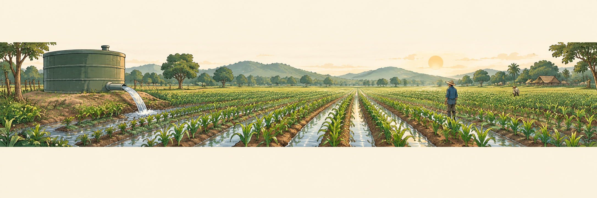

# ช่วงที่ 2 — ตรรกะควบคุมอัตโนมัติและการออกแบบ Fail-safe สำหรับฟาร์ม

**ให้โปรแกรมตัดสินใจและสั่งงานแทนเรา**

ช่วงนี้เราจะศึกษาหลักการ Hysteresis ฝึกเพิ่มเงื่อนไขเวลา จำลองปัญหาและเพิ่มกฎป้องกันความเสียหาย (fail-safe) ที่มีประโยชน์สำหรับหน้างานจริง

## ก่อนเริ่ม ให้ตรวจสอบดังนี้

- [ ] Home Assistant ยังใช้งานได้
- [ ] บอร์ดเซนเซอร์ใช้งานได้
- [ ] บอร์ดรีเลย์ใช้งานได้ สามารถเปิด–ปิดไฟ LED ได้
- [ ] เปิดบอร์ดเซนเซอร์และ Home Assistant ทิ้งไว้ตลอดช่วงนี้ เพื่อให้ Home Assistant บันทึกประวัติค่าเซนเซอร์ไว้อ่านและวิเคราะห์ในช่วงที่ 3

---

## กิจกรรมที่ 4 — ตั้งกฎให้ระบบทำงานอัตโนมัติ (Think)

{ .activity-banner width="1800" height="300" loading="lazy" decoding="async" }

**70 นาที** รวมต่อปั๊มแทนหลอดไฟ

**อุปกรณ์ที่ใช้** บอร์ด GoGo-IoT, บอร์ดรีเลย์, หลอด LED 12V ที่ต่ออยู่, **ปั๊มตู้ปลา 12V, สวิตช์ลูกลอยและแก้วน้ำจากช่วงที่ 1**, ไขควง, แล็ปท็อป

### ใบงาน { #a4 }

คลิกหัวข้อเพื่อดูวิธีทำ ทำเสร็จแล้วทำเครื่องหมายและบันทึกผล กรอกที่นี่หรือในขั้นตอนด้านล่างก็ได้

- [ ] **[4.1 สังเกตปัญหาไฟกะพริบ](#a4-1)** เกณฑ์เปิดไฟจากช่วงที่ 1 ต่ำกว่า {{n:s1.light.on|4}} ซึ่งเท่ากับเกณฑ์ปิด ขยับมือช้า ๆ อยู่ใกล้เกณฑ์ 1 นาที ไฟติดและดับรวมกี่ครั้ง {{n:s2.chatter.before|3}}
- [ ] **[4.2 แก้ไขด้วยการแยกเกณฑ์เปิดและปิด](#a4-2)** ปรับค่าเกณฑ์ปิดไฟ เพื่อให้มีช่องว่างระหว่างเกณฑ์เปิด ค่าเกณฑ์ปิดใหม่ที่เลือกคือ {{n:s2.light.off|4}} แล้วไฟติดดับเหลือกี่ครั้ง {{n:s2.chatter.after|3}} เงื่อนไข 3 ข้อที่ต้องผ่าน: ติดดับไม่เกิน 2 ครั้งใน 1 นาที · ครอบเซนเซอร์แล้วไฟติด · เอามือออกแล้วไฟดับ
- [ ] **[4.3 เพิ่มการจำกัดช่วงเวลาเปิดไฟ](#a4-3)** ตั้งช่วงเวลาที่ไม่ครอบคลุมเวลาปัจจุบัน แล้วครอบเซนเซอร์ ไฟไม่ติด เปิด **Traces** แล้วรอบล่าสุดหยุดที่ส่วนใด {{f:s2.time.trace|16}}
- [ ] **[4.4 เพิ่ม Trigger ให้รองรับทุกกรณี ให้ไฟเปิดได้เมื่อถึงเวลา](#a4-3b)** ทำนายผลก่อนแก้กฎ แสงมืดหลัง 18.30 น. ไฟติดหรือไม่ {{r:s2.time.dark_after|ติด|ไม่ติด}} · แสงมืดก่อน 18.30 น. {{r:s2.time.dark_before|ติด|ไม่ติด}} · หลังเพิ่ม trigger เวลา แสงมืดก่อนเวลาแล้วไฟติดเมื่อถึงเวลาหรือไม่ {{r:s2.time.fixed|ติด|ไม่ติด}} · ทำไมยังต้องตรวจค่าความสว่างในส่วน **And if** อีก {{f:s2.time.why|30}}
- [ ] **[4.5 ลองเพิ่มการแจ้งเตือน](#a4-4)** ให้กฎ `มืด-เปิดไฟ` ทำงาน แล้วดูว่ามีข้อความที่ไอคอนกระดิ่งหรือไม่
- [ ] **[4.6 ต่อปั๊มแทนหลอดไฟ](#a4-5)** ปิดกฎ สั่ง Off และถอดปลั๊กก่อนเปลี่ยนสาย ต่อปั๊มแล้วสั่ง On–Off ทดสอบ ปั๊มเดินแห้ง ไม่ต้องต่อสายยางหรือใช้น้ำ · ต่อปั๊มเมื่อ {{f:s2.pump_back_t|5}} น.
- [ ] **[4.7 สร้างกฎรดน้ำ](#a4-5b)** ความชื้นอากาศในห้อง = {{n:s1.hum.room}} % ค่าเกณฑ์ เปิดปั๊มเมื่อความชื้นต่ำกว่า {{n:s2.hum.on|4}} % ปิดปั๊มเมื่อสูงกว่า {{n:s2.hum.off|4}} %
- [ ] **[4.8 สร้างโหมด Auto และ Manual](#a4-6)** สร้าง Toggle `Pump Auto Mode` แสดงบนแดชบอร์ด และเพิ่มเป็นเงื่อนไขของกฎ `รดน้ำ - เปิดปั๊ม` · ปิดโหมดแล้วปั๊มเริ่มเองหรือไม่ {{r:s2.mode.off|ไม่เริ่ม|เริ่ม}} · เปิดโหมดแล้ว {{r:s2.mode.on|เริ่ม|ไม่เริ่ม}} · ก่อนจบให้ `Pump Auto Mode` และกฎรดน้ำสองกฎ **เปิดอยู่** กฎไฟสวนกับกฎตั้งเวลา **ปิดไว้**
- [ ] **[คำถามท้ายกิจกรรม](#a4-q)** เกณฑ์เปิดและเกณฑ์ปิดของระบบไฟสวนคือเท่าไร ทำไมสองค่านี้ต้องต่างกัน และเราเอาบทเรียนนี้ไปใช้กับระบบรดน้ำอย่างไร {{ta:s2.q4}}

### 4.1 สังเกตปัญหาไฟกะพริบ { #a4-1 }

**เตรียมทดสอบ**

1. ใช้หลอด LED แทนไฟสวน เปิดกฎ `มืด-เปิดไฟ` และ `สว่าง-ปิดไฟ` ไว้ทั้งคู่ ส่วนกฎ `ปิดไฟตามเวลา` (ถ้าสร้างไว้) ต้องปิดไว้ ขณะนี้เกณฑ์เปิดและปิดเป็นค่าเดียวกัน: {{n:s1.light.on|4}} หันหลอดออกจากเซนเซอร์ก่อนทดสอบ

**สังเกตและนับการเปิด–ปิด**

2. เลื่อนมือจนค่าแสงอยู่ใกล้เกณฑ์ แล้วขยับมือขึ้นลงช้า ๆ
3. ให้สมาชิกอีกคนจับเวลา 1 นาที นับทุกครั้งที่ไฟเปลี่ยนจากติดเป็นดับหรือดับเป็นติด
4. บันทึกก่อนแก้ {{n:s2.chatter.before|3}} ครั้งใน 1 นาที

> **Chattering** คือการเปิด–ปิดถี่เมื่อค่าแกว่งข้ามเกณฑ์ไปมา ทำให้รีเลย์และอุปกรณ์สึกหรอเร็ว

[↑ กลับไปที่ใบงาน](#a4){ .ws-back }

### 4.2 แก้ไขด้วยการแยกเกณฑ์เปิดและปิด { #a4-2 }

**แยกเกณฑ์เปิดและปิด**

1. เปิดกฎ `สว่าง-ปิดไฟ` ปรับ **Above** ให้สูงกว่าเกณฑ์เปิด แต่ต่ำกว่าค่าแสงเมื่อไม่บังเซนเซอร์ เช่น เปิดต่ำกว่า 40 ปิดสูงกว่า 60 เมื่อในห้องอ่านได้ 80

**ทดสอบและบันทึกผล**

2. กด **Save** แล้วขยับมือแบบเดิม 1 นาที
3. บันทึกเกณฑ์ปิด {{n:s2.light.off|4}} และจำนวนครั้งหลังแก้ {{n:s2.chatter.after|3}} ครั้ง

การเว้นระยะระหว่างเกณฑ์เปิดกับเกณฑ์ปิดเรียกว่า **hysteresis** เมื่อค่าอยู่ระหว่างสองเกณฑ์ อุปกรณ์จะคงสถานะเดิม

**ตรวจการทำงานหลังแก้**

4. ตรวจว่าขยับมือใกล้เกณฑ์เปิดแล้วไฟเปลี่ยนสถานะไม่เกิน 2 ครั้งใน 1 นาที จากนั้นครอบให้ไฟติดและเอามือออกให้ไฟดับ

> ถ้ายังกะพริบ ให้เพิ่มระยะห่างของเกณฑ์ ถ้าไฟไม่ติดหรือไม่ดับ ให้ตรวจว่าเกณฑ์ทั้งสองยังอยู่ระหว่างค่ามืดกับค่าสว่างที่วัดได้

[↑ กลับไปที่ใบงาน](#a4){ .ws-back }

### 4.3 เพิ่มการจำกัดช่วงเวลาเปิดไฟ { #a4-3 }

บางครั้งนอกจากค่าแสงสว่างแล้ว เราอาจต้องการจำกัดช่วงเวลาที่ไฟจะทำงานควบคู่กันไปด้วย เช่น ให้เปิดไฟได้หลัง 18.30 น. เท่านั้น ถ้ามืดก่อนก็ยังไม่ต้องเปิด

กฎจากช่วงที่ 1 มีแค่ **When** (trigger) กับ **Then do** (action) ส่วน **And if** คือ **condition** เงื่อนไขเพิ่มเติมที่ต้องผ่านทุกข้อ กฎจึงจะสั่งงาน

**เพิ่มเงื่อนไขเวลา**

1. เปิด `มืด-เปิดไฟ` ใน **And if** กด **+ Add condition → Time** ตั้งช่วงเวลา **After** และ **Before** ตามความเหมาะสมแล้วกด **Save**

**ทดสอบในและนอกช่วงเวลา**

**ก่อนทดสอบแต่ละรอบ:** เอามือออก รอให้ค่าแสงสูงกว่าเกณฑ์เปิด และสั่งรีเลย์ **Off** เพื่อให้เริ่มจากสภาพเดียวกัน

2. **ทดสอบในเวลา:** ตั้งช่วงที่ครอบคลุมเวลาปัจจุบัน แล้วครอบเซนเซอร์ ไฟควรติด
3. **ทดสอบนอกเวลา:** ตั้งช่วงที่ยังมาไม่ถึง แล้วครอบเซนเซอร์ ไฟควรไม่ติด เปิด **Traces** ดูว่ากฎหยุดที่ส่วนใด

> Condition ตรวจเมื่อเกิด trigger เท่านั้น การถึงช่วงเวลาที่ตั้งไว้ยังไม่ทำให้กฎเริ่มเอง

**บันทึกผล**

4. รอบล่าสุดใน Traces หยุดที่ส่วนใด {{f:s2.time.trace|16}}

### 4.4 เพิ่ม Trigger ให้รองรับทุกกรณี ให้ไฟเปิดได้เมื่อถึงเวลา { #a4-3b }

เนื่องจาก Trigger ทำงานเฉพาะเวลาที่ค่าแสงข้ามเกณฑ์ ดังนั้นถ้าฟ้ามืดก่อนถึงเวลาที่กำหนด จะพบว่าไฟไม่ติดเมื่อถึงเวลา เพราะค่าแสงข้ามเกณฑ์ไปก่อนหน้าแล้ว การแก้ไขต้องเพิ่ม trigger เวลาและตรวจค่าความสว่าง ณ ตอนนั้น

**ทำนายผลก่อนแก้กฎ** ด้วยกฎใน Automation ปัจจุบัน ถ้ากำหนดให้ไฟติดได้ระหว่าง 18.30 ถึง 07.30 น. วันถัดไป

1. ถ้าแสงมืดหลัง 18.30 น. ไฟจะติดหรือไม่ {{r:s2.time.dark_after|ติด|ไม่ติด}} เพราะ {{f:s2.time.dark_after_why|24}}
2. ถ้าแสงมืดก่อน 18.30 น. ไฟจะติดหรือไม่ {{r:s2.time.dark_before|ติด|ไม่ติด}} เพราะ {{f:s2.time.dark_before_why|24}}

การทำให้ระบบทำงานได้สมบูรณ์นั้น จำเป็นต้องเพิ่ม Trigger เมื่อถึงเวลา 18.30 น. เพิ่มเติม

**เพิ่มเหตุการณ์เวลาและเงื่อนไขแสง**

3. ใน `มืด-เปิดไฟ` เพิ่ม **When → + Add trigger → Time** ตั้งเวลา **At time** ให้ตรงกับค่าเวลา **After** ใน 4.3
4. เพิ่ม **And if → + Add condition** ค้นหาคำว่า **ความสว่าง (light)** ใส่ค่าเกณฑ์เปิดใน **Below**
5. ใน `สว่าง-ปิดไฟ` เพิ่ม **Time trigger** ตั้ง **At** ให้ตรงกับ **Before** ของกฎเปิดไฟ แล้วบันทึกทั้งสองกฎ

**ทดสอบ** จำลองฟ้ามืดก่อนเวลา แล้วไม่แตะเซนเซอร์อีก

6. สั่งรีเลย์ **Off** แล้วครอบเซนเซอร์ให้มืดค้างไว้
7. แก้ **After** และ **At time** ของกฎเปิดไฟเป็นอีก 2 นาทีข้างหน้า ส่วน **Before** และ **At time** ของกฎปิดไฟให้ช้ากว่านั้น 1 นาที กด **Save** ทั้งสองกฎ
8. รอดู ไฟต้องติดเมื่อถึงเวลาเปิด และดับเมื่อถึงเวลาปิด

**บันทึกผล**

9. ถ้าแสงมืดก่อนเวลาที่กำหนด เมื่อถึงเวลาแล้วไฟติดหรือไม่ {{r:s2.time.fixed|ติด|ไม่ติด}}

> หลาย trigger หมายถึงเกิดเหตุการณ์ใดเหตุการณ์หนึ่งก็เริ่มกฎได้ แต่ condition ทุกข้อยังต้องเป็นจริง

**อธิบายเหตุผล**

10. เมื่อเพิ่ม trigger เวลาแล้ว ทำไมยังต้องตรวจค่าความสว่างในส่วน And if อีก {{f:s2.time.why|30}}

[↑ กลับไปที่ใบงาน](#a4){ .ws-back }

### 4.5 ลองเพิ่มการแจ้งเตือน { #a4-4 }

Home Assistant สามารถส่งข้อความแจ้งเตือนได้ผ่านทางหน้า Web หรือทาง Mobile App (ต้องติดตั้ง App ก่อนจาก Play Store / App Store)

**เพิ่มข้อความแจ้งเตือน**

1. ใน `มืด-เปิดไฟ` เพิ่ม **Action → Send a persistent notification** ใส่ข้อความ เช่น `ไฟสวนเปิดแล้ว` แล้วกด **Save** ข้อความจะอยู่ที่ไอคอนกระดิ่ง

**ทดสอบการแจ้งเตือน**

2. ตั้งช่วง **After–Before** ให้ครอบคลุมเวลาปัจจุบัน เริ่มจากไฟดับและค่าแสงสูงกว่าเกณฑ์เปิด แล้วครอบเซนเซอร์ ไฟต้องติดและมีข้อความแจ้งเตือน

**(ไม่บังคับทำ) ลองแจ้งเตือนทางโทรศัพท์**

3. ถ้าเข้า Home Assistant ผ่านแอป Companion ไว้แล้ว ลองใช้ **Send a notification via mobile_app** เพื่อส่งข้อความไปยังโทรศัพท์

[↑ กลับไปที่ใบงาน](#a4){ .ws-back }

### 4.6 ต่อปั๊มแทนหลอดไฟ { #a4-5 }

ใช้รีเลย์ตัวเดิมควบคุมปั๊มแทนหลอดไฟ ในห้องนี้ปั๊ม**เดินแห้ง** ไม่ต่อสายยางและไม่ใช้น้ำ เราดูว่าปั๊มเดินหรือหยุดจากเสียงและการสั่นของตัวปั๊ม

**หยุดระบบและถอดปลั๊ก**

1. **ปิดกฎไฟสวนและกฎตั้งเวลาทุกกฎ** แล้วสั่งรีเลย์ **Off** การปิดกฎไม่ได้ปิดรีเลย์ ต้องทำทั้งสองอย่าง
2. **ถอดอะแดปเตอร์ออกจากปลั๊ก** ก่อนแก้สาย ถอดสายหลอด LED ที่เต๋าต่อสายและเก็บหลอดไว้

**ต่อปั๊มและจัดอุปกรณ์**

3. ต่อสายปั๊มแทนสายหลอด: สายบวกเข้าจุดที่มาจาก **NO** และสายลบเข้าจุดลบ ขันสกรูให้แน่น ไม่มีสายเข้า **NC**
4. วางปั๊มบนโต๊ะห่างจากบอร์ดและแล็ปท็อป เติมน้ำในแก้วครึ่งแก้วแล้ววางสวิตช์ลูกลอยลงไปเหมือนช่วงที่ 1 วางแก้วให้ห่างจากบอร์ด

**จ่ายไฟและทดสอบ**

5. เสียบอะแดปเตอร์ รอให้บอร์ดเชื่อมต่อ สถานะลูกลอยต้องแสดง **Wet**
6. สั่งปั๊ม **On** ประมาณ 10 วินาที แล้ว **Off** ฟังเสียงและแตะตัวปั๊ม ปั๊มต้องเดินแล้วหยุดตามคำสั่ง
7. บันทึกเวลาปัจจุบัน {{f:s2.pump_back_t|5}} น. เดี๋ยวจะใช้แยกแยะเหตุการณ์ใน Log เมื่ออ่านกราฟในกิจกรรมช่วงที่ 3

> ปั๊มเดินแห้งได้ครั้งละไม่นาน ทดสอบเสร็จให้สั่ง **Off** ทันที และไม่ปล่อยให้เดินทิ้งไว้เกิน 1 นาที
> หากปั๊มไม่เดิน ให้สั่ง **Off** และถอดปลั๊กก่อนตรวจสายบวกจาก NO สายลบ และกล่องจ่ายไฟ หากปั๊มเดินทั้งที่ Off ให้ตรวจว่าเผลอต่อกับ NC หรือไม่
> **ยังไม่ต้องเพิ่มกฎตรวจลูกลอย** ในฟาร์มจริงเราต้องตรวจเสมอว่าน้ำในถังแห้งหรือไม่  เราจะเพิ่มการป้องกันนี้ในกิจกรรมที่ 5

### 4.7 สร้างกฎรดน้ำ { #a4-5b }

**ใช้ความชื้นอากาศจำลองค่าความชื้นดิน** ใช้ลมปากเพิ่มค่าความชื้นเพื่อจำลองดินเปียก 

**ตรวจค่าก่อนเลือกเกณฑ์**

1. เลือกค่าเกณฑ์ที่แยกระหว่างดินแห้งกับดินเปียก ค่าที่เลือก = {{n:s1.hum.room}} % 

**สร้างกฎเปิด–ปิดปั๊ม**

2. สร้าง `รดน้ำ - เปิดปั๊ม` เลือก **Trigger → Entity → Numeric state → ความชื้นอากาศ** ตั้ง **Below** สูงกว่าค่าห้องเล็กน้อย และ **Action → Switch → Turn on** รีเลย์ของกลุ่ม
3. สร้าง `รดน้ำ - ปิดปั๊ม` ด้วยวิธีเดียวกัน ตั้ง **Above** สูงกว่าเกณฑ์เปิด 5–10 จุดเปอร์เซ็นต์ และ **Action → Switch → Turn off** บันทึกทั้งสองกฎ

**ทดสอบการทำงาน**

4. สั่งปั๊ม **On** จากหน้าอุปกรณ์ เป่าลมจนความชื้นสูงกว่าเกณฑ์ปิด ปั๊มต้องหยุด
5. รอให้ค่าลดต่ำกว่าเกณฑ์เปิด ปั๊มต้องกลับมาเดิน ถ้าค่าไม่ข้ามเกณฑ์ ให้ปรับเกณฑ์ให้อยู่ในช่วงที่ทดลองได้

**บันทึกผล**

6. ลองแยกค่าเกณฑ์ความชื้นอากาศที่ใช้เปิดและปิดปั๊ม ตามหลักการ Hysteresis เปิดปั๊มเมื่อต่ำกว่า {{n:s2.hum.on|4}} % ปิดปั๊มเมื่อสูงกว่า {{n:s2.hum.off|4}} % 

[↑ กลับไปที่ใบงาน](#a4){ .ws-back }

### 4.8 สร้างโหมด Auto และ Manual { #a4-6 }

ในหน้างานจริงมักใช้โหมดอัตโนมัติควบคู่กับโหมดสั่งเองด้วยมือ เวลาซ่อมอุปกรณ์หรือทดสอบข้อผิดพลาด เราจะได้เลือกเปิดหรือปิดปั๊มเองได้ โดยไม่ต้องพึ่งระบบอัตโนมัติเพียงอย่างเดียว

Home Assistant ปิดกฎแต่ละข้อได้อยู่แล้ว แต่ถ้าสร้างสวิตช์เลือกโหมดเพื่อใช้งานผ่านแดชบอร์ดจะสะดวกกว่า และเป็นหลักเดียวกับตู้ควบคุม Auto / Off / Manual ที่ใช้งานจริง

**สร้างสวิตช์เลือกโหมด** ซึ่งเป็นสวิตช์บนหน้าจอ ไม่ใช่อุปกรณ์จริง

1. เปิด **Settings → Devices & services** แล้วเลือกแท็บ **Helpers**
2. กด **+ Create helper** พิมพ์ค้นหา **"Toggle"** แล้วเลือก
3. ตั้งชื่อ `Pump Auto Mode` แล้วกด **Create**

**เปิดใช้แดชบอร์ดเพื่อดูสวิตช์ใหม่นี้**

4. เปิด **Settings → Dashboards** กด **+ Add dashboard**
5. เลือก **Overview (Legacy)** ตั้งชื่อว่า `Farm Dashboard` หรือชื่ออื่นที่ต้องการ ขอให้แน่ใจว่าเปิด **Add to sidebar** ไว้
6. เปิด Dashboard ใหม่นี้จากเมนูด้านซ้าย สังเกตดูว่ามีอะไรบ้าง หา Toggle ชื่อ `Pump Auto Mode` แล้วลองกดเปิด–ปิด

**แก้ไข Automation เพื่อให้กฎรดน้ำตรวจโหมดก่อนสั่งปั๊ม**

7. เปิด **Settings → Automations & scenes** เลือก `รดน้ำ - เปิดปั๊ม`
8. ในส่วน **And if** กด **+ Add condition** พิมพ์ในช่องค้นหา `Pump Auto Mode` แล้วเลือกเงื่อนไข **Switch is on**  กด **Save**

**ทดสอบ** ใช้วิธีเป่าลมแบบเดียวกับ 4.7 และสั่งรีเลย์ **Off** ก่อนทุกรอบ

9. ทดสอบโหมด Manual - ให้ปิด `Pump Auto Mode` เป่าลมให้ความชื้นสูงกว่าเกณฑ์เปิด แล้วหยุดเป่า เมื่อค่าลดต่ำกว่าเกณฑ์ ปั๊มเริ่มเองหรือไม่ {{r:s2.mode.off|ไม่เริ่ม|เริ่ม}} ระหว่างนี้สั่งรีเลย์ **On–Off** จากหน้าอุปกรณ์ ปั๊มยังเดินและหยุดตามมือเรา นี่คือโหมด Manual
10. ทดสอบโหมด Auto - เปิด `Pump Auto Mode` แล้วทำซ้ำ ปั๊มเริ่มเองหรือไม่ {{r:s2.mode.on|เริ่ม|ไม่เริ่ม}}

**เตรียมระบบสำหรับกิจกรรมถัดไป**

11. ก่อนทำกิจกรรมถัดไป ให้ `Pump Auto Mode` **เปิดอยู่** กฎรดน้ำสองกฎ **เปิดอยู่** และกฎไฟสวนกับกฎตั้งเวลา **ปิดไว้**

[↑ กลับไปที่ใบงาน](#a4){ .ws-back }

**คำถามท้ายกิจกรรม** เรานำหลักการ Hysteresis ไปใช้กับระบบรดน้ำนี้ได้อย่างไรบ้าง
{: #a4-q }

{{ta:s2.q4}}

---

## กิจกรรมที่ 5 — จำลองปัญหาและเพิ่มระบบป้องกัน (Failure lab)

{ .activity-banner width="1800" height="300" loading="lazy" decoding="async" }

**50 นาที**

**อุปกรณ์ที่ใช้** ระบบรดน้ำทำงานอยู่ ปั๊มต่อกับรีเลย์และเดินแห้ง สวิตช์ลูกลอยในแก้วน้ำ

จับคู่กับกลุ่มข้าง ๆ ผลัดกัน **จำลองปัญหา → สังเกตปัญหาที่เกิด → เพิ่มกฎเพื่อแก้ไข → สังเกตว่าแก้ปัญหาสำเร็จหรือไม่** 

### ใบงาน { #a5 }

คลิกหัวข้อเพื่อดูวิธีทำ ทำเสร็จแล้วทำเครื่องหมายและบันทึกผล กรอกที่นี่หรือในขั้นตอนด้านล่างก็ได้

- [ ] **[ก่อนจำลองปัญหาทุกข้อ](#a5-0)** ตรวจว่ากฎรดน้ำสองข้อเปิดอยู่ · `Pump Auto Mode` เปิดอยู่ · กฎไฟสวนและกฎตั้งเวลาปิดไว้ · ลูกลอยอยู่ในแก้วน้ำและแสดง Wet 
- [ ] **[5.1 น้ำหมด](#a5-1)**
    - จำลองปัญหาสำเร็จหรือไม่ {{r:s2.sab.1.ok|สำเร็จ|ไม่สำเร็จ}} · เกิดอะไรขึ้น {{f:s2.sab.1.what|24}}
    - แก้ได้แล้วหรือไม่ {{r:s2.sab.1.fixed|แก้ได้|ยังไม่ได้}} · หมายเหตุ {{f:s2.sab.1.note|24}}
- [ ] **[5.2 ปั๊มเสีย](#a5-2)**
    - จำลองปัญหาสำเร็จหรือไม่ {{r:s2.sab.2.ok|สำเร็จ|ไม่สำเร็จ}} · เกิดอะไรขึ้น {{f:s2.sab.2.what|24}}
    - แก้ได้แล้วหรือไม่ {{r:s2.sab.2.fixed|แก้ได้|ยังไม่ได้}} · หมายเหตุ {{f:s2.sab.2.note|24}}
- [ ] **[5.3 บอร์ดเซนเซอร์ดับ](#a5-3)**
    - ถ้าระบบควบคุมไม่ได้รับค่าความชื้น กลุ่มเลือกให้ปั๊ม {{r:s2.fs3.choice|เปิด|ปิด|คงสถานะเดิม}} เพราะ {{f:s2.fs3.why|30}}
    - จำลองปัญหาสำเร็จหรือไม่ {{r:s2.sab.3.ok|สำเร็จ|ไม่สำเร็จ}} · เกิดอะไรขึ้น {{f:s2.sab.3.what|24}}
    - แก้ได้แล้วหรือไม่ {{r:s2.sab.3.fixed|แก้ได้|ยังไม่ได้}} · หมายเหตุ {{f:s2.sab.3.note|24}}
- [ ] **[5.4 ปั๊มเดินนานเกินไป](#a5-4)**
    - จำลองปัญหาสำเร็จหรือไม่ {{r:s2.sab.4.ok|สำเร็จ|ไม่สำเร็จ}} · เกิดอะไรขึ้น {{f:s2.sab.4.what|24}}
    - แก้ได้แล้วหรือไม่ {{r:s2.sab.4.fixed|แก้ได้|ยังไม่ได้}} · หมายเหตุ {{f:s2.sab.4.note|24}}
- [ ] **[5.5 สรุปข้อจำกัดของกฎป้องกัน](#a5-5)** ปัญหาใดบ้างในตารางที่ไม่มีกฎข้อใดหยุดปั๊มได้ {{f:s2.fs.none|30}} ต้องผ่าน: ปัญหาที่ 1–4 จำลองแล้วเห็นอาการจริง และแก้แล้วจำลองซ้ำผ่าน
- [ ] **[คำถามท้ายกิจกรรม](#a5-q)** ถ้า Home Assistant ดับหรือส่งคำสั่งไม่ได้ กฎป้องกันเหล่านี้ยังช่วยหยุดปั๊มได้หรือไม่ ควรเพิ่มการป้องกันไว้ที่ใด {{ta:s2.q5}}

### ก่อนจำลองปัญหาทุกข้อ { #a5-0 }

**ตรวจความพร้อมก่อนทดสอบ**

1. ตรวจว่ากฎรดน้ำเปิดอยู่ `Pump Auto Mode` เปิดอยู่ กฎไฟสวนและกฎตั้งเวลาปิดไว้
2. ตรวจว่าปั๊มต่อกับรีเลย์แล้ว ลูกลอยอยู่ในแก้วน้ำและแสดง **Wet**
3. ตรวจว่าบอร์ดทั้งสองแสดงค่าปัจจุบัน เปิดหน้าอุปกรณ์ไว้คนละแท็บ
4. ใช้ปุ่มสั่งปั๊มในการทดสอบ ไม่ต้องเปลี่ยนเกณฑ์ความชื้น

### 5.1 น้ำต่ำแต่ปั๊มยังเดิน { #a5-1 }

**จำลองปัญหา**

1. ยกลูกลอยพ้นน้ำ รอให้แสดง **Dry** แล้วสั่งปั๊ม On

**สังเกตผล**

2. สังเกตว่าปั๊มยังเดิน (ฟังเสียง) เพราะกฎเดิมดูความชื้นแต่ไม่ตรวจระดับน้ำ จากนั้นสั่ง Off ก่อนแก้กฎ

**สร้างกฎป้องกัน**

หยุดปั๊มเมื่อน้ำต่ำ และหยุดด้วยหากมีคนสั่ง On ขณะน้ำต่ำ

3. สร้างกฎใหม่ เพิ่ม **Trigger → Entity → State** เลือกลูกลอย **To: Dry**
4. เพิ่ม trigger อีกข้อ เลือกสวิตช์รีเลย์ **To: On**
5. เพิ่ม **Condition → Entity → State** เลือกลูกลอย **Dry**
6. เพิ่ม **Action → Switch → Turn off** รีเลย์ และ **Send a persistent notification** ข้อความ `น้ำในถังต่ำ หยุดปั๊มแล้ว` บันทึกชื่อ `Fail-safe - น้ำหมด`
7. เปิดกฎ `รดน้ำ - เปิดปั๊ม` เพิ่ม condition ให้ลูกลอยเป็น **Wet** ก่อนเริ่มปั๊ม แล้วบันทึก

**ทดสอบให้ผ่านทั้งสองแบบ**

8. ลูกลอยเป็น Dry แล้วสั่ง On ทั้งจากปุ่มบนบอร์ดและหน้าอุปกรณ์ ปั๊มต้องหยุดและมีแจ้งเตือน
9. ลูกลอยเป็น Wet สั่งปั๊มเดิน แล้วยกลูกลอยให้เป็น Dry ปั๊มต้องหยุดเช่นกัน

**คืนสภาพลูกลอย**

10. วางลูกลอยกลับในน้ำ การกลับเป็น Wet อย่างเดียวไม่ได้สั่งปั๊มให้เริ่มใหม่

**บันทึกผล**

11. จำลองปัญหาสำเร็จหรือไม่ {{r:s2.sab.1.ok|สำเร็จ|ไม่สำเร็จ}} · เกิดอะไรขึ้น {{f:s2.sab.1.what|24}}

    แก้ได้แล้วหรือไม่ {{r:s2.sab.1.fixed|แก้ได้|ยังไม่ได้}} · หมายเหตุ {{f:s2.sab.1.note|24}}

> กฎเปิดปั๊มต้องเห็น **Wet** จึงจะเริ่มได้ ถ้าสายลูกลอยหลุดจะอ่าน Dry ถ้าบอร์ดขาดการเชื่อมต่อจะเป็น unavailable ทั้งสองกรณีไม่ผ่านเงื่อนไข

[↑ กลับไปที่ใบงาน](#a5){ .ws-back }

### 5.2 สั่งแล้วปั๊มไม่เดิน { #a5-2 }

**เตรียมการตรวจจับ**

1. วางบอร์ด GoGo-IoT ให้แตะตัวปั๊ม หรือวางบนพื้นเดียวกันชิดปั๊ม ให้รับแรงสั่นได้ ลองสั่ง On–Off ตรวจว่า `ปั๊มกำลังทำงาน` เปลี่ยนตาม หากไม่เปลี่ยน ให้ขยับตำแหน่งหรือเพิ่ม **ความไวตรวจจับปั๊ม**

**จำลองปัญหา**

2. สั่ง Off และถอดปลั๊กอะแดปเตอร์ก่อนถอดสายปั๊มที่จุดต่อจาก NO เก็บปลายสายไม่ให้แตะขั้วอื่น เสียบปลั๊ก รอให้บอร์ดเชื่อมต่อ แล้วสั่ง On

**สังเกตผล**

3. สังเกตว่ารีเลย์เป็น On แต่ปั๊มเงียบและไม่สั่น สถานะรีเลย์ยืนยันได้เพียงว่าสวิตช์เปิดอยู่

**สร้างกฎป้องกัน**

ตรวจแรงสั่นหลังสั่งเปิดปั๊ม หากไม่พบให้หยุดและแจ้งเตือน การสั่นเป็นหลักฐานประกอบ ไม่ได้ยืนยันว่าน้ำไหลถึงแปลง

| entity | บอกอะไร |
|---|---|
| `ความสั่นสะเทือน (vibration)` | ความแรงของการสั่น หน่วย **mg** (มิลลิจี) |
| `ปั๊มกำลังทำงาน (pump running)` | ผลการตรวจจับ เดิน / ไม่เดิน |

4. สร้าง automation ชื่อ `Fail-safe - สั่งแล้วไม่เดิน`
5. Trigger: **Entity → State** เลือกสวิตช์ปั๊ม ช่อง **To** ใส่ `On` ช่อง **For** ใส่ **15 วินาที** (สั้นกว่ากฎจำกัดเวลาที่จะสร้างในข้อ 5.4 จึงแยกได้ว่ากฎใดเป็นผู้ตัด)
6. Condition: **Entity → State** เลือก `ปั๊มกำลังทำงาน` สถานะ **Off**
7. Action: **Switch → Turn off** สวิตช์ปั๊ม และแจ้งเตือน `สั่งปั๊มแล้วแต่ไม่มีการสั่น ตรวจสายและระดับน้ำ`

**ทดสอบกฎ**

8. เมื่อสายยังถอดอยู่ สั่ง On กฎต้องปิดรีเลย์และแจ้งเตือนหลังครบประมาณ 15 วินาที

**ต่อสายกลับและทดสอบ**

9. สั่ง Off ถอดปลั๊ก แล้วต่อสายกลับ ขันให้แน่น เสียบปลั๊กและรอให้บอร์ดพร้อม สั่ง On อีกครั้ง ปั๊มต้องเดินผ่าน 15 วินาทีได้ ถ้าถูกตัด ให้ตรวจตำแหน่งบอร์ดและความไว

**บันทึกผล**

10. จำลองปัญหาสำเร็จหรือไม่ {{r:s2.sab.2.ok|สำเร็จ|ไม่สำเร็จ}} · เกิดอะไรขึ้น {{f:s2.sab.2.what|24}}

    แก้ได้แล้วหรือไม่ {{r:s2.sab.2.fixed|แก้ได้|ยังไม่ได้}} · หมายเหตุ {{f:s2.sab.2.note|24}}

[↑ กลับไปที่ใบงาน](#a5){ .ws-back }

### 5.3 บอร์ดเซนเซอร์ดับ { #a5-3 }

{ width="100%" }

ใช้สวิตช์ **ON / OFF** ปิดบอร์ด ไม่ใช่ปุ่ม BOOT การถอด USB อย่างเดียวอาจไม่ดับเพราะมีถ่านในบอร์ด

**จำลองปัญหา**

1. สั่งปั๊ม On แล้วปิดสวิตช์ GoGo-IoT ดูว่าเมื่อใดค่าความชื้นเปลี่ยนเป็น **unavailable** และปั๊มหยุดด้วยกฎใด จากนั้นเปิดบอร์ดกลับ

> กฎ `Fail-safe - สั่งแล้วไม่เดิน` จากข้อ 5.2 อาจหยุดปั๊มก่อนระบบตรวจพบว่าบอร์ดหาย ให้ดูชื่อกฎในแจ้งเตือนหรือ **Traces** อย่าตัดสินจากการหยุดของปั๊มอย่างเดียว

**เลือกวิธีรับมือ**

2. หากไม่ได้รับค่าความชื้น กลุ่มคิดว่าปั๊มควรเปิด ปิด หรือคงสถานะเดิม เพราะอะไร

**บันทึกผล**

3. กลุ่มเลือกให้ปั๊ม {{r:s2.fs3.choice|เปิด|ปิด|คงสถานะเดิม}} เพราะ {{f:s2.fs3.why|30}}

**สร้างกฎหยุดปั๊มเมื่อเซนเซอร์หาย**

กฎตัวอย่างนี้หยุดปั๊มเพื่อป้องกันการสูบน้ำต่อโดยไม่มีข้อมูล

4. สร้าง automation ชื่อ `Fail-safe - เซนเซอร์หาย`
5. Trigger: **Entity → State** เลือกความชื้นอากาศ ช่อง **To** พิมพ์ `unavailable` แล้วเพิ่ม trigger อีกอันแบบเดียวกันแต่ To เป็น `unknown`
6. Action: **Switch → Turn off** สวิตช์ปั๊ม และแจ้งเตือน `ไม่ได้รับค่าจากเซนเซอร์ หยุดปั๊มเพื่อความปลอดภัย`

**ทดสอบกฎ**

7. รอให้บอร์ดกลับมาแสดงค่า แล้วสั่งปั๊ม On และปิดบอร์ดอีกครั้ง ตรวจใน **Traces** ว่ากฎ `Fail-safe - เซนเซอร์หาย` ทำงานเมื่อค่าเป็น unavailable และสั่ง Off พร้อมแจ้งเตือน แม้กฎอื่นจะหยุดปั๊มไปก่อน จากนั้นเปิดบอร์ดกลับ

**บันทึกผล**

8. จำลองปัญหาสำเร็จหรือไม่ {{r:s2.sab.3.ok|สำเร็จ|ไม่สำเร็จ}} · เกิดอะไรขึ้น {{f:s2.sab.3.what|24}}

    แก้ได้แล้วหรือไม่ {{r:s2.sab.3.fixed|แก้ได้|ยังไม่ได้}} · หมายเหตุ {{f:s2.sab.3.note|24}}

[↑ กลับไปที่ใบงาน](#a5){ .ws-back }

### 5.4 ปั๊มเดินนานเกินไป { #a5-4 }

**จำลองปัญหา**

1. สั่งปั๊ม On รอ 1 นาทีโดยรักษาความชื้นให้คงที่

> ถ้าปั๊มถูกตัดที่ราว 15 วินาที แปลว่ากฎ `Fail-safe - สั่งแล้วไม่เดิน` จากข้อ 5.2 ทำงาน ให้ตรวจตำแหน่งบอร์ดและ **ความไวตรวจจับปั๊ม** แล้วจำลองใหม่

**สังเกตผล**

2. สังเกตว่าปั๊มยังเดิน เพราะความชื้นไม่ข้ามเกณฑ์ปิด สั่ง Off ก่อนสร้างกฎ

**สร้างกฎจำกัดเวลา**

3. สร้าง automation ชื่อ `Fail-safe - จำกัดเวลาเปิดปั๊ม`
4. Trigger: **Entity → State** เลือกสวิตช์ปั๊ม ช่อง **To** เลือก **On** ช่อง **For** ตั้ง **30 วินาที** (ใช้สำหรับการทดลองนี้ และยาวกว่ากฎสั่งแล้วไม่เดิน 15 วินาที)
5. Action: **Switch → Turn off** สวิตช์ปั๊ม และแจ้งเตือน `ปั๊มเดินเกินเวลา ตัดการทำงานแล้ว โปรดตรวจสอบ`

**ทดสอบการหยุดตามเวลา**

6. กดปุ่มให้ปั๊มเดินอีกครั้ง ปั๊มต้องหยุดเองที่ราว 30 วินาที พร้อมข้อความแจ้งเตือน

**บันทึกผล**

7. จำลองปัญหาสำเร็จหรือไม่ {{r:s2.sab.4.ok|สำเร็จ|ไม่สำเร็จ}} · เกิดอะไรขึ้น {{f:s2.sab.4.what|24}}

    แก้ได้แล้วหรือไม่ {{r:s2.sab.4.fixed|แก้ได้|ยังไม่ได้}} · หมายเหตุ {{f:s2.sab.4.note|24}}

> เมื่อตัดปั๊มแล้ว ให้ตรวจสาเหตุก่อนเริ่มใหม่ กฎรดน้ำจะเริ่มอีกครั้งเมื่อความชื้นข้ามเกณฑ์เปิด ไม่ใช่ทันทีที่ปัญหาหมดไป

[↑ กลับไปที่ใบงาน](#a5){ .ws-back }

### 5.5 สรุปข้อจำกัดของกฎป้องกัน { #a5-5 }

**ทบทวนข้อจำกัด**

1. อ่านตาราง แล้วระบุปัญหาที่ไม่มีกฎใดหยุดปั๊มได้ในช่องบันทึกผล

| ปัญหาที่เกิดขึ้น | Home Assistant เห็นอะไร | กฎที่หยุดปั๊ม |
|---|---|---|
| สายลูกลอยหลุด หรือลูกลอยค้างในตำแหน่งจม | ลูกลอยเป็น **Dry** | กฎน้ำหมด (หยุดปั๊มทั้งที่อาจยังมีน้ำ ปลอดภัยแต่ต้องมีคนไปดู) |
| ลูกลอยค้างในตำแหน่งลอย เช่น ติดตะไคร่หรือขอบถัง | ลูกลอยยังเป็น **Wet** ทั้งที่น้ำหมด | กฎน้ำหมดตรวจไม่พบ; กฎจำกัดเวลายังตัดได้เมื่อครบเวลา ต้องตรวจลูกลอยและใช้ข้อมูลอื่นยืนยัน |
| น้ำหมดอยู่ก่อนแล้ว มีคนสั่งเปิดปั๊มจากหน้าอุปกรณ์หรือปุ่มบนบอร์ด | สวิตช์ปั๊มเป็น On ขณะลูกลอยเป็น **Dry** | กฎน้ำหมด (trigger ที่สอง) |
| บอร์ด GoGo-IoT โดนปิดสวิตช์ ถ่านหมด หรือหลุดจาก WiFi | entity ทุกตัวของบอร์ดเป็น **unavailable** | กฎเซนเซอร์หาย หรือกฎจำกัดเวลา; กฎรดน้ำไม่เริ่มรอบใหม่ถ้าลูกลอยไม่ใช่ Wet |
| สั่งแล้วปั๊มไม่เดิน | สวิตช์เป็น On แต่ `ปั๊มกำลังทำงาน` เป็น Off | กฎสั่งแล้วไม่เดิน |
| ปั๊มเดินนานผิดปกติไม่ว่าจากสาเหตุใด | สวิตช์เป็น On นานเกิน | กฎจำกัดเวลา |
| แล็ปท็อปหลุดจาก WiFi หรือ Home Assistant ดับ | Home Assistant ไม่สามารถติดตามหรือสั่งงานปั๊มได้ | **ไม่มีข้อใดเลย** ปั๊มค้างอยู่ในคำสั่งสุดท้าย |

**บันทึกผล**

2. ปัญหาใดบ้างในตารางที่ไม่มีกฎข้อใดหยุดปั๊มได้ {{f:s2.fs.none|30}}

**ตรวจผลการทดลอง**

3. ตรวจว่ากลุ่มทำข้อ 5.1–5.4 ครบ และทดสอบกฎป้องกันที่สร้างไว้ซ้ำผ่านแล้วทุกข้อ

[↑ กลับไปที่ใบงาน](#a5){ .ws-back }

**คำถามท้ายกิจกรรม** ถ้า Home Assistant ดับหรือส่งคำสั่งไม่ได้ กฎป้องกันเหล่านี้ยังช่วยหยุดปั๊มได้หรือไม่ ควรเพิ่มการป้องกันไว้ที่ใด
{: #a5-q }

{{ta:s2.q5}}

---

## สรุปและสาธิตตู้ควบคุม

**15 นาที**

### อภิปราย

- ถ้า Home Assistant หยุดทำงาน อะไรควรหยุดปั๊มแทนได้
- อุปกรณ์ใดเสี่ยงเสียก่อน และต้องตรวจอะไรเป็นประจำ

> **บันทึกผล** ตารางบำรุงรักษา ใครดูแล บ่อยแค่ไหน ดูอะไร

| รายการ | ผู้รับผิดชอบ | ความถี่ | สิ่งที่ต้องตรวจ |
|--------|-------|------------|--------|
| เซนเซอร์บนบอร์ด | {{f:s2.maint.sensor.who|8}} | {{f:s2.maint.sensor.freq|8}} | {{f:s2.maint.sensor.what|16}} |
| สวิตช์ลูกลอย | {{f:s2.maint.float.who|8}} | {{f:s2.maint.float.freq|8}} | {{f:s2.maint.float.what|16}} |
| ปั๊มและท่อ | {{f:s2.maint.pump.who|8}} | {{f:s2.maint.pump.freq|8}} | {{f:s2.maint.pump.what|16}} |
| รีเลย์และตู้ควบคุม | {{f:s2.maint.relay.who|8}} | {{f:s2.maint.relay.freq|8}} | {{f:s2.maint.relay.what|16}} |
| เครือข่ายและ Home Assistant | {{f:s2.maint.net.who|8}} | {{f:s2.maint.net.freq|8}} | {{f:s2.maint.net.what|16}} |

### สาธิต: ตู้ควบคุมปั๊ม Auto / Off / Manual

ดูผู้สอนสลับ **Auto / Off / Manual** แล้วสังเกตว่าแต่ละโหมดให้ใครสั่งปั๊ม

| ตำแหน่ง | ใครสั่งปั๊ม | ใช้เมื่อไร |
|---------|-------------|------------|
| **Auto** | ระบบควบคุมอัตโนมัติของชุดสาธิต | ทำงานตามกฎ |
| **Off** | หยุดคำสั่งเดินปั๊ม | หยุดใช้งาน; ก่อนซ่อมต้องตัดแหล่งจ่ายไฟด้วย |
| **Manual** | คนผ่านสวิตช์ที่ตู้ | สั่งงานในพื้นที่เมื่อระบบอัตโนมัติขัดข้อง |

> การหยุดปั๊มจากตู้ช่วยให้คนควบคุมได้แม้ Home Assistant ใช้งานไม่ได้ การป้องกันด้วยวงจรต้องออกแบบและติดตั้งให้เหมาะกับปั๊มจริง

### สิ่งที่เราได้เรียนรู้

1. **automation = trigger + condition + action** และการทดสอบต้องทำให้ค่า **ข้าม** เกณฑ์จริง
2. **ใช้ hysteresis ลดการเปิด–ปิดถี่** กำหนดเกณฑ์เปิดและปิดให้ต่างกัน หลักนี้นำไปใช้ได้ทั้งกับหลอดไฟ ปั๊ม และอุปกรณ์อื่น
3. **ปัญหาเกิดได้ทั้งที่เซนเซอร์ เครือข่าย และระบบควบคุม** ในชุดทดลองนี้ เมื่อส่งคำสั่งใหม่ไม่ได้ ปั๊มจะคงสถานะตามคำสั่งล่าสุด
4. **fail-safe ต้องช่วยป้องกันความเสียหายได้จริง** นอกจากแจ้งเตือนแล้ว ต้องทำให้ระบบหยุดหรือทำงานในลักษณะที่ปลอดภัย และควรมีการป้องกันที่ทำงานได้แม้ระบบควบคุมหลักขัดข้อง
5. **กำหนดผู้ดูแลตั้งแต่เริ่มออกแบบ** ระบุให้ชัดว่าใครตรวจอะไร และต้องตรวจบ่อยเพียงใด

### ก่อนจบช่วงที่ 2

- [ ] **เปิด Home Assistant และแล็ปท็อปไว้** ไม่ให้เครื่องพักการทำงาน เพื่อเก็บข้อมูลต่อสำหรับช่วงที่ 3
- [ ] ปิดกฎ `รดน้ำ - เปิดปั๊ม` แล้วสั่งรีเลย์ **Off** ตรวจว่าปั๊มหยุด
- [ ] จ่ายไฟให้บอร์ดทั้งสองตามเดิม และกด **ดาวน์โหลดคำตอบ** สำรองคำตอบของกลุ่ม

ต่อไป: [ช่วงที่ 3 — โครงสร้างระบบ IoT: การสื่อสาร คลาวด์ แดชบอร์ด และการออกแบบระบบ](session-3.md)
