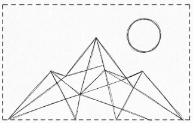

# ช่วงที่ 2 — ตรรกะควบคุมอัตโนมัติและการออกแบบ Fail-safe สำหรับฟาร์ม

**Logic ย้ายเข้าซอฟต์แวร์**

ในช่วงที่ 1 เราเป็น Logic เอง ช่วงนี้เราย้ายกฎเข้า Home Assistant แล้วทำให้ฉลาดขึ้น เราจะเริ่มจากระบบไฟกลางคืนสำหรับแปลงไม้ดอก เพื่อเรียนรู้ปัญหาที่ระบบอัตโนมัติทุกระบบต้องเจอ แล้วนำบทเรียนนั้นกลับมาใช้กับระบบรดน้ำของเรา ครึ่งหลังผู้สอนจะ **ทำให้ระบบของเราพังทีละส่วน** ขณะปั๊มทำงานอยู่ เพื่อให้เห็นด้วยตาว่าระบบอัตโนมัติล้มเหลวอย่างไร

> **เมื่อจบช่วงนี้** ระบบจะเปิดไฟเองเมื่อมืดโดยไม่กะพริบ รดน้ำเองเมื่ออากาศแห้ง และหยุดเองเมื่อน้ำหมด เซนเซอร์หาย หรือเดินนานเกิน

## ก่อนเริ่ม

- [ ] ต่อแล็ปท็อปเข้า WiFi ห้องอบรม เปิด Home Assistant ของทีม รอครึ่งนาที แล้วตรวจว่า entity ของบอร์ดทั้งสองกลับมาแสดงค่า (ไม่ใช่ unavailable)
- [ ] ดูจอกล่องจ่ายไฟว่ายังติด และไฟบอร์ด GoGo-IoT ที่ช่อง USB ยังติด
- [ ] วางปั๊มกลับลงใบ A ปลายสายยางลงใบ A สวิตช์ลูกลอยอยู่ในใบ A เติมน้ำให้ค่อนใบ
- [ ] สลับบทบาทตามตาราง

---

## ข้อมูลช่วงที่เราไม่อยู่

**15 นาที** · บอร์ด GoGo-IoT ของเราอยู่ในห้องและส่งค่าให้เครื่อง Home Assistant กลางของผู้สอนตลอด

1. เปิดเครื่อง Home Assistant กลางตามที่อยู่ที่ผู้สอนแจ้ง (หรือดูจากจอโปรเจกเตอร์)
2. ไปที่ **History** กด **+ Choose entity** แล้วค้นหาชื่อบอร์ดของทีมเรา เพิ่มความชื้นอากาศ อุณหภูมิ และแสง
3. ตั้งช่วงเวลาให้ครอบตั้งแต่ตอนจบช่วงที่ 1 จนถึงตอนนี้

{ width="60%" }

> **จดลงใบบันทึก** ความชื้นอากาศต่ำสุดและสูงสุด ตอนกี่โมง · ไฟห้องดับตอนกี่โมง เปิดตอนกี่โมง (อ่านจากกราฟแสง) · กราฟมีช่วงขาดหายหรือไม่

**ตอบด้วยข้อมูลของทีม** ถ้าใช้ค่าเกณฑ์ความชื้นที่เลือกไว้ในช่วงที่ 1 ปั๊มควรเดินตอนกี่โมงบ้าง และถ้าไม่มีการบันทึกข้อมูล เราจะรู้เรื่องนี้ได้อย่างไร

---

## กิจกรรมที่ 3 — Think

**60 นาที** · บอร์ด GoGo-IoT, บอร์ดรีเลย์, แล็ปท็อป

> **สลับบทบาทก่อนเริ่ม**

### สถานการณ์: ไฟกลางคืนสำหรับแปลงไม้ดอก

ไม้ดอกหลายชนิด เช่น เบญจมาศ ต้องได้แสงยาวกว่ากลางวันธรรมชาติ สวนจึงเปิดหลอดไฟเมื่อมืด ระบบนี้ต้องตัดสินใจจาก **เซนเซอร์แสง** และสั่ง **หลอดไฟ** ผ่านรีเลย์ ในห้องนี้ไฟ LED บนบอร์ดรีเลย์ทำหน้าที่แทนหลอดไฟในสวน เมื่อรีเลย์ทำงาน ไฟติด นั่นคือหลอดไฟในสวนติด

เราเลือกสถานการณ์นี้ก่อนระบบรดน้ำเพราะเซนเซอร์แสงตอบทันที ใช้มือครอบก็มืด เปิดมือก็สว่าง ทำให้เห็นปัญหาของระบบอัตโนมัติได้ในไม่กี่วินาที

### ปลดปั๊มออกชั่วคราว

รีเลย์ตัวเดียวของเราต่อปั๊มอยู่ ระหว่างฝึกเรื่องไฟสวน รีเลย์จะเปิดปิดถี่ ซึ่งไม่ดีกับปั๊ม **Hardware** คลายสกรูขั้ว **NO** บนบอร์ดรีเลย์ ถอดสายบวกของปั๊มออก แล้วพับปลายสายให้ห่างจากขั้วอื่น รีเลย์จะยังคลิกและไฟ LED ยังติด แต่ปั๊มไม่เดิน เราจะต่อกลับตอนกลับมาที่ระบบรดน้ำ

### automation หนึ่งข้อมีสามส่วน

| ส่วน | คำถามที่มันตอบ |
|------|----------------|
| **Trigger** | เมื่อไร |
| **Condition** | แต่ต้อง... ด้วย |
| **Action** | ให้ทำอะไร |

### (ก) เกณฑ์เดียว: มืดแล้วเปิดไฟ

ทีมเลือก **ค่าเกณฑ์แสง** จากค่าปกติในห้องและค่าตอนครอบที่จดไว้ เลือกค่ากลาง ๆ ระหว่างสองค่านั้น

1. **Settings → Automations & scenes** กด **+ Create automation → Create new automation**
2. ในส่วน **When** กด **+ Add trigger → Entity → Numeric state**
3. เลือก entity แสง ช่อง **Below** พิมพ์ค่าเกณฑ์
4. ในส่วน **Then do** กด **+ Add action** ค้นหา **Switch → Turn on** เลือก entity สวิตช์ของบอร์ดรีเลย์
5. **Save** ตั้งชื่อ `ไฟสวน - เปิด`

{ width="60%" }

**ทดสอบ** Hardware ครอบบอร์ด ไฟ LED บนรีเลย์ติดหรือไม่ เปิดมือ ไฟดับหรือไม่ เพราะอะไร

> trigger แบบ Numeric state ทำงานเฉพาะตอนค่า **ข้าม** เส้นเกณฑ์ ถ้าค่าอยู่ใต้เกณฑ์อยู่แล้วตั้งแต่ก่อนสร้างกฎ จะยังไม่มีอะไรเกิดขึ้น ต้องทำให้ค่าขึ้นเหนือเกณฑ์ก่อนแล้วค่อยลดลงมาใหม่

สั่ง Off ด้วยมือก่อนไปขั้นถัดไป

### ดูปัญหาให้เห็นก่อนแก้

สร้าง automation ข้อที่สองด้วยวิธีเดียวกัน แต่ trigger ใช้ช่อง **Above** พิมพ์ **ค่าเดียวกับค่าเปิด** และ action เป็น **Switch → Turn off** ตั้งชื่อ `ไฟสวน - ปิด`

ตอนนี้ระบบมีกฎครบ มืดเปิด สว่างปิด ดูเหมือนถูกต้อง

**Hardware** ค่อย ๆ เลื่อนมือเข้าหาบอร์ดจนค่าแสงอยู่ใกล้เกณฑ์ แล้วขยับมือช้า ๆ ขึ้นลงตรงนั้นราวหนึ่งนาที เหมือนเมฆบางลอยผ่านตอนพลบค่ำ **Driver** นับจำนวนครั้งที่ไฟ LED ติดดับ

> อาการนี้เรียกว่า **chattering** ในสวนจริงคือหลอดไฟกะพริบทุกเย็น รีเลย์เสียก่อนเวลา และถ้าเป็นปั๊มก็คือปั๊มกระตุกจนพัง

### (ข) Hysteresis: ปิดด้วยเกณฑ์อีกค่า

เปิด `ไฟสวน - ปิด` แก้ค่า **Above** ให้สูงกว่าค่าเปิดพอสมควร (เช่น สูงกว่าราวหนึ่งในสี่ของระยะระหว่างค่ามืดกับค่าสว่าง) กด Save แล้วให้ Hardware ทำแบบเดิม นับใหม่

> **จดลงใบบันทึก** จำนวนครั้งที่ไฟติดดับใน 1 นาที ก่อนแก้และหลังแก้ · ค่าเปิดไฟและค่าปิดไฟของทีม

- [ ] **ทีมตรวจเอง** ขยับมือรอบเกณฑ์หนึ่งนาทีแล้วไฟติดดับไม่เกิน 2 ครั้ง ถือว่าผ่าน ถ้ายังกะพริบถี่ ให้ถ่างค่าเปิดกับค่าปิดออกอีก

### (ค) เงื่อนไขเวลา *(เมื่อมีเวลา)*

สวนไม้ดอกไม่ได้เปิดไฟทั้งคืน แต่เปิดเป็นช่วง เปิด `ไฟสวน - เปิด` ในส่วน **And if** กด **+ Add condition → Time** ตั้ง **After** และ **Before**

เพื่อทดสอบในห้อง ตั้งช่วงที่ครอบเวลาปัจจุบันก่อน แล้วลองตั้งช่วงที่ไม่ครอบ เพื่อดูว่า trigger ทำงานแต่ action ไม่เกิด

### (ง) แจ้งเตือน *(เมื่อมีเวลา)*

เพิ่ม action อีกอันใน `ไฟสวน - เปิด` ค้นหา **notification → Send a persistent notification** ใส่ข้อความที่อยากให้เจ้าของสวนเห็น ข้อความจะขึ้นที่ไอคอนกระดิ่งมุมล่างซ้าย

ถ้ามีใครติดตั้งแอป Home Assistant Companion ไว้ ให้ใช้ **Send a notification via mobile_app** แทน ข้อความจะเด้งบนโทรศัพท์จริง

### สลับสถานการณ์: กลับมาที่ระบบรดน้ำ

รีเลย์ของเรามีตัวเดียว ตอนนี้จะให้ทำหน้าที่ปั๊มแทนหลอดไฟ

1. **ปิดสวิตช์** ของ `ไฟสวน - เปิด` และ `ไฟสวน - ปิด` ทั้งสองข้อ (สวิตช์ทางขวาในหน้า Automations) กฎยังอยู่ แต่ไม่ทำงาน แล้วสั่งสวิตช์รีเลย์เป็น Off
2. **Hardware** ต่อสายบวกของปั๊มกลับเข้าขั้ว **NO** ขันแน่น ตรวจว่าปั๊มจมอยู่ในใบ A และปลายสายยางอยู่ในใบ A (น้ำวน)
3. สร้าง automation `รดน้ำ - เปิดปั๊ม`: Numeric state ของ **ความชื้นอากาศ** ช่อง **Below** ใส่ค่าเกณฑ์จากช่วงที่ 1 (สูงกว่าค่าปกติในห้องเล็กน้อย) → Switch turn on
4. สร้าง `รดน้ำ - ปิดปั๊ม`: Numeric state ของความชื้นอากาศ ช่อง **Above** ใส่ค่าที่ **สูงกว่า** ค่าเปิดราว 5–10 % (ใช้บทเรียนจากข้อ (ข) ทันที) → Switch turn off
5. ทดสอบ: ค่าในห้องต่ำกว่าเกณฑ์เปิดอยู่แล้ว ให้ Hardware เป่าลมใส่บอร์ดจนค่าพุ่งเกินเกณฑ์ปิด ปั๊มหยุดหรือไม่ แล้วหยุดเป่า รอให้ค่าตกลงต่ำกว่าเกณฑ์เปิด ปั๊มกลับมาเดินหรือไม่ ใช้เวลากี่วินาที

### แผงควบคุม

**Overview** → ดินสอ → **+ Add card → Entities** เพิ่มห้าอย่าง แล้วตั้งชื่อ card ว่า `แผงควบคุม`

- automation `รดน้ำ - เปิดปั๊ม` และ `รดน้ำ - ปิดปั๊ม`
- automation `ไฟสวน - เปิด` และ `ไฟสวน - ปิด` (ปิดอยู่)
- entity สวิตช์ของบอร์ดรีเลย์ (นี่คือ **manual override** บนหน้าจอ)

{ width="55%" }

ลองปิดสวิตช์ของ `รดน้ำ - เปิดปั๊ม` แล้วทำให้อากาศแห้ง ปั๊มทำอะไร และยังสั่งด้วยมือได้หรือไม่

**คำถามของ Recorder** ค่าเปิดและค่าปิดของระบบไฟสวนคือเท่าไร ทำไมสองค่านี้ต้องต่างกัน และเราเอาบทเรียนนี้ไปใช้กับระบบรดน้ำอย่างไร

---

## กิจกรรมที่ 4 — Failure lab

**45 นาที** · ระบบรดน้ำทำงานอยู่ ปั๊มจมในใบ A น้ำวนกลับใบ A สวิตช์ลูกลอยในใบ A

> **สลับบทบาทก่อนเริ่ม**

### รอบก่อกวน

**จับคู่กับทีมข้าง ๆ** ทีมของเราจะเป็นทั้งผู้ก่อกวนและผู้ถูกก่อกวน สลับกันไปมา ผู้สอนแจกบัตรก่อกวน 3 ใบให้ทุกทีม **ห้ามให้ทีมคู่เห็นบัตร**

ก่อนเริ่ม ทั้งสองทีมทำให้ปั๊มของตัวเองเดินอยู่ (ปล่อยค่าความชื้นตามปกติของห้อง ถ้าปั๊มไม่เดินให้ขยับค่าเกณฑ์เปิดขึ้นชั่วคราว) น้ำวนในถังเดียวจึงไม่มีวันหมด

ทำสามรอบ แต่ละรอบมีสองครึ่ง

1. **ครึ่งแรก เราเป็นผู้สังเกต** ทุกคนในทีมหันไปมองแดชบอร์ดอย่างเดียว **ห้ามมองโต๊ะอุปกรณ์** คนจากทีมคู่จะเดินมาทำอะไรบางอย่างกับระบบของเราตามบัตรของเขา
2. **ครึ่งหลัง เราเป็นผู้ก่อกวน** คนหนึ่งจากทีมเราถือบัตรใบที่ตรงกับรอบนั้น เดินไปทำกับระบบของทีมคู่ แล้วกลับมา

ตอนเป็นผู้สังเกต หน้าที่คือ **ดูอย่างเดียว ห้ามแก้** จนกว่าจะจบรอบ

> **จดลงใบบันทึกทันทีทุกรอบ** เห็นอะไรบนแดชบอร์ด · ปั๊มทำอะไร · ทีมคิดว่าสาเหตุคืออะไร · ใช้เวลากี่วินาทีจึงสังเกตเห็น

เมื่อครบสามรอบ **เปิดบัตรเทียบกัน** ทั้งสองทีมดูว่าเดาถูกกี่รอบ แล้วตอบร่วมกันว่า **รอบไหนที่ปั๊มยังเดินอยู่แม้ Logic ไม่รู้เรื่องอะไรแล้ว** และ **รอบไหนที่แดชบอร์ดดูปกติทุกอย่างแต่ระบบไม่ทำงานจริง**

> พอสำหรับตอนนี้: เมื่อการเชื่อมต่อขาด entity จะกลายเป็น **unavailable** และปั๊มค้างอยู่ในสถานะสุดท้ายที่ได้รับคำสั่ง โดยไม่มีใครสั่งมันต่อ เราจะเปิดดูว่าการเชื่อมต่อนั้นคืออะไรในช่วงที่ 3

### Fail-safe 1 — น้ำในถังหมด หยุดปั๊ม

นี่คือเหตุผลที่ระบบของเรามีสวิตช์ลูกลอย ปั๊มที่ดูดอากาศเพราะน้ำหมดจะพังภายในไม่กี่นาที

1. สร้าง automation ชื่อ `Fail-safe - น้ำหมด`
2. Trigger: **Entity → State** เลือกสวิตช์ลูกลอย ช่อง **To** เลือกสถานะที่จดไว้ว่าปรากฏ **ตอนยกลูกลอยขึ้น** (คือน้ำต่ำ)
3. Action สองอย่าง: **Switch → Turn off** สวิตช์ปั๊ม และ **Send a persistent notification** ข้อความ `น้ำในถังต่ำ หยุดปั๊มแล้ว`
4. ทดสอบ: ปั๊มเดินอยู่ ให้ Hardware ยกสวิตช์ลูกลอยขึ้นพ้นน้ำ จับเวลาว่าปั๊มดับเมื่อไร แล้ววางกลับ

> ตอนนี้กฎรดน้ำและกฎน้ำหมดขัดกันได้: อากาศแห้งสั่งเปิด แต่น้ำหมดสั่งปิด ลองดูว่าถ้าลูกลอยยังยกอยู่แล้วอากาศแห้งอีกครั้ง ปั๊มจะเป็นอย่างไร กฎข้อไหนควรชนะ และทำอย่างไรให้ชนะเสมอ (คำใบ้: เพิ่ม condition ให้ `รดน้ำ - เปิดปั๊ม` ตรวจสถานะลูกลอยก่อน)

### Fail-safe 2 — ปั๊มเดินได้ไม่เกินเวลาที่กำหนด

ไม่ว่า Logic จะคิดอะไร ปั๊มไม่ควรเดินติดต่อกันนานเกินที่แปลงจะรับได้

1. สร้าง automation ชื่อ `Fail-safe - เวลาปั๊มสูงสุด`
2. Trigger: **Entity → State** เลือกสวิตช์ปั๊ม ช่อง **To** เลือก **On** ช่อง **For** ตั้ง **30 วินาที** (ในฟาร์มจริงอาจเป็น 10–20 นาที)
3. Action: **Switch → Turn off** สวิตช์ปั๊ม และแจ้งเตือน `ปั๊มเดินเกินเวลา ตัดการทำงานแล้ว โปรดตรวจสอบ`
4. ทดสอบ: สั่งเปิดปั๊มด้วยมือ แล้วจับเวลาว่าดับเองเมื่อไร

### Fail-safe 3 — เซนเซอร์หาย ไปสู่สถานะปลอดภัย *(เมื่อมีเวลา)*

ทีมตกลงกันก่อนว่า **ถ้า Logic ไม่รู้ค่าความชื้นแล้ว ปั๊มควรเปิด ปิด หรือคงสถานะเดิม** และเพราะอะไร

1. สร้าง automation ชื่อ `Fail-safe - เซนเซอร์หาย`
2. Trigger: **Entity → State** เลือกความชื้นอากาศ ช่อง **To** พิมพ์ `unavailable` แล้วเพิ่ม trigger อีกอันแบบเดียวกันแต่ To เป็น `unknown`
3. Action: **Switch → Turn off** สวิตช์ปั๊ม และแจ้งเตือน `ไม่ได้รับค่าจากเซนเซอร์ หยุดปั๊มเพื่อความปลอดภัย`
4. ทดสอบ: ปั๊มเดินอยู่ ให้ Hardware ถอดสาย USB ของ **บอร์ด GoGo-IoT** ออกจากช่อง USB ของกล่องจ่ายไฟ จับเวลาว่าปั๊มดับเมื่อไร แล้วเสียบกลับ

{ width="60%" }

- [ ] **ทีมตรวจเอง** ทดสอบ fail-safe อย่างน้อยหนึ่งข้อแล้วเห็นปั๊มดับเองจริง และมีข้อความแจ้งเตือนขึ้น

**คำถามของ Recorder** fail-safe ทั้งหมดอยู่ใน Home Assistant ถ้าแล็ปท็อปดับหรือปิดฝาไปเหมือนรอบก่อกวน fail-safe เหล่านี้ยังทำงานหรือไม่ ถ้าไม่ ควรมีอะไรอยู่ที่ไหนอีกจึงจะปลอดภัยจริง

---

## สรุปและสาธิตตู้ควบคุม

**15 นาที**

### อภิปราย

- ระบบสำรอง (redundancy) ในฟาร์มมีอะไรบ้าง อะไรคุ้มค่าทำก่อน
- watchdog คืออะไร ต่างจาก fail-safe ที่เราทำอย่างไร
- ชิ้นส่วนไหนในระบบของเราจะเสียก่อน และเพราะอะไร

> **จดลงใบบันทึก** ตารางบำรุงรักษา: ใครดูแล บ่อยแค่ไหน ดูอะไร สำหรับเซนเซอร์ สวิตช์ลูกลอย ปั๊มและท่อ รีเลย์ และเครือข่าย

### สาธิต: ตู้ควบคุมปั๊ม Auto / Off / Manual

ผู้สอนต่อตู้ควบคุมจริงเข้าชุดอุปกรณ์ของผู้สอน แล้วบิดสวิตช์ขณะ automation ทำงานอยู่ ดูว่าปั๊มฟังใคร

{ width="50%" }

| ตำแหน่ง | ใครสั่งปั๊ม | ใช้เมื่อไร |
|---------|-------------|------------|
| **Auto** | ตัวควบคุม | ทำงานปกติ |
| **Off** | ไม่มีใคร ปั๊มเดินไม่ได้ | ซ่อมบำรุง เจอน้ำรั่ว |
| **Manual** | คน โดยไม่ผ่านตัวควบคุม | เซนเซอร์เสีย เครือข่ายล่ม แต่พืชยังต้องการน้ำ |

> สวิตช์นี้คือคำตอบส่วนหนึ่งของคำถาม Recorder ในกิจกรรมที่ 4 ชั้นป้องกันที่ไม่ขึ้นกับ Logic เลย เช่นเดียวกับสวิตช์ลูกลอยในฟาร์มจริง ซึ่งมักต่อสายตัดไฟปั๊มโดยตรง ไม่ต้องผ่านคอนโทรลเลอร์

### สิ่งที่เราได้เรียนรู้

1. **automation = trigger + condition + action** และการทดสอบต้องทำให้ค่า **ข้าม** เกณฑ์จริง
2. **hysteresis คือกฎสองข้อที่มีเกณฑ์ต่างกัน** ไม่มีมันหลอดไฟจะกะพริบและปั๊มจะกระตุก บทเรียนนี้ใช้กับ Output ทุกชนิด
3. **ระบบล้มเหลวได้จากทุกจุด** เซนเซอร์ เครือข่าย หรือตัว Logic เอง และ Output จะค้างอยู่ในคำสั่งสุดท้าย
4. **fail-safe ต้องพาระบบไปสู่สถานะปลอดภัย** ไม่ใช่แค่แจ้งเตือน และควรมีชั้นที่ไม่ขึ้นกับ Logic หลัก
5. **ระบบต้องมีคนดูแล** ใครตรวจอะไรบ่อยแค่ไหน ต้องเขียนไว้ตั้งแต่ตอนออกแบบ

ต่อไป: [ช่วงที่ 3 — โครงสร้างระบบ IoT: การสื่อสาร คลาวด์ แดชบอร์ด และการออกแบบระบบ](session-3.md)
