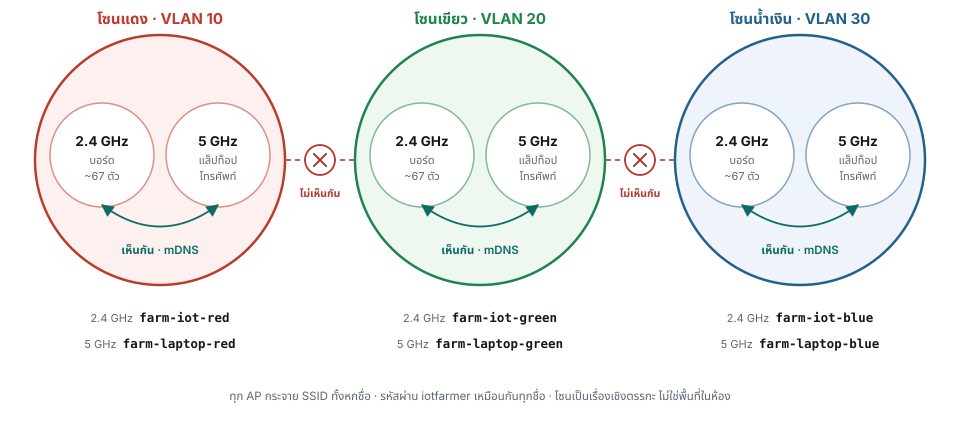
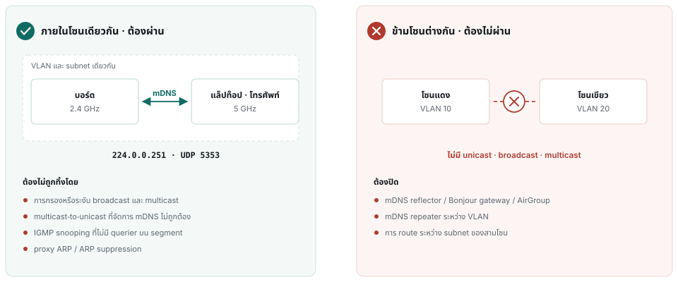

# ข้อกำหนดระบบเครือข่ายสำหรับการอบรม

> **เอกสารนี้ยกเลิกแล้ว — 21 กันยายน 2569 ไม่ต้องส่งเอกสารนี้ให้ผู้ให้บริการเครือข่าย**
> แบบเครือข่ายที่ใช้ VLAN แยกตาม SSID ในเอกสารนี้ถูกแทนที่ด้วยเราเตอร์ GL.iNet Flint สามตัวที่คณะจัดทำนำมาและตั้งค่าเอง
> ตัวละหนึ่งโซน โดย NT ให้บริการ WiFi 5 GHz สำหรับอินเทอร์เน็ตและพอร์ตสายแลนสามพอร์ต เอกสารฉบับปัจจุบันคือ
> **[NETWORK-SETUP.md](NETWORK-SETUP.md)** (ภาษาอังกฤษ) เก็บไฟล์นี้ไว้เพื่ออ้างอิงเท่านั้น
> ชื่อ SSID รหัสผ่าน และสีโซนยังคงเดิม ส่วนเรื่อง VLAN คอนโทรลเลอร์ และการตั้งค่า multicast ฝั่งผู้ให้บริการไม่ใช้แล้วทั้งหมด

## 1. ชื่อ SSID และรหัสผ่าน

ห้องอบรมแบ่งเป็นสามโซน แต่ละโซนใช้ VLAN แยกกัน และมี SSID หนึ่งคู่ คือ 2.4 GHz สำหรับบอร์ด
และ 5 GHz สำหรับแล็ปท็อปกับโทรศัพท์

| โซน | VLAN (เสนอแนะ) | SSID 2.4 GHz (บอร์ด) | SSID 5 GHz (แล็ปท็อป โทรศัพท์) | รหัสผ่าน |
|---|---|---|---|---|
| แดง | 10 | `farm-iot-red` | `farm-laptop-red` | `iotfarmer` |
| เขียว | 20 | `farm-iot-green` | `farm-laptop-green` | `iotfarmer` |
| น้ำเงิน | 30 | `farm-iot-blue` | `farm-laptop-blue` | `iotfarmer` |

**ใช้รหัสผ่าน `iotfarmer` ชุดเดียวกันทั้งหกชื่อ ระบบความปลอดภัย WPA2-PSK (AES/CCMP)**

> **ต้องใช้ชื่อและรหัสผ่านตามนี้เท่านั้น** เพราะผู้จัดคอมไพล์ค่าเหล่านี้ลงในเฟิร์มแวร์ของบอร์ด 200 ตัว
> ล่วงหน้า และแก้ที่หน้างานไม่ได้ หากมีข้อใดตั้งตามนี้ไม่ได้ ขอให้แจ้งทันที

ทุก AP ต้องกระจาย SSID ทั้งหกชื่อ (วิทยุละสามชื่อ) เพราะการแบ่งโซนกำหนดจากเครือข่าย ไม่ได้แบ่งตามที่นั่ง
เฟิร์มแวร์ของบอร์ดแต่ละตัวฝัง SSID ของโซนไว้ ชุดอุปกรณ์ติดสีไว้ตรงกัน และกลุ่มจะนั่งตรงไหนก็ได้
ขอให้ไม่เพิ่ม SSID ชื่อที่เจ็ดบนวิทยุเหล่านี้

### แนวทางการออกแบบสำคัญ

**แนวทางที่ 1 ภายในคู่ SSID ของโซนเดียวกัน อุปกรณ์ต้องติดต่อกันได้ทั้งหมด** ทั้ง unicast และ mDNS
ข้ามย่านความถี่ ดังนั้น SSID ทั้งสองของโซนต้องอยู่บน **VLAN และ subnet เดียวกัน** และต้อง **ปิด client isolation /
AP isolation / guest mode บน SSID ทั้งหกชื่อ** ส่วนฝั่ง mDNS อยู่ในข้อ 1

**แนวทางที่ 2 ข้ามคู่ SSID ต่างโซน อุปกรณ์ต้องติดต่อข้ามโซนไม่ได้** ทั้ง unicast, broadcast
และ multicast ดังนั้น

- **ห้ามเปิด mDNS reflector / Bonjour gateway / AirGroup / mDNS repeater ระหว่าง VLAN**
  ฟีเจอร์นี้เป็นสิ่งที่ controller หลายยี่ห้อเปิดให้เองเมื่อเห็นว่ามีหลาย VLAN และเป็นสาเหตุที่พบบ่อยของปัญหา
  ของการออกแบบนี้ จึงไม่ต้องเปิดใช้ฟีเจอร์นี้ เพราะแล็ปท็อปกับบอร์ดของกลุ่มเดียวกันอยู่ VLAN เดียวกันอยู่แล้ว
- **ไม่ route ระหว่าง subnet ของสามโซน** หากโครงสร้างจำเป็นต้อง route ขอให้ปิดกั้นด้วย ACL ที่ gateway

จุดประสงค์หลักของแนวทางที่ 2 คือการลด **ปริมาณ multicast** ภาระ mDNS ใน broadcast domain
หนึ่งแปรตามจำนวนอุปกรณ์ที่ส่งคำถามคูณจำนวนอุปกรณ์ที่ตอบกลับ การแยกสามโซนออกจากกันจริงจึงลดภาระลงราว 9 เท่า แต่ถ้าโซนใด
มองเห็นกันได้ ภาระจะกลับไปเท่ากับเครือข่ายที่รวม client 500 ตัวไว้ในวงเดียวกัน ทำให้การแบ่งโซนไม่ช่วยลดภาระตามที่ตั้งใจไว้

ไม่มีอุปกรณ์ใดบนเครือข่ายนี้ที่ต้องข้ามโซน จึงไม่ต้องเปิดข้อยกเว้นสำหรับการติดต่อข้ามโซน

---

## 2. ประเภทและจำนวนอุปกรณ์ที่คาดว่าจะเชื่อมต่อ

| อุปกรณ์ | จำนวน | ต่อผ่าน | หมายเหตุ |
|---|---|---|---|
| บอร์ดเซนเซอร์ (ESP32-C3) และบอร์ดรีเลย์ (ESP32-C6) | อย่างละ 100 | SSID 2.4 GHz **เท่านั้น** ช่องกว้าง 20 MHz | โซนละ ~67 ตัว เปิดตลอดงาน รวมช่วงกลางคืน |
| แล็ปท็อปของกลุ่ม | 100 (+ สำรอง และของผู้สอนอีก 1) | SSID 5 GHz | รัน Home Assistant ใน **VM แบบ bridged** แล็ปท็อปหนึ่งเครื่องจึงมี MAC และ IP อย่างละสองหมายเลข (ข้อ 2) |
| โทรศัพท์ | 100–400 | SSID 5 GHz | ใช้เปิดแดชบอร์ดของกลุ่ม ซึ่งอยู่ใน VM บนแล็ปท็อป ไม่ได้อยู่บนอินเทอร์เน็ต จึงต้องเข้า SSID ของโซนตัวเอง |
| แล็ปท็อปนำเสนอ | 1 | **สาย LAN** พอร์ต access | ใช้ฉายสไลด์ ต้องออกอินเทอร์เน็ตได้ |

**จำนวน client ที่เชื่อมต่อพร้อมกัน คาดว่าประมาณ 500 และอาจถึง 800** หากผู้เข้าอบรมทุกคนต่อโทรศัพท์
ขอให้วางแผนรองรับอุปกรณ์บนย่าน 5 GHz ตามจำนวนสูงสุดนี้ ส่วนฝั่ง 2.4 GHz มีเฉพาะบอร์ด 200 ตัวเท่านั้น ไม่มีอุปกรณ์อื่น

> **ขอ private /16 ให้แต่ละโซน** เช่น `10.10.0.0/16` โซนแดง `10.20.0.0/16` โซนเขียว
> `10.30.0.0/16` โซนน้ำเงิน เพราะต้องนับจำนวน lease ไม่ใช่จำนวนอุปกรณ์ รวมประมาณ **โซนละ 170–270 lease**
> (บอร์ด ~67 ตัว + แล็ปท็อป ~34 เครื่อง × 2 จาก VM แบบ bridged + โทรศัพท์ + สำรอง) ส่วน /24 ไม่เหลือ
> ที่ว่างเลยเมื่อรวมโทรศัพท์ และไม่พอสำหรับ lease ยาวตามข้อ 4 **หากแผนการจัดสรร IP ให้ /16 ไม่ได้
> ขั้นต่ำที่ใช้ได้คือโซนละหนึ่ง /23**
>
> subnet ที่ใหญ่ขึ้นไม่ได้ทำให้ใช้ airtime เพิ่มขึ้น เพราะปริมาณ broadcast และ multicast แปรตาม
> จำนวนอุปกรณ์ ซึ่งเท่าเดิม ไม่ได้แปรตามขนาดของ subnet

**การใช้งานหลักที่ระบบต้องรองรับ** แล็ปท็อปของแต่ละกลุ่มบน 5 GHz ต้องค้นหาบอร์ดสองตัวของกลุ่มตัวเองบน 2.4 GHz
เจอด้วยชื่อ `name.local` และรักษาการเชื่อมต่อ TCP กับบอร์ดแต่ละตัวไว้ได้ต่อเนื่องหลายชั่วโมง

---

## 3. การตั้งค่าที่สำคัญ

โปรดตรวจสอบการตั้งค่าต่อไปนี้เป็นอันดับแรก เนื่องจากมีผลโดยตรงต่อการเชื่อมต่ออุปกรณ์ระหว่างอบรม ส่วนการตั้งค่าเพิ่มเติมอยู่ในส่วนที่ 5

**1. ส่งต่อ mDNS ระหว่างอุปกรณ์ไร้สายด้วยกัน และข้าม SSID ทั้งสองของโซน** การแปลงชื่อเป็น IP ใช้
multicast DNS ที่ **224.0.0.251 / UDP 5353** ซึ่งต้องไปถึง client ทุกตัวในโซน และส่งข้ามไปยังโซนอื่นไม่ได้
ตามแนวทางที่ 2 ขอให้ตรวจว่าการตั้งค่าต่อไปนี้ไม่ทำให้แพ็กเก็ตถูกทิ้ง: การกรองหรือระงับ broadcast/multicast ·
การแปลง multicast เป็น unicast ที่จัดการ mDNS ไม่ถูกต้อง · IGMP snooping โดยไม่มี querier
บน segment · proxy ARP / ARP suppression

> multicast อื่นจะระงับอย่างไรก็ได้ตามที่เห็นสมควร **แต่พอร์ต 5353 ต้องผ่านเสมอ** หาก AP ของท่าน
> แปลง multicast เป็น unicast โดยจัดการ mDNS ได้ถูกต้อง ขอให้เปิดใช้ เพราะเป็นวิธีประหยัด airtime
> ที่ได้ผลที่สุดเมื่อมีอุปกรณ์เชื่อมต่อหนาแน่นระดับนี้ หากมีการจำกัดอัตรา multicast ขอทราบค่าที่ตั้งไว้

**2. รองรับ MAC address สองหมายเลขผ่าน client ไร้สายหนึ่งเครื่อง** Home Assistant รันใน VM แบบ bridged
แล็ปท็อปหนึ่งเครื่องจึงแสดง MAC และ IP อย่างละสองหมายเลขผ่านการเชื่อมต่อเดียว ขอให้ปิดทุกอย่างที่
มองว่าลักษณะนี้เป็นการปลอม MAC เช่น client integrity check การจำกัดจำนวน MAC ของแต่ละ station และ
ข้อจำกัดเรื่อง WDS *ข้อนี้มักถูกมองข้าม โปรดยืนยันผลการตรวจสอบแยกต่างหาก*

**3. การเชื่อมต่อพร้อมกันจำนวนมาก** หาก AP หรือ controller รีสตาร์ต บอร์ดมากถึง 200 ตัวจะเชื่อมต่อ
ใหม่พร้อมกัน ขอให้ยืนยันว่าไม่มีการจำกัดอัตรา association หรือเพดานจำนวน client ของแต่ละวิทยุที่จะ
ทำให้บอร์ดบางส่วนต่อไม่ได้ และ DHCP รองรับการขอ IP พร้อมกันครั้งนี้ได้

**4. กำหนดอายุ DHCP lease ให้ครอบคลุมระยะเวลาจัดงาน** ขอให้ตั้งเวลา lease ให้ครอบคลุมการอบรมทั้งหมด
เช่น 7 วัน หรือใช้ reservation **แนะนำให้ตั้งค่าตามนี้ หากระบบรองรับ** เพราะทุกอย่างอ้างอิงกันด้วยชื่อ
IP ที่เปลี่ยนไปจึงไม่ทำให้การเชื่อมต่อผ่านชื่ออุปกรณ์หยุดทำงาน แต่ที่ขอเพราะกลุ่มที่จด IP ของบอร์ดไว้เป็นทางสำรองในวันแรก ควรใช้
เลขเดิมนั้นได้อีกในวันที่สอง และการจัดสรรช่วง IP ตามส่วนที่ 2 จะช่วยให้มีหมายเลขเพียงพอสำหรับ lease ระยะยาว

---

## 4. การทดสอบตรวจรับ

ทำในช่วงติดตั้งก่อนวันงาน โดยมีผู้ที่แก้ค่าบน controller ได้อยู่ด้วย ต้องผ่านทุกข้อ และขอเจ้าหน้าที่
ประจำหน้างานหรือติดต่อได้ทันที ตลอดช่วงติดตั้งและชั่วโมงแรกของการอบรม

| # | การทดสอบ | เกณฑ์ผ่าน |
|---|---|---|
| 1 | บอร์ดบน `farm-iot-red` แล็ปท็อปบน `farm-laptop-red` แล้ว `ping <boardname>.local` | แปลงชื่อเป็น IP ได้และได้รับคำตอบจาก ping ยืนยัน **mDNS ข้ามย่านความถี่ภายในโซน** (ข้อ 1) |
| 2 | ping เดิมจากภายใน VM แบบ bridged บนแล็ปท็อป | แปลงชื่อเป็น IP ได้และได้รับคำตอบจาก ping ยืนยัน **multicast + สอง MAC** (ข้อ 2) |
| 3 | แล็ปท็อปบน `farm-laptop-green` ping บอร์ด**โซนแดง**ด้วยชื่อ | **ต้องไม่สำเร็จ** ยืนยันว่าโซนแยกจากกัน (แนวทางที่ 2) |
| 3ข | แล็ปท็อปเครื่องเดิม เปิดโปรแกรมค้นหาอุปกรณ์ mDNS (เช่น `dns-sd -B _esphome._tcp` หรือ Discovery บนมือถือ) | **เห็นเฉพาะบอร์ดโซนเขียว** ไม่มีชื่อที่มี `red` หรือ `blue` ปรากฏในรายการ ยืนยันว่าไม่มี mDNS reflector ทำงานอยู่ (แนวทางที่ 2) |
| 4 | โทรศัพท์บน `farm-laptop-red` เปิด `http://<VM-ip>` | เปิดแดชบอร์ดได้ ยืนยันว่า client ติดต่อกันได้โดยตรง พอร์ต 80 |
| 5 | แล็ปท็อปคงการเชื่อมต่อกับบอร์ดไว้โดยไม่สั่งงาน 30 นาที | การเชื่อมต่อยังทำงานตามปกติ (ส่วนที่ 5) |
| 6 | เปิด**บอร์ด 20–30 ตัว**กระจายทุกโซนพร้อมกัน แล้วปิด-เปิด AP หนึ่งตัว | ทุกตัวเชื่อมต่อและได้ lease ครบ และกลับมาต่อได้ทั้งหมดหลัง AP รีสตาร์ต (ข้อ 3) |
| 7 | แล็ปท็อปบน `farm-laptop-red` เปิด <https://web.esphome.io> | หน้าเว็บโหลดได้ ยืนยันว่า SSID ฝั่งแล็ปท็อปออกอินเทอร์เน็ตได้ |

การทดสอบข้อ 1, 2 และ 3ข คือข้อที่มักไม่ผ่านบนค่าตั้งต้นของระบบเครือข่ายองค์กร

> **ข้อจำกัดของการทดสอบ** บอร์ด 20–30 ตัวคิดเป็นเพียง 10–15 % ของโหลดจริง จึงพิสูจน์ได้เฉพาะ
> เรื่องการตั้งค่า (SSID, VLAN, mDNS, DHCP) ซึ่งเป็นจุดที่มักผิดพลาด แต่พิสูจน์ไม่ได้ว่าบอร์ด
> 200 ตัวบนย่าน 2.4 GHz จะทำงานได้ จึงต้องอาศัยแผนรองรับจำนวนอุปกรณ์ของผู้ดูแลเครือข่าย (ข้อ 3 และหมายเหตุ
> เรื่องคลื่นความถี่ในส่วนที่ 5)

---

## 5. การตั้งค่าเพิ่มเติม

โปรดตรวจสอบรายการต่อไปนี้เพิ่มเติมก่อนวันงาน เพื่อไม่ต้องแก้การตั้งค่าระหว่างอบรม

- **ตั้งค่า SSID ย่าน 2.4 GHz ให้รองรับบอร์ดไมโครคอนโทรลเลอร์** ไม่ใช่ WPA3 อย่างเดียวและไม่ใช่ WPA-Enterprise ·
  PMF / 802.11w ตั้งเป็น optional หรือปิด · ไม่ใช้ 802.11r / k / v ไม่ใช้ band steering และ
  ไม่ตั้งอัตราขั้นต่ำที่ตัดอัตราต่ำของ 802.11n ออก เพราะบอร์ดไม่มีการเคลื่อนย้าย · ไม่มี captive portal
  หน้า splash หรือการยืนยันตัวตนซ้ำเป็นระยะ เพราะไมโครคอนโทรลเลอร์ไม่สามารถเปิดหน้าเว็บเพื่อกดยอมรับเงื่อนไขได้
- **รักษาการเชื่อมต่อให้ต่อเนื่องตลอดงาน** แล็ปท็อปแต่ละเครื่องเปิด TCP session ค้างไว้กับบอร์ดของตนนาน
  หลายชั่วโมง และบอร์ดต้องคงการเชื่อมต่อไว้ข้ามคืนโดยไม่มี client ต่ออยู่ ขอให้ปิด idle timeout,
  session timeout และ inactivity timeout ของ client ทั้งหมด และไม่มีการรีบูตประจำคืนหรือ
  ช่วงบำรุงรักษาตลอดงาน
- **ปิด rogue-AP containment** เพราะบอร์ดแต่ละตัวจะเปิด hotspot เล็ก ๆ สำหรับตั้งค่าขึ้นมาเอง
  หาก SSID ของโซนหายไป และ hotspot จากโทรศัพท์ของผู้สอนคืออินเทอร์เน็ตสำรองของเรา
- **การวางแผนช่องสัญญาณและตำแหน่ง AP** ย่าน 2.4 GHz มีช่องสัญญาณที่ไม่ทับซ้อนกันเพียงสามช่อง (1/6/11)
  AP สามตัวที่วางตำแหน่งดีจึงดีกว่า AP หกตัวที่แย่งช่องกัน หากต้องใช้มากกว่าสามตัว ขอให้เป็น cell
  ช่องเดียวกันที่แยกพื้นที่กันชัดเจนและลดกำลังส่งลง ส่วนย่าน 5 GHz ใช้ AP ได้เท่าที่ความครอบคลุม
  ต้องการ WiFi 6 / OFDMA ช่วยได้มากเมื่อมีอุปกรณ์เชื่อมต่อหนาแน่นระดับนี้ ขอสัญญาณสม่ำเสมอที่ **ระดับความสูง
  ของโต๊ะ** เพราะบอร์ดวางอยู่ท่ามกลางคน แล็ปท็อป และภาชนะใส่น้ำ
- **อินเทอร์เน็ต** ต้องการเฉพาะ SSID ฝั่งแล็ปท็อปและพอร์ตของแล็ปท็อปนำเสนอ ขอพอร์ตขาออก 443
  ตลอดงาน และพอร์ตขาออก **8883 (MQTT/TLS)** ราวหนึ่งชั่วโมงในช่วงที่ 3 จากทั้งสามโซน ส่วน SSID
  ฝั่งบอร์ดไม่ต้องออกอินเทอร์เน็ต และไม่ต้องเปิดการเข้าถึงขาเข้าที่ใดทั้งสิ้น

---

## 6. แนวทางสำรองเมื่อแยก VLAN ตาม SSID ไม่ได้

ใช้ subnet เดียว (/22) กับ SSID สองชื่อ คือ `farm-iot` บน 2.4 GHz และ `farm-laptop` บน 5 GHz
รหัสผ่าน `iotfarmer` เหมือนเดิม ข้อกำหนดอื่นคงเดิมทั้งหมด และต้องพึ่งการแปลง multicast เป็น unicast
อย่างมาก **ขอให้แจ้งล่วงหน้าโดยเร็ว** เพราะต้องจัดเตรียมเฟิร์มแวร์ให้ตรงกับเครือข่ายที่จะใช้
